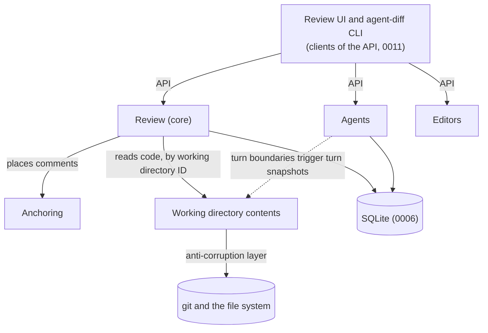
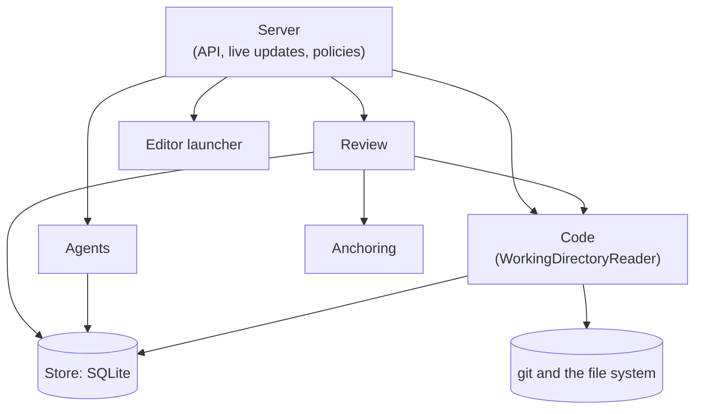
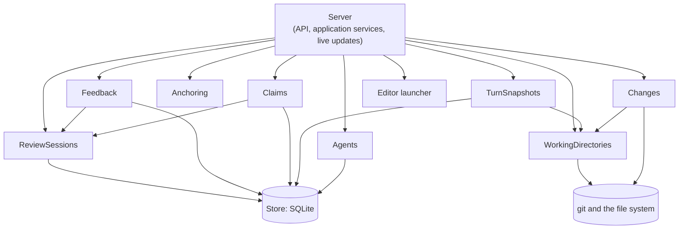
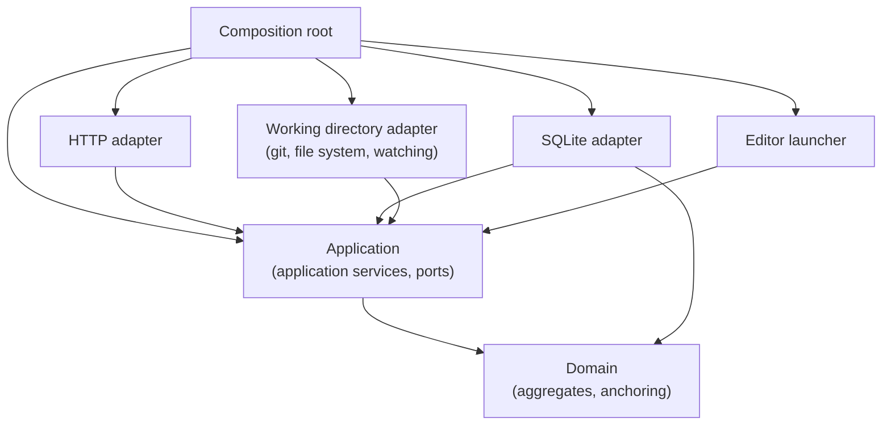

# 0002: How could the review server be split into a few deep modules?

- Date: 2026-10-13

## Question

The [review server](../glossary.md#review-server) is the part of
`agent-diff` with the most behavior: it stores review state, watches
[working directories](../glossary.md#working-directory), computes diffs,
re-anchors [comments](../glossary.md#comment), and provides the API that the
[review UI](../glossary.md#review-ui) and the `agent-diff` CLI call
([0011](../decisions/0011-api-core-with-cli-client.md)). In the prototype,
almost all of that is one class
([`prototype/src/server/service.ts`](../../prototype/src/server/service.ts),
848 lines).

Dan plans to give each module's internals to an agent session as a brief, and
to critique each module's interface before that. So the question is which
modules the review server could be split into, such that each one:

- is **deep**: a small, simple interface that hides a lot of behavior. The
  term is John Ousterhout's: the benefit of a module is the functionality it
  provides, its cost is the complexity of its interface, and the best
  modules have a lot of the first and little of the second
  ([*A Philosophy of Software Design*](https://web.stanford.edu/~ouster/cgi-bin/book.php),
  chapter 4, "Modules Should Be Deep"). A **shallow** module's interface is
  nearly as complicated as what it does.
- can be specified and tested on its own: its inputs, outputs, errors, and
  invariants are in its signatures and doc comments, and its dependencies
  can be replaced with test doubles.

Domain-driven design (DDD) is used to find the boundaries. Its terms are
explained where they're first used in [Findings](#findings). The
[glossary](../glossary.md) is treated as the ubiquitous language: the one
set of terms that the code, the docs, and the people working on the product
all use ([Fowler, "UbiquitousLanguage"](https://martinfowler.com/bliki/UbiquitousLanguage.html)).

This research records findings and options only. It doesn't recommend a
decomposition.

## Findings

### DDD and software design terms used here

These are used in their standard sense. Sources are Eric Evans's
[*Domain-Driven Design Reference*](https://www.domainlanguage.com/ddd/reference/)
(a summary of his 2003 book), Vaughn Vernon's
[*Effective Aggregate Design*](https://www.dddcommunity.org/library/vernon_2011/),
Martin Fowler's bliki, and Alistair Cockburn's
[*Hexagonal Architecture*](https://alistair.cockburn.us/hexagonal-architecture/).

| Term | Meaning |
| ---- | ------- |
| Bounded context | A boundary inside which one model, and one meaning for each term, applies ([Fowler](https://martinfowler.com/bliki/BoundedContext.html)). |
| Context map | A diagram of the bounded contexts and how they relate, such as one being upstream of another. |
| Entity | An object defined by its identity, which stays the same while its attributes change. |
| Value object | An object defined only by its attributes, with no identity of its own, and usually immutable ([Fowler](https://martinfowler.com/bliki/ValueObject.html)). |
| Aggregate | A cluster of entities and value objects changed together as a unit, with one root entity. Its boundary is a consistency boundary: every invariant inside it holds after each change. Other code refers to an aggregate only by the root's identity ([Fowler](https://martinfowler.com/bliki/DDD_Aggregate.html), Vernon). |
| Invariant | A rule that must always hold, such as "a working directory has at most one active claim." |
| Domain event | A record that something meaningful happened in the domain, which other parts react to ([Fowler](https://martinfowler.com/eaaDev/DomainEvent.html)). |
| Repository | An object that loads and saves whole aggregates, hiding the storage. |
| Anti-corruption layer | A translating layer that keeps an outside system's model (here, git and the file system) from leaking into the domain model. |
| Application service | Code that carries out one use case: it loads aggregates, calls domain logic, saves, and publishes events. It holds no business rules itself. |
| Domain logic | The business rules: what's allowed and what changes, independent of storage, transport, and I/O. |
| Port and adapter | In hexagonal architecture, a port is an interface the application defines for what it needs (such as storage), and an adapter implements it for one technology (such as SQLite). |
| Deep and shallow module | See [Question](#question). |

### Domain model

#### Bounded contexts and the context map

The glossary is small and has no term with two meanings, so the bounded
contexts below aren't separated by language, as they often are in larger
systems. They're separated by what each part of the model is about and by
which invariants have to be checked together.

| Context | What it's about | Glossary terms | Kind |
| ------- | --------------- | -------------- | ---- |
| Review | What's being reviewed, what the reviewer said, and who's addressing it. | review session, review, comment, draft, feedback, claim, reviewer, actor | Core: this is what makes the product different. |
| Anchoring | Where a comment is shown on code that has changed since it was written. | anchor, anchor state, file version | Supporting, and mostly an algorithm ([0008](../decisions/0008-comment-reanchoring.md)). |
| Working directory contents | What's in a working directory and how it changed: diff modes, the file view, file contents, turn snapshots, and live changes. | working directory, base ref, diff mode, file view, turn snapshot, current directory | Supporting. Almost all of it is an anti-corruption layer over git and the file system. |
| Agents | Which agents exist, how they relate, and when their turns start and end. | agent, agent session, agent tree, main agent, sub-agent, harness, registration, turn | Supporting. |
| Editors | Opening a working directory, branch, or file in an IDE ([0003](../decisions/0003-open-in-ide.md)). | (none) | Generic: launching a process. |

How they relate:



Findings from the map:

- **Review and Agents don't depend on each other.** The agent tree "doesn't
  define what a review session covers"
  ([glossary](../glossary.md#agent-tree),
  [0009](../decisions/0009-review-sessions-and-claims.md) amending
  [0004](../decisions/0004-agent-tree-is-an-input.md)), and the review
  server never contacts agents
  ([0010](../decisions/0010-user-prompts-agent-to-fetch-review.md)). They
  share only working directory IDs. Filtering the review UI by agent
  ([README "Typical workflow"](../../README.md#typical-workflow), step 4)
  joins the two in the client or in the API, not in either context.
- **Review is downstream of working directory contents.** Placing a comment,
  checking a base ref, and listing files all need the code, but nothing
  about the code needs review state. The one exception in the prototype is
  the file view's comment count per file
  ([README "File view"](../../README.md#file-view)), which joins the two.
- **Agents feed turn snapshots.** "Last turn" depends on agents reporting
  turn boundaries ([0004](../decisions/0004-agent-tree-is-an-input.md)
  Benefits, [0007](../decisions/0007-live-reload-from-file-watching.md)
  Solution), so agents are upstream of turn snapshots. Nothing flows back.
- **The API is the only way in.** All behavior goes through the API, and
  the CLI never touches the database
  ([0011](../decisions/0011-api-core-with-cli-client.md)). In DDD terms the
  API is an open host service: one published protocol for every client.

#### Entities, value objects, and aggregates

| Glossary term | Classification | Notes |
| ------------- | -------------- | ----- |
| [Review session](../glossary.md#review-session) | Aggregate root | Holds its status (open or ended) and the working directories it covers. |
| [Working directory](../glossary.md#working-directory) | Entity | Identity is open: "how a working directory is identified when it's moved, deleted, or recreated at the same path" ([0013](../decisions/0013-working-directories.md)). The prototype uses a hash of the path ([`workspace.ts:27`](../../prototype/src/server/workspace.ts)). |
| A working directory's membership in a review session | Entity inside the review session aggregate | Not a glossary term. [0013](../decisions/0013-working-directories.md) asks whether the base ref belongs to the working directory or to "the working directory's membership in a review session." The prototype puts it on the membership ([`db.ts:21`](../../prototype/src/server/db.ts)). |
| [Base ref](../glossary.md#base-ref) | Value object | A branch or commit name. Where it lives is open (above). |
| [Review](../glossary.md#review) | Entity, in an aggregate with the drafts it was submitted from | Identified so the agent can fetch it. Immutable once submitted in the prototype ([`service.ts:449`](../../prototype/src/server/service.ts)), which no decision states. |
| [Comment](../glossary.md#comment) | Entity | Its body can change while it's a draft. Belongs to the review session while it's a draft and to a review once submitted, the gap noted in [README "To do"](../../README.md#to-do). |
| [Draft](../glossary.md#draft) | A state of a comment, not a separate object | |
| [Feedback](../glossary.md#feedback) | A read model, not an object | The comments in submitted reviews, seen from the agent's side. |
| [Anchor](../glossary.md#anchor) | Value object | "An anchor never changes." |
| [Anchor state](../glossary.md#anchor-state) | Value object, computed and never stored | Re-anchoring "only changes where the comment is shown" ([0008](../decisions/0008-comment-reanchoring.md)). |
| [File version](../glossary.md#file-version) | Value object, identified by its content | Stored once and shared, for example content-addressed ([0008](../decisions/0008-comment-reanchoring.md) follow-ups). Two equal contents are the same file version, which is the definition of a value object. |
| [Claim](../glossary.md#claim) | Aggregate root | A lease with a lifecycle: active, then released, completed, or expired. Its invariant spans every claim on one working directory, so the consistency boundary is "the claims on a working directory" rather than one claim. |
| [Diff mode](../glossary.md#diff-mode) | Value object (an enumeration) | |
| [File view](../glossary.md#file-view) | A read model | Computed from git and the review's comments. Never stored. |
| [Turn snapshot](../glossary.md#turn-snapshot) | Entity | Has a sequence in its working directory. Where it's stored is open ([0006](../decisions/0006-sqlite-review-state.md) follow-ups). |
| [Agent](../glossary.md#agent) | Entity | Identified by the ID it registers with. |
| [Agent tree](../glossary.md#agent-tree) | Aggregate root | Its invariant (it's a tree, so no agent is its own ancestor) spans agents. |
| [Agent session](../glossary.md#agent-session), [harness](../glossary.md#harness) | Outside the model | The server never contacts them ([0010](../decisions/0010-user-prompts-agent-to-fetch-review.md)). How a restarted agent reclaims its record is open ([0006](../decisions/0006-sqlite-review-state.md)). |
| [Turn](../glossary.md#turn) | A domain event pair (start and end), not stored | |
| [Actor](../glossary.md#actor), [reviewer](../glossary.md#reviewer) | Value objects | Who started or ended a review session. |
| [Current directory](../glossary.md#current-directory) | Value object | A path the CLI sends, used to find the working directory that contains it ([0013](../decisions/0013-working-directories.md)). |

#### Invariants

Each invariant traces to a decision or a `README.md` section. They're
numbered so the options can refer to them.

| # | Invariant | Owned by | Source |
| - | --------- | -------- | ------ |
| I1 | A review session covers a set of working directories, and working directories can be added after it starts. | Review session | [0009](../decisions/0009-review-sessions-and-claims.md) "Review sessions"; [README "Typical workflow"](../../README.md#typical-workflow) step 3 |
| I2 | A review session ends through an API call, from the reviewer, an agent, or other automation. | Review session | [0009](../decisions/0009-review-sessions-and-claims.md); [README "Typical workflow"](../../README.md#typical-workflow) step 9 |
| I3 | Every review is submitted to one review session, and a review session can receive many reviews over time. | Review | [0009](../decisions/0009-review-sessions-and-claims.md); [glossary](../glossary.md#review) |
| I4 | A review can span several working directories. | Review | [0009](../decisions/0009-review-sessions-and-claims.md) |
| I5 | A comment is a draft until its review is submitted. Agents get a submitted review as a whole, never comments one at a time. | Review | [glossary](../glossary.md#comment); [0005](../decisions/0005-notify-then-pull-feedback.md) "Review is synchronous at the feedback level," kept by [0010](../decisions/0010-user-prompts-agent-to-fetch-review.md) |
| I6 | A line or range comment has an anchor (path, diff side, line range, file version) that never changes. Re-anchoring changes only where the comment is shown. | Comment | [glossary](../glossary.md#anchor); [0008](../decisions/0008-comment-reanchoring.md) "Anchors" |
| I7 | A file version's full contents are saved, once, and shared by every comment written on it. | File version store | [0008](../decisions/0008-comment-reanchoring.md) "Anchors"; [glossary](../glossary.md#file-version) |
| I8 | Re-anchoring compares the original file version with the current one, never a chain. The anchor state is current, moved, or outdated, and when in doubt it's outdated. | Anchoring | [0008](../decisions/0008-comment-reanchoring.md) "Anchors" and "Layers" |
| I9 | Renamed files are followed with git's rename detection. Comments on code moved to another file are outdated. Comments on deleted lines anchor to the base version. | Anchoring and working directory contents | [0008](../decisions/0008-comment-reanchoring.md) "Other cases" |
| I10 | A working directory has at most one active claim at a time. Whether that's per review session or across them is open. | Claims on a working directory | [glossary](../glossary.md#claim); [0009](../decisions/0009-review-sessions-and-claims.md) "Claims"; scope open in [0013](../decisions/0013-working-directories.md) |
| I11 | A claim is a lease: the agent renews it while working, it expires if not renewed, and it can be released or completed. | Claim | [0009](../decisions/0009-review-sessions-and-claims.md) "Claims" |
| I12 | Claims are advisory. They don't stop any process from editing files. | Claim | [0009](../decisions/0009-review-sessions-and-claims.md) |
| I13 | A claim is taken on a working directory in a review session, to address that working directory's unaddressed feedback. | Claim | [0009](../decisions/0009-review-sessions-and-claims.md); [glossary](../glossary.md#claim) |
| I14 | Overall comments aren't tied to a working directory, so claims don't cover them. | Review and claim | [0009](../decisions/0009-review-sessions-and-claims.md) Costs |
| I15 | `agent-diff review` returns the most recent submitted review for the working directory that contains the agent's current directory. | Review (read side) | [0010](../decisions/0010-user-prompts-agent-to-fetch-review.md); [0013](../decisions/0013-working-directories.md) |
| I16 | The review server never contacts agents. Agents always pull. | Whole server | [0010](../decisions/0010-user-prompts-agent-to-fetch-review.md) |
| I17 | The diff and the file view only include files under the working directory, even when git runs against the whole repo. | Working directory contents | [0013](../decisions/0013-working-directories.md); [glossary](../glossary.md#working-directory) |
| I18 | In a git working directory, the branch is whatever `HEAD` points to and isn't part of the working directory. | Working directory | [0013](../decisions/0013-working-directories.md) |
| I19 | A working directory that doesn't use git has no diff modes or git statuses, and its file view lists all its files. | Working directory contents | [0013](../decisions/0013-working-directories.md); [README "File view"](../../README.md#file-view) |
| I20 | Each diff mode compares the two states in the table in [README "Diff modes"](../../README.md#diff-modes). "Last turn" compares the previous turn snapshot to the current state. | Working directory contents | [README "Diff modes"](../../README.md#diff-modes); [glossary](../glossary.md#diff-mode) |
| I21 | By default the file view lists only files changed in the selected diff mode. A toggle also lists unchanged files, and changed files keep their status. | Working directory contents (file view) | [0002](../decisions/0002-show-unchanged-files.md); [README "File view"](../../README.md#file-view) |
| I22 | Each file in the file view shows its status for the diff mode, how many comments it has, and how many lines were added and removed. | File view (joins contents and review) | [README "File view"](../../README.md#file-view) |
| I23 | The server watches the working tree, the index, `HEAD`, and refs of every working directory in a review session, and pushes changes to the review UI. | Working directory contents | [0007](../decisions/0007-live-reload-from-file-watching.md) |
| I24 | The agent tree is reported by agents or harnesses, never inferred from git, and doesn't define what a review session covers. | Agent tree | [0004](../decisions/0004-agent-tree-is-an-input.md); [0009](../decisions/0009-review-sessions-and-claims.md) amendment; [glossary](../glossary.md#agent-tree) |
| I25 | Registration reports an agent's ID, its parent, and its working directories, and nothing about how to reach it. | Agent tree | [glossary](../glossary.md#registration); [0010](../decisions/0010-user-prompts-agent-to-fetch-review.md) "Effect on earlier decisions" |
| I26 | A working directory with no registered agents can still be reviewed. | Review session | [0004](../decisions/0004-agent-tree-is-an-input.md); [0009](../decisions/0009-review-sessions-and-claims.md) Benefits |
| I27 | Review sessions, their working directories, reviews, claims, comments with their anchors, and the agent tree survive restarts in SQLite. Code stays in git, and diffs are computed rather than stored. | Persistence | [0006](../decisions/0006-sqlite-review-state.md) |
| I28 | Turn snapshots are recorded at turn boundaries, which agents report. | Working directory contents | [README "Diff modes"](../../README.md#diff-modes); [0004](../decisions/0004-agent-tree-is-an-input.md) Benefits; [0007](../decisions/0007-live-reload-from-file-watching.md) |
| I29 | All behavior goes through the API. The CLI is a client and doesn't read or write the database. | Whole server | [0011](../decisions/0011-api-core-with-cli-client.md) |
| I30 | Opening a branch in an IDE never switches the branch of an existing checkout. It needs a worktree for the branch, and applies only to git working directories. | Editors | [0003](../decisions/0003-open-in-ide.md); [0013](../decisions/0013-working-directories.md) |

No two decisions contradict each other on these. Some open follow-ups leave
an invariant's scope unsettled (I10's scope, where I1's base ref lives,
whether I6 has a diff side in a working directory without git), and the
options below leave them unsettled too.

#### Rules the prototype enforces that no decision states

These can't be traced to a decision or `README.md`, so they aren't listed
as invariants. Each is a choice a module's brief would have to make or
leave open.

| Rule | Where in the prototype |
| ---- | ---------------------- |
| A review session needs at least one working directory to start. | [`service.ts:167`](../../prototype/src/server/service.ts) |
| Working directories and comments can't be added to an ended review session. | [`service.ts:183`, `:395`, `:212-216`](../../prototype/src/server/service.ts) |
| A review can't be submitted with no drafts. | [`service.ts:472`](../../prototype/src/server/service.ts) |
| Submitted comments can't be edited or deleted. | [`service.ts:449`, `:459`](../../prototype/src/server/service.ts) |
| Adding a working directory records a turn snapshot if it has none, so "Last turn" works before any turn is reported. | [`service.ts:197`](../../prototype/src/server/service.ts) |
| A turn start records a snapshot only when the working directory is in an open review session. | [`service.ts:617`](../../prototype/src/server/service.ts) |
| The default base ref is `origin/HEAD`, then `main` or `master`, then `HEAD`, and the base side is the merge base of the base ref and `HEAD`. | [`workspace.ts:118-150`](../../prototype/src/server/workspace.ts) |
| Overall comments go to every working directory in the review session when the agent fetches. | [`service.ts:478-479`, `:686`](../../prototype/src/server/service.ts) |
| Fetching returns every review this working directory hasn't fetched, and records the fetch, rather than the most recent review (I15). | [`service.ts:677-683`, `:722-733`](../../prototype/src/server/service.ts) |
| Line comments are validated against the file version's line count when written. | [`service.ts:416-421`](../../prototype/src/server/service.ts) |

#### Domain events

Events are named in the past tense. "Raised by" is the aggregate or context
whose change it records.

| Event | Raised by | Consumed by | Source |
| ----- | --------- | ----------- | ------ |
| ReviewSessionStarted | Review session | Review UI (live update) | [0009](../decisions/0009-review-sessions-and-claims.md) |
| WorkingDirectoryAdded | Review session | Watching starts for it (I23); review UI | [0009](../decisions/0009-review-sessions-and-claims.md); [0007](../decisions/0007-live-reload-from-file-watching.md) |
| ReviewSessionEnded | Review session | Watching stops for working directories in no other open review session; review UI | [0009](../decisions/0009-review-sessions-and-claims.md); prototype [`service.ts:129-138`](../../prototype/src/server/service.ts) |
| DraftWritten, DraftEdited, DraftDeleted | Review (drafts) | Review UI | [0008](../decisions/0008-comment-reanchoring.md) "Drafts and submitted comments"; [0006](../decisions/0006-sqlite-review-state.md) |
| ReviewSubmitted | Review | Review UI, which shows a prompt to copy ([0010](../decisions/0010-user-prompts-agent-to-fetch-review.md)). No agent is told (I16). | [0010](../decisions/0010-user-prompts-agent-to-fetch-review.md) |
| ClaimTaken, ClaimRenewed, ClaimReleased, ClaimCompleted, ClaimExpired | Claim | Review UI, which shows that an agent picked up the review ([0010](../decisions/0010-user-prompts-agent-to-fetch-review.md) Benefits) | [0009](../decisions/0009-review-sessions-and-claims.md) |
| WorkingDirectoryChanged | Working directory contents (the watcher) | Caches of git results; review UI, which refetches and re-anchors | [0007](../decisions/0007-live-reload-from-file-watching.md); [0008](../decisions/0008-comment-reanchoring.md) Costs |
| AgentRegistered | Agent tree | Review UI (agent filter) | [0004](../decisions/0004-agent-tree-is-an-input.md) |
| TurnBoundaryReported | Agent tree | Turn snapshots | [0004](../decisions/0004-agent-tree-is-an-input.md); [0007](../decisions/0007-live-reload-from-file-watching.md) |
| TurnSnapshotRecorded | Working directory contents | Review UI ("Last turn" picker) | [README "Diff modes"](../../README.md#diff-modes) |

Two things that might look like events aren't:

- **Re-anchoring isn't triggered by an event.** The anchor state is
  computed when comments are read for the current code, so a
  WorkingDirectoryChanged only has to make readers ask again. When
  re-anchoring runs is a follow-up in
  [0008](../decisions/0008-comment-reanchoring.md).
- **Fetching a review isn't an event in the decisions.** The prototype
  records fetches ([`service.ts:722-733`](../../prototype/src/server/service.ts))
  for notification status, which [0010](../decisions/0010-user-prompts-agent-to-fetch-review.md)
  removed. Taking a claim is what tells the reviewer an agent picked up a
  review.

#### Where DDD doesn't fit a single-user local tool

- **Aggregates matter less as concurrency boundaries.** In a large system an
  aggregate is the unit that's locked, so it's kept small. Here one server
  process owns one SQLite file with one writer
  ([0006](../decisions/0006-sqlite-review-state.md) Costs), so a transaction
  across two aggregates is cheap and safe. Aggregates are still useful as
  the place an invariant is checked, especially I10, where two CLI
  processes can race to claim a working directory.
- **No eventual consistency is needed between aggregates.** Everything runs
  in one process, so domain events can be synchronous callbacks rather than
  messages on a bus. Since [0010](../decisions/0010-user-prompts-agent-to-fetch-review.md)
  there's no outbound delivery, so there's no need for an outbox or retries.
- **Bounded contexts aren't separating different meanings of words.** They
  usually match teams with different models. Here there's one glossary and
  one person, so the contexts are useful as units of delegation and testing
  rather than as language boundaries.
- **Repositories and aggregates suit writes, not reads.** Most API calls are
  reads that cut across aggregates: the file view joins git with comment
  counts (I22), and placed comments join comments, file versions, and the
  current code. Separate read models for queries, as in CQRS (command query
  responsibility segregation, [Fowler](https://martinfowler.com/bliki/CQRS.html)),
  fit them better than loading aggregates.
- **Most of the complexity isn't in the domain model.** The review rules
  (review sessions, drafts, claims) are small. Most of the code, and most of what
  a deep module could hide, is in the anti-corruption layer over git and
  the file system and in the re-anchoring algorithm. Of the prototype's
  2,348 lines in `src/server/` and `src/shared/reanchor.ts`, about 700 are
  git and watching ([`git.ts`](../../prototype/src/server/git.ts),
  [`workspace.ts`](../../prototype/src/server/workspace.ts),
  [`watcher.ts`](../../prototype/src/server/watcher.ts)) and 304 are
  re-anchoring ([`reanchor.ts`](../../prototype/src/shared/reanchor.ts)),
  counted with `wc -l`.

### Constraints a module would have to hide

From the prototype's code and its
["Findings so far"](../../prototype/README.md#findings-so-far). All
measurements are the prototype's, on its machine.

| Constraint | How the prototype handles it | Source |
| ---------- | ---------------------------- | ------ |
| Spawning git costs about 60 ms per command. One file took about 850 ms of git time before caching. | Results keyed by an object hash are cached for good. Results that depend on the repo's current state are cached only while a watcher is running, until it reports a change. | [prototype README](../../prototype/README.md#findings-so-far); [`workspace.ts:49-50`, `:93-108`, `:302-310`](../../prototype/src/server/workspace.ts) |
| Reading one file side would take three spawns. | Objects are read through one long-running `git cat-file --batch-command` (git 2.36 or later). | [`git.ts:81-177`](../../prototype/src/server/git.ts) |
| Building trees mustn't touch the agent's or human's index, stash, reflogs, or refs. | The working tree and index are written as trees through private index files in the data directory. Index copies keep their timestamps so same-second edits are seen. | [`workspace.ts:1-10`, `:155-187`, `:336-345`](../../prototype/src/server/workspace.ts); [`test/workspace.test.ts`](../../prototype/test/workspace.test.ts) |
| Turn snapshots must survive and not appear in the user's history. | A snapshot is a commit of the working-tree tree under `refs/agent-diff/`, which git writes no reflogs for. | [`workspace.ts:287-299`](../../prototype/src/server/workspace.ts); [prototype README "Turn snapshots"](../../prototype/README.md#4-turn-snapshots) |
| An index with merge conflicts can't be written as a tree. | The "Staged" and "Unstaged" modes fail with an error. | [`workspace.ts:164`](../../prototype/src/server/workspace.ts) |
| A git hook that runs an agent may set `GIT_DIR` and similar variables. | They're removed from every git command's environment. | [`git.ts:29-37`](../../prototype/src/server/git.ts) |
| Git may exit without reading stdin. | `EPIPE` on stdin is ignored, and the exit code decides. | [`git.ts:56-60`](../../prototype/src/server/git.ts) |
| Floods of file events, editors' rename-saves, git lock files, ignored paths, and the server's own snapshot refs. | Debounced at 150 ms, flushed at least every 1,000 ms. Lock files and `refs/agent-diff/` are dropped, and paths are filtered with `git check-ignore`. Events arrive about 240 to 290 ms after the last write. | [`watcher.ts:75-148`](../../prototype/src/server/watcher.ts); [prototype README](../../prototype/README.md#findings-so-far) |
| Linked worktrees keep `HEAD` and the index in a separate git directory. | The git directory and common directory are watched too. | [`watcher.ts:31-38`](../../prototype/src/server/watcher.ts) |
| Large and binary files. | Blobs over 2 MB aren't read, and a NUL byte in the first 8,000 bytes marks a file as binary. | [`workspace.ts:19`, `:267-284`](../../prototype/src/server/workspace.ts) |
| Untracked files look like added files in a tree diff. | Paths not in the index are marked untracked. | [`workspace.ts:232`](../../prototype/src/server/workspace.ts) |
| Content matching needs tuned thresholds. On 20 commits of a real repo, 86% of comments stayed current, 1% moved, and 13% became outdated. | Six options with defaults. | [`reanchor.ts:14-44`](../../prototype/src/shared/reanchor.ts); [prototype README](../../prototype/README.md#findings-so-far) |

### The prototype mapped to the domain model

The prototype says "workspace" where the glossary says "working directory,"
and predates [0010](../decisions/0010-user-prompts-agent-to-fetch-review.md)
and [0013](../decisions/0013-working-directories.md). It has no claims
([prototype README "Not in the prototype"](../../prototype/README.md#not-in-the-prototype)).

#### Files in `prototype/src/server/`

| File | Lines | Maps to | Notes |
| ---- | ----: | ------- | ----- |
| [`main.ts`](../../prototype/src/server/main.ts) | 103 | Composition root and server lifecycle | Builds the database, service, and API (`:27-30`), serves the review UI, and writes the server info file that the CLI uses to find the server (`:55-57`, a follow-up in [0001](../decisions/0001-local-web-app.md)). |
| [`http.ts`](../../prototype/src/server/http.ts) | 162 | The API (open host service) and live updates | Routes (`:76-143`), Host and write-header checks (`:40-44`), and server-sent events to the review UI (`:30-33`, `:46-52`). |
| [`service.ts`](../../prototype/src/server/service.ts) | 848 | Every context | See the sections below. |
| [`db.ts`](../../prototype/src/server/db.ts) | 151 | Persistence for every aggregate | One schema for all tables (`:5-106`), including `notifications` (removed by [0010](../decisions/0010-user-prompts-agent-to-fetch-review.md)) and `feedback_fetches`, and no claims table. |
| [`workspace.ts`](../../prototype/src/server/workspace.ts) | 354 | Working directory contents, as an anti-corruption layer over git | Working directory identity (`:27-35`), base ref (`:118-150`), diff modes as pairs of trees (`:189-207`), the file view (`:209-252`), file contents (`:259-284`), turn snapshots (`:287-299`), and caches. Requires git (`:34`), which [0013](../decisions/0013-working-directories.md) no longer does. |
| [`git.ts`](../../prototype/src/server/git.ts) | 192 | Anti-corruption layer over git (process level) | Running git safely, and the long-running object reader. |
| [`watcher.ts`](../../prototype/src/server/watcher.ts) | 154 | Working directory contents: live changes | Emits the WorkingDirectoryChanged event (called `workspace-changed`). |
| [`notify.ts`](../../prototype/src/server/notify.ts) | 80 | Nothing | Delivers notifications to agents, which [0010](../decisions/0010-user-prompts-agent-to-fetch-review.md) removed (I16). |

`service.ts` by section:

| Lines | Section | Maps to |
| ----- | ------- | ------- |
| `32-38` | `HttpError` | The API. Domain code throws HTTP status codes. |
| `67-79`, `780-788` | Settings | Configuration for the watcher, notifications, and re-anchoring. |
| `81-158` | Opening, watching, and looking up workspaces | Working directory contents and the review session's membership. |
| `162-250` | Review sessions | Review session aggregate (I1, I2). |
| `254-321` | Diffs and the file view | Working directory contents, joined with comment counts (I22). |
| `325-462` | Comments and placing them | Review (drafts, I5, I6, I7) and anchoring (I8, I9). |
| `466-565` | Reviews and notifications | Review (I3, I4), plus notification delivery that [0010](../decisions/0010-user-prompts-agent-to-fetch-review.md) removed. |
| `569-640` | Agents and turns | Agent tree (I24, I25) and turn snapshots (I28), plus agent busy state and notification delivery. |
| `642-742` | Pending feedback and fetching it | Review (read side, I15), anchoring, and fetch records. |
| `746-778` | Turn snapshots | Working directory contents (I28). |

#### HTTP routes

Routes are from [`http.ts:85-142`](../../prototype/src/server/http.ts).
"Status" says what happens to each under the decisions since.

| Route | Service call | Domain operation | Context | Status |
| ----- | ------------ | ---------------- | ------- | ------ |
| `GET /api/health` | none | Server liveness | Server | Kept |
| `GET /api/state` | `listReviewSessions`, `agents`, `settings` | Read model joining review sessions and the agent tree | Review, Agents | Kept, mixes two contexts |
| `POST /api/review-sessions` | `startReviewSession` | Start a review session | Review session | Kept |
| `GET /api/review-sessions/:rs` | `reviewSessionInfo` | Read a review session | Review session | Kept |
| `POST /api/review-sessions/:rs/workspaces` | `addWorkspace` | Add a working directory | Review session | Kept, renamed by [0013](../decisions/0013-working-directories.md) |
| `POST /api/review-sessions/:rs/end` | `endReviewSession` | End a review session | Review session | Kept |
| `GET /api/review-sessions/:rs/workspaces/:ws/files` | `files` | List files for a diff mode | Contents, joined with Review | Kept |
| `GET /api/review-sessions/:rs/workspaces/:ws/file` | `file` | Read one file's diff with placed comments | Contents, Review, Anchoring | Kept |
| `GET /api/review-sessions/:rs/workspaces/:ws/snapshots` | `snapshots` | List turn snapshots | Contents | Kept |
| `GET /api/review-sessions/:rs/comments` | `placedComments` | List comments, placed for a diff mode | Review, Anchoring | Kept |
| `POST /api/review-sessions/:rs/comments` | `createComment` | Write a draft | Review | Kept |
| `PATCH /api/comments/:id` | `updateComment` | Edit a draft | Review | Kept |
| `DELETE /api/comments/:id` | `deleteComment` | Delete a draft | Review | Kept |
| `GET /api/review-sessions/:rs/reviews` | `reviews` | List reviews with notification status | Review | Kept without notification status |
| `POST /api/review-sessions/:rs/reviews` | `submitReview` | Submit a review | Review | Kept, without notifying ([0010](../decisions/0010-user-prompts-agent-to-fetch-review.md)) |
| `POST /api/notifications/:id/resend` | `resendNotification` | none | none | Removed by [0010](../decisions/0010-user-prompts-agent-to-fetch-review.md) |
| `POST /api/agents` | `registerAgent`, `registerAgentWorkspace` | Registration | Agents | Kept, without a notify method (I25) |
| `POST /api/agents/:id/turn` | `turn` | Report a turn boundary | Agents, Contents | Kept, without busy state or notifications |
| `GET /api/feedback/pending` | `pendingFeedbackFor` | Is there unfetched feedback? | Review | Was for agent hooks ([0005](../decisions/0005-notify-then-pull-feedback.md)); no decision needs it now |
| `POST /api/feedback` | `feedback` | Fetch feedback | Review, Anchoring | Becomes "fetch the most recent review" (I15) |
| `POST /api/workspaces/snapshot` | `openWorkspace`, `createSnapshot` | Record a turn snapshot by hand | Contents | Kept |
| `GET`/`POST /api/settings` | `settings`, `updateSettings` | Tuning | Server | Prototype only |
| `POST /api/metrics` | none | Appends timing rows to a file | Server | Prototype only |
| `GET /api/events` | none | Live updates (server-sent events) | Server | Kept (I23) |

There are no routes for claims, which aren't in the prototype, or for
opening an IDE ([0003](../decisions/0003-open-in-ide.md)).

#### Where the prototype mixes concerns

- **Domain code knows about HTTP.** `ReviewService` throws `HttpError` with
  status codes ([`service.ts:32-38`](../../prototype/src/server/service.ts)),
  so its errors can't be reused or tested without HTTP.
- **One class owns every aggregate and every table.** Review sessions,
  comments, reviews, agents, notifications, and turn snapshots all go
  through `ReviewService` and raw SQL on one `Db`
  ([`service.ts`](../../prototype/src/server/service.ts) throughout), so no
  invariant has one owner.
- **Writing a comment reads git.** `createComment` reads the blob from git
  to save the file version and check the line range
  ([`service.ts:416-423`](../../prototype/src/server/service.ts)), which
  ties the review aggregate to git.
- **Submitting a review delivers notifications.** The same transaction
  creates notification rows per agent, and then pushes them
  ([`service.ts:481-505`](../../prototype/src/server/service.ts)).
- **One turn call does five things.** `turn` registers the agent, links its
  working directory, sets its busy state, records a turn snapshot, and
  delivers held notifications
  ([`service.ts:608-640`](../../prototype/src/server/service.ts)).
- **Fetching feedback writes.** `feedback` reads, places, and returns
  comments, and also records fetches and updates notification status
  ([`service.ts:671-742`](../../prototype/src/server/service.ts)).
- **The file view joins git and the database in one method**
  ([`service.ts:264-290`](../../prototype/src/server/service.ts)), and the
  file diff places comments inline
  ([`:292-321`](../../prototype/src/server/service.ts)).
- **The watcher reaches into the workspace's caches.** It sets
  `ws.cacheable` and calls `ws.invalidate`
  ([`watcher.ts:36-44`, `:125`](../../prototype/src/server/watcher.ts)), so
  caching correctness is split across two classes.
- **Turn snapshot storage is split.** The commit and ref are made in
  `workspace.ts` ([`:287-299`](../../prototype/src/server/workspace.ts)),
  but the ref's name and the sequence number are chosen in `service.ts`
  ([`:761-778`](../../prototype/src/server/service.ts)).
- **Events for the review UI are coarse and emitted from domain code.**
  `emit({ type: 'state-changed' })` is called throughout the service, so the
  review UI refetches everything
  ([`service.ts:178`, `:198`, `:592`, `:638`](../../prototype/src/server/service.ts);
  [`types.ts:183-188`](../../prototype/src/shared/types.ts)).
- **The working directory model is a git worktree.** Opening a workspace
  resolves it to `git rev-parse --show-toplevel` and fails outside git
  ([`workspace.ts:32-35`](../../prototype/src/server/workspace.ts)), where
  [0013](../decisions/0013-working-directories.md) allows any directory and
  a directory inside a repo.

## Options

Three decompositions follow. They differ on two axes:

- **Option A** has four modules, one per bounded context, so each is as deep
  as it can be.
- **Option B** has eight modules, one per aggregate or capability, so each is
  small enough to brief and test alone.
- **Option C** splits by technical layer instead: a pure domain, application
  services, and adapters for SQLite, git, HTTP, and editors (hexagonal
  architecture).

Every option exposes the same API to the review UI and the CLI, uses the
same value objects, and has the same anchoring module, described first. The
interfaces are TypeScript sketches with stub types, meant to be argued with.
Errors are named classes, and doc comments say which a method throws.
Routes, paths, and status codes aren't designed here.

### Shared by every option

#### Value objects, views, and events

```ts
// Branded identifiers, so a plain string can't be passed where an ID is expected.
declare const brand: unique symbol;
type Brand<T, Name extends string> = T & { readonly [brand]: Name };

type ReviewSessionId = Brand<string, 'ReviewSessionId'>;
type WorkingDirectoryId = Brand<string, 'WorkingDirectoryId'>;
type CommentId = Brand<string, 'CommentId'>;
type ReviewId = Brand<string, 'ReviewId'>;
type ClaimId = Brand<string, 'ClaimId'>;
type AgentId = Brand<string, 'AgentId'>;
type TurnSnapshotId = Brand<string, 'TurnSnapshotId'>;
/** A hash of a file version's contents. Which hash is a follow-up in 0008. */
type FileVersionHash = Brand<string, 'FileVersionHash'>;
/** An absolute, normalized path on disk. */
type AbsolutePath = Brand<string, 'AbsolutePath'>;
/** A '/'-separated path relative to a working directory's root. */
type RelativePath = Brand<string, 'RelativePath'>;
/** An ISO 8601 timestamp. */
type Instant = Brand<string, 'Instant'>;
type Unsubscribe = () => void;

interface Clock {
  now(): Instant;
}

type DiffMode = 'all' | 'committed' | 'staged' | 'unstaged' | 'last-turn';
type Side = 'old' | 'new';

/** 1-based and inclusive. */
interface LineRange {
  readonly start: number;
  readonly end: number;
}

/** What a line or range comment was written on. Never changes (I6). */
interface Anchor {
  readonly workingDirectoryId: WorkingDirectoryId;
  readonly path: RelativePath;
  /** Null in a working directory that doesn't use git, which has no diff sides (open in 0013). */
  readonly side: Side | null;
  readonly lines: LineRange;
  readonly fileVersion: FileVersionHash;
}

type AnchorState = 'current' | 'moved' | 'outdated';

/** Where a comment is shown in the code being viewed. Computed on read, never stored (I8). */
interface Placement {
  readonly state: AnchorState;
  /** The current path, after following a rename (I9). Null if the file is gone. */
  readonly path: RelativePath | null;
  /** The commented lines now. Set when current or moved. */
  readonly lines: LineRange | null;
  /** When outdated, the code that replaced the commented lines, if any. */
  readonly replacement: LineRange | null;
  /** When outdated with no replacement, the line the removed lines followed (0 is the top). */
  readonly insertAfter: number | null;
  /** Why this state was chosen, for the review UI. */
  readonly reason: string;
}

type FileStatus =
  | 'added' | 'modified' | 'deleted' | 'renamed' | 'copied'
  | 'type-changed' | 'untracked' | 'conflicted' | 'unchanged';

type Actor =
  | { readonly kind: 'reviewer' }
  | { readonly kind: 'agent'; readonly agentId: AgentId | null }
  | { readonly kind: 'automation'; readonly name: string };

/**
 * What the diff compares. `mode: null` is a working directory that doesn't use
 * git, which lists all its files with no diff (I19). For "Last turn", a missing
 * `snapshotId` means the latest turn snapshot.
 */
type DiffSelection =
  | { readonly mode: DiffMode; readonly snapshotId?: TurnSnapshotId }
  | { readonly mode: null };

interface WorkingDirectoryView {
  readonly id: WorkingDirectoryId;
  readonly root: AbsolutePath;
  readonly usesGit: boolean;
  /** Whatever HEAD points to now, or null when detached or not git. Not part of the working directory (I18). */
  readonly branch: string | null;
  /** Null when the working directory doesn't use git. Where it belongs is open in 0013. */
  readonly baseRef: string | null;
}

interface ReviewSessionView {
  readonly id: ReviewSessionId;
  readonly title: string | null;
  readonly status: 'open' | 'ended';
  readonly startedBy: Actor;
  readonly startedAt: Instant;
  readonly endedAt: Instant | null;
  readonly workingDirectories: readonly WorkingDirectoryView[];
}

interface FileEntry {
  readonly path: RelativePath;
  readonly oldPath: RelativePath | null;
  /** 'unchanged' only appears when unchanged files were asked for (I21). */
  readonly status: FileStatus;
  readonly linesAdded: number | null;
  readonly linesRemoved: number | null;
  readonly binary: boolean;
  readonly commentCount: number;
}

interface FileListView {
  readonly workingDirectoryId: WorkingDirectoryId;
  readonly selection: DiffSelection;
  /** Labels for the two sides, such as "main (1a2b3c4d)". Null without git. */
  readonly from: string | null;
  readonly to: string | null;
  readonly files: readonly FileEntry[];
}

interface FileSide {
  /** Null when the file doesn't exist on this side. */
  readonly fileVersion: FileVersionHash | null;
  /** Null when absent, binary, or too large. */
  readonly content: string | null;
  readonly binary: boolean;
  readonly tooLarge: boolean;
}

interface CommentView {
  readonly id: CommentId;
  readonly reviewSessionId: ReviewSessionId;
  /** Null while the comment is a draft (I5). */
  readonly reviewId: ReviewId | null;
  /** Null for an overall comment. */
  readonly anchor: Anchor | null;
  readonly body: string;
  readonly createdAt: Instant;
  readonly updatedAt: Instant;
}

interface PlacedCommentView extends CommentView {
  /** Null for an overall comment. */
  readonly placement: Placement | null;
  /** The lines the comment was written on, from its file version (0008). */
  readonly originalCode: readonly string[];
}

interface FileDiffView {
  readonly workingDirectoryId: WorkingDirectoryId;
  readonly path: RelativePath;
  readonly oldPath: RelativePath | null;
  readonly status: FileStatus;
  readonly old: FileSide;
  readonly new: FileSide;
  readonly comments: readonly PlacedCommentView[];
}

interface ReviewView {
  readonly id: ReviewId;
  readonly reviewSessionId: ReviewSessionId;
  readonly submittedAt: Instant;
  readonly commentCount: number;
  readonly workingDirectoryIds: readonly WorkingDirectoryId[];
}

type ClaimState = 'active' | 'released' | 'completed' | 'expired';

interface ClaimView {
  readonly id: ClaimId;
  readonly reviewSessionId: ReviewSessionId;
  readonly workingDirectoryId: WorkingDirectoryId;
  /** The agent that holds it, if it said. Agents don't have to be registered (I26). */
  readonly holder: AgentId | null;
  readonly state: ClaimState;
  readonly takenAt: Instant;
  readonly expiresAt: Instant;
  readonly endedAt: Instant | null;
}

/** What `agent-diff review` returns (I15). */
interface FeedbackView {
  readonly reviewSessionId: ReviewSessionId;
  readonly workingDirectory: WorkingDirectoryView;
  readonly review: ReviewView;
  /** This working directory's comments in the review, and its overall comments, placed on the current code. */
  readonly comments: readonly PlacedCommentView[];
  readonly claim: ClaimView | null;
}

interface AgentView {
  readonly id: AgentId;
  readonly parentId: AgentId | null;
  readonly label: string | null;
  readonly workingDirectoryIds: readonly WorkingDirectoryId[];
  readonly registeredAt: Instant;
  readonly lastSeenAt: Instant;
}

interface AgentNode {
  readonly agent: AgentView;
  readonly children: readonly AgentNode[];
}

interface AgentTreeView {
  readonly roots: readonly AgentNode[];
}

interface TurnSnapshotView {
  readonly id: TurnSnapshotId;
  readonly workingDirectoryId: WorkingDirectoryId;
  readonly agentId: AgentId | null;
  readonly reason: 'turn-start' | 'turn-end' | 'review-session-start' | 'manual';
  readonly createdAt: Instant;
}

type DraftInput =
  | { readonly kind: 'overall'; readonly body: string }
  | { readonly kind: 'line'; readonly anchor: Anchor; readonly body: string };

type ClaimEventType = 'ClaimTaken' | 'ClaimRenewed' | 'ClaimReleased' | 'ClaimCompleted' | 'ClaimExpired';

/** The domain events from Findings. Each module emits a subset. */
type DomainEvent =
  | { readonly type: 'ReviewSessionStarted'; readonly reviewSessionId: ReviewSessionId; readonly startedBy: Actor; readonly at: Instant }
  | { readonly type: 'WorkingDirectoryAdded'; readonly reviewSessionId: ReviewSessionId; readonly workingDirectoryId: WorkingDirectoryId; readonly at: Instant }
  | { readonly type: 'ReviewSessionEnded'; readonly reviewSessionId: ReviewSessionId; readonly endedBy: Actor; readonly at: Instant }
  | { readonly type: 'DraftWritten' | 'DraftEdited' | 'DraftDeleted'; readonly reviewSessionId: ReviewSessionId; readonly commentId: CommentId; readonly at: Instant }
  | { readonly type: 'ReviewSubmitted'; readonly reviewSessionId: ReviewSessionId; readonly reviewId: ReviewId; readonly workingDirectoryIds: readonly WorkingDirectoryId[]; readonly at: Instant }
  | { readonly type: ClaimEventType; readonly claim: ClaimView; readonly at: Instant }
  | { readonly type: 'WorkingDirectoryChanged'; readonly workingDirectoryId: WorkingDirectoryId; readonly paths: readonly RelativePath[]; readonly morePaths: boolean; readonly gitMetadata: boolean; readonly at: Instant }
  | { readonly type: 'AgentRegistered'; readonly agent: AgentView; readonly at: Instant }
  | { readonly type: 'TurnBoundaryReported'; readonly agentId: AgentId; readonly boundary: 'start' | 'end'; readonly workingDirectoryId: WorkingDirectoryId; readonly at: Instant }
  | { readonly type: 'TurnSnapshotRecorded'; readonly snapshot: TurnSnapshotView; readonly at: Instant };

type EventOf<T extends DomainEvent['type']> = Extract<DomainEvent, { type: T }>;
```

#### Errors

Errors are part of each interface. Mapping them to HTTP status codes is the
API's job and isn't designed here. The last column says whether a decision
requires the error or it only follows a prototype rule.

```ts
declare abstract class AgentDiffError extends Error {
  abstract readonly code: string;
}
declare class ReviewSessionNotFoundError extends AgentDiffError {
  readonly code: 'review-session-not-found';
  readonly reviewSessionId: ReviewSessionId;
}
declare class ReviewSessionEndedError extends AgentDiffError {
  readonly code: 'review-session-ended';
  readonly reviewSessionId: ReviewSessionId;
}
declare class NoWorkingDirectoriesError extends AgentDiffError {
  readonly code: 'no-working-directories';
}
declare class WorkingDirectoryNotInReviewSessionError extends AgentDiffError {
  readonly code: 'working-directory-not-in-review-session';
  readonly reviewSessionId: ReviewSessionId;
  readonly workingDirectoryId: WorkingDirectoryId;
}
declare class NotADirectoryError extends AgentDiffError {
  readonly code: 'not-a-directory';
  readonly path: AbsolutePath;
}
declare class UnknownWorkingDirectoryError extends AgentDiffError {
  readonly code: 'unknown-working-directory';
  readonly workingDirectoryId: WorkingDirectoryId;
}
declare class UnknownBaseRefError extends AgentDiffError {
  readonly code: 'unknown-base-ref';
  readonly workingDirectoryId: WorkingDirectoryId;
  readonly baseRef: string;
}
declare class DiffModeUnavailableError extends AgentDiffError {
  readonly code: 'diff-mode-unavailable';
  readonly workingDirectoryId: WorkingDirectoryId;
  readonly mode: DiffMode;
  readonly reason: 'not-git' | 'no-turn-snapshot' | 'index-has-conflicts';
}
declare class FileNotFoundError extends AgentDiffError {
  readonly code: 'file-not-found';
  readonly path: RelativePath;
}
declare class UnknownFileVersionError extends AgentDiffError {
  readonly code: 'unknown-file-version';
  readonly fileVersion: FileVersionHash;
}
declare class AnchorOutsideFileVersionError extends AgentDiffError {
  readonly code: 'anchor-outside-file-version';
  readonly anchor: Anchor;
  readonly lineCount: number;
}
declare class EmptyCommentError extends AgentDiffError {
  readonly code: 'empty-comment';
}
declare class CommentNotFoundError extends AgentDiffError {
  readonly code: 'comment-not-found';
  readonly commentId: CommentId;
}
declare class CommentNotDraftError extends AgentDiffError {
  readonly code: 'comment-not-draft';
  readonly commentId: CommentId;
}
declare class NoDraftsError extends AgentDiffError {
  readonly code: 'no-drafts';
  readonly reviewSessionId: ReviewSessionId;
}
declare class NoReviewError extends AgentDiffError {
  readonly code: 'no-review';
  readonly reviewSessionId: ReviewSessionId;
  readonly workingDirectoryId: WorkingDirectoryId;
}
declare class ClaimHeldError extends AgentDiffError {
  readonly code: 'claim-held';
  readonly claim: ClaimView;
}
declare class ClaimNotFoundError extends AgentDiffError {
  readonly code: 'claim-not-found';
  readonly claimId: ClaimId;
}
declare class ClaimNotActiveError extends AgentDiffError {
  readonly code: 'claim-not-active';
  readonly claim: ClaimView;
}
declare class NoWorkingDirectoryForPathError extends AgentDiffError {
  readonly code: 'no-working-directory-for-path';
  readonly currentDirectory: AbsolutePath;
}
declare class AmbiguousWorkingDirectoryError extends AgentDiffError {
  readonly code: 'ambiguous-working-directory';
  readonly currentDirectory: AbsolutePath;
  readonly candidates: readonly { readonly reviewSessionId: ReviewSessionId; readonly workingDirectoryId: WorkingDirectoryId }[];
}
declare class UnknownAgentError extends AgentDiffError {
  readonly code: 'unknown-agent';
  readonly agentId: AgentId;
}
declare class AgentTreeCycleError extends AgentDiffError {
  readonly code: 'agent-tree-cycle';
  readonly agentId: AgentId;
  readonly parentId: AgentId;
}
declare class EditorUnavailableError extends AgentDiffError {
  readonly code: 'editor-unavailable';
  readonly editor: string;
}
```

| Error | Required by |
| ----- | ----------- |
| `ReviewSessionNotFoundError`, `UnknownWorkingDirectoryError`, `CommentNotFoundError`, `ClaimNotFoundError`, `UnknownAgentError`, `FileNotFoundError`, `UnknownFileVersionError` | Any lookup by ID or path. |
| `ReviewSessionEndedError` | Prototype rule (ended review sessions take no changes). |
| `NoWorkingDirectoriesError` | Prototype rule. |
| `WorkingDirectoryNotInReviewSessionError` | I13 (claims) and the membership a base ref depends on. |
| `NotADirectoryError` | I1, with [0013](../decisions/0013-working-directories.md): any directory, git or not. |
| `UnknownBaseRefError` | The [base ref](../glossary.md#base-ref) must name a branch or commit. |
| `DiffModeUnavailableError` | I19 (no git), I20 ("Last turn" needs a turn snapshot), and the index-conflict constraint. |
| `AnchorOutsideFileVersionError`, `EmptyCommentError` | Prototype rules. |
| `CommentNotDraftError` | Prototype rule (submitted comments are fixed). |
| `NoDraftsError` | Prototype rule. |
| `NoReviewError` | I15, when nothing has been submitted for the working directory. |
| `ClaimHeldError` | I10. |
| `ClaimNotActiveError` | I11. |
| `NoWorkingDirectoryForPathError`, `AmbiguousWorkingDirectoryError` | I15 with the "working directory lookup" follow-up in [0010](../decisions/0010-user-prompts-agent-to-fetch-review.md) and "nested working directories" in [0013](../decisions/0013-working-directories.md). |
| `AgentTreeCycleError` | The [agent tree](../glossary.md#agent-tree) is a tree. |
| `EditorUnavailableError` | [0003](../decisions/0003-open-in-ide.md): which editors are offered is configurable. |

#### The API

Every option's outermost module implements this. Each method is one call
the review UI or the CLI makes. The CLI sends its current directory, and
the server finds the working directory that contains it. 0011 says the CLI
works out the working directory, so whether that lookup happens in the CLI
or the server is a follow-up each option leaves open.

```ts
interface LocateRequest {
  /** The CLI's current directory (0013). */
  readonly currentDirectory: AbsolutePath;
  /** Needed only when the working directory is in several open review sessions. */
  readonly reviewSessionId?: ReviewSessionId;
}

interface WorkingDirectoryInput {
  readonly path: AbsolutePath;
  /** Defaults to a base ref the server picks. Ignored without git. */
  readonly baseRef?: string;
}

type OpenInEditorRequest =
  | { readonly target: 'working-directory'; readonly workingDirectoryId: WorkingDirectoryId; readonly editor?: string }
  | { readonly target: 'branch'; readonly workingDirectoryId: WorkingDirectoryId; readonly editor?: string }
  | { readonly target: 'file'; readonly workingDirectoryId: WorkingDirectoryId; readonly path: RelativePath; readonly line?: number; readonly editor?: string };

interface ReviewServerApi {
  /** @throws NoWorkingDirectoriesError, NotADirectoryError, UnknownBaseRefError */
  startReviewSession(req: { readonly workingDirectories: readonly WorkingDirectoryInput[]; readonly title?: string; readonly startedBy: Actor }): Promise<ReviewSessionView>;
  /** Adding a working directory that's already covered changes nothing. @throws ReviewSessionNotFoundError, ReviewSessionEndedError, NotADirectoryError, UnknownBaseRefError */
  addWorkingDirectory(reviewSessionId: ReviewSessionId, wd: WorkingDirectoryInput): Promise<ReviewSessionView>;
  /** @throws ReviewSessionNotFoundError, ReviewSessionEndedError */
  endReviewSession(reviewSessionId: ReviewSessionId, endedBy: Actor): Promise<ReviewSessionView>;
  /** @throws ReviewSessionNotFoundError */
  getReviewSession(reviewSessionId: ReviewSessionId): Promise<ReviewSessionView>;
  listReviewSessions(filter?: { readonly status?: 'open' | 'ended' }): Promise<readonly ReviewSessionView[]>;

  /** The file view (I17, I19, I21, I22). @throws ReviewSessionNotFoundError, WorkingDirectoryNotInReviewSessionError, DiffModeUnavailableError */
  listFiles(reviewSessionId: ReviewSessionId, workingDirectoryId: WorkingDirectoryId, selection: DiffSelection, options: { readonly includeUnchanged: boolean }): Promise<FileListView>;
  /** One file's two sides, with its comments placed. @throws as listFiles, and FileNotFoundError */
  readFile(reviewSessionId: ReviewSessionId, workingDirectoryId: WorkingDirectoryId, selection: DiffSelection, path: RelativePath): Promise<FileDiffView>;
  /** Every comment in the review session, placed for the selection. @throws ReviewSessionNotFoundError */
  listComments(reviewSessionId: ReviewSessionId, selection: DiffSelection): Promise<readonly PlacedCommentView[]>;
  listTurnSnapshots(workingDirectoryId: WorkingDirectoryId): Promise<readonly TurnSnapshotView[]>;

  /** @throws ReviewSessionNotFoundError, ReviewSessionEndedError, WorkingDirectoryNotInReviewSessionError, UnknownFileVersionError, AnchorOutsideFileVersionError, EmptyCommentError */
  writeDraft(reviewSessionId: ReviewSessionId, draft: DraftInput): Promise<CommentView>;
  /** @throws CommentNotFoundError, CommentNotDraftError, EmptyCommentError */
  editDraft(commentId: CommentId, body: string): Promise<CommentView>;
  /** @throws CommentNotFoundError, CommentNotDraftError */
  deleteDraft(commentId: CommentId): Promise<void>;
  /** Turns every draft in the review session into one review (I3, I5). @throws ReviewSessionNotFoundError, ReviewSessionEndedError, NoDraftsError */
  submitReview(reviewSessionId: ReviewSessionId): Promise<ReviewView>;
  listReviews(reviewSessionId: ReviewSessionId): Promise<readonly ReviewView[]>;

  /** @throws NoWorkingDirectoryForPathError, AmbiguousWorkingDirectoryError, ClaimHeldError */
  takeClaim(req: LocateRequest & { readonly holder: AgentId | null }): Promise<ClaimView>;
  /** @throws ClaimNotFoundError, ClaimNotActiveError */
  renewClaim(claimId: ClaimId): Promise<ClaimView>;
  /** @throws ClaimNotFoundError, ClaimNotActiveError */
  releaseClaim(claimId: ClaimId): Promise<ClaimView>;
  /** @throws ClaimNotFoundError, ClaimNotActiveError */
  completeClaim(claimId: ClaimId): Promise<ClaimView>;
  /** `agent-diff review` (I15). @throws NoWorkingDirectoryForPathError, AmbiguousWorkingDirectoryError, NoReviewError */
  latestReview(req: LocateRequest): Promise<FeedbackView>;

  /** Registering again with the same ID updates the agent. @throws AgentTreeCycleError, NotADirectoryError */
  registerAgent(req: { readonly id: AgentId; readonly parentId?: AgentId; readonly label?: string; readonly workingDirectories: readonly AbsolutePath[] }): Promise<AgentView>;
  /** @throws NotADirectoryError */
  reportTurnBoundary(req: { readonly agentId: AgentId; readonly boundary: 'start' | 'end'; readonly currentDirectory: AbsolutePath }): Promise<void>;
  agentTree(): Promise<AgentTreeView>;

  /** @throws UnknownWorkingDirectoryError, EditorUnavailableError, DiffModeUnavailableError (branch without git) */
  openInEditor(req: OpenInEditorRequest): Promise<void>;

  /** Live updates for the review UI (I23). */
  subscribe(listener: (event: DomainEvent) => void): Unsubscribe;
}
```

#### Anchoring module

The same module in every option. In Option C it's part of the domain layer.

- **Purpose:** decide where a comment is shown on the code being viewed.
- **Invariants it owns:** I8, and the rename and moved-code rules of I9.
- **What it hides:** the three layers of
  [0008](../decisions/0008-comment-reanchoring.md) (line diff mapping,
  strict content matching near the predicted position, falling back to
  outdated), the thresholds and their defaults, ambiguity checks, rename
  following, and cutting out the original code. In the prototype that's
  [`reanchor.ts`](../../prototype/src/shared/reanchor.ts) (304 lines) and
  [`service.ts:356-392`](../../prototype/src/server/service.ts).
- **Depends on:** nothing. File contents come in through the `CurrentFiles`
  and `original` arguments, which tests can fake with literals.
- **Events:** none emitted or consumed. It's pure.

```ts
interface AnchoringOptions {
  /** Lines of context compared around the commented lines. */
  readonly contextLines: number;
  /** Minimum similarity, 0 to 1, for a content match. */
  readonly minSimilarity: number;
  /** A runner-up within this margin of the best match makes the match ambiguous, so the comment is outdated. */
  readonly ambiguityMargin: number;
}

/** The code being viewed in one working directory, for one diff selection. */
interface CurrentFiles {
  /** The file's contents on `side` (null side without git), or null if it doesn't exist there. */
  read(side: Side | null, path: RelativePath): Promise<string | null>;
  /** Where git's rename detection says `path` went, or null (I9). */
  renamedTo(path: RelativePath): Promise<RelativePath | null>;
}

interface AnchoringModule {
  /**
   * Places each comment on the current code. Overall comments come back with
   * a null placement. Every anchored comment must be in the working directory
   * `current` describes. Never throws for code that changed: a comment that
   * can't be placed with confidence is outdated (I8).
   * @throws UnknownFileVersionError when `original` has no contents for a comment's file version
   */
  place(
    comments: readonly CommentView[],
    original: (fileVersion: FileVersionHash) => Promise<string | null>,
    current: CurrentFiles,
    options?: Partial<AnchoringOptions>,
  ): Promise<readonly PlacedCommentView[]>;
}
```

#### Store

Options A and B share one SQLite file
([0006](../decisions/0006-sqlite-review-state.md)) through this interface.
Each module owns its own tables and migrations, and no module reads
another's tables. Option C replaces it with repositories.

- **Purpose:** give modules transactions on the one database file.
- **Invariants it owns:** I27's "survives restarts," and that only one
  process writes ([0006](../decisions/0006-sqlite-review-state.md)).
- **What it hides:** opening the file, WAL mode and the busy timeout, and
  tracking applied migrations. [`db.ts:110-151`](../../prototype/src/server/db.ts).
- **Depends on:** SQLite.
- **Emits and consumes:** none.

```ts
type SqlValue = string | number | null;

interface StoreTransaction {
  all<T>(sql: string, ...params: SqlValue[]): T[];
  get<T>(sql: string, ...params: SqlValue[]): T | undefined;
  run(sql: string, ...params: SqlValue[]): void;
}

interface Migration {
  readonly id: string;
  readonly sql: string;
}

interface Store {
  /** Runs `fn` in one transaction. A nested call joins the outer transaction, so modules can compose writes. */
  transaction<T>(fn: (tx: StoreTransaction) => T): T;
  /** Applies a module's migrations in order, each once. `owner` prefixes the module's tables. */
  migrate(owner: string, migrations: readonly Migration[]): void;
}
```

#### Editor launcher

Launching an editor ([0003](../decisions/0003-open-in-ide.md)) is a small
adapter in every option, not a primary module. "Open branch" also needs a
worktree for the branch (I30), which only the module that wraps git can make,
so each option gives that module a `checkoutForBranch` method.

- **Purpose:** open a directory or a file at a line in the reviewer's editor.
- **Invariants it owns:** only configured editors are launched
  ([0003](../decisions/0003-open-in-ide.md)).
- **What it hides:** each editor's command-line tool or URL scheme, and
  detecting which are installed. New: not in the prototype.
- **Depends on:** the operating system's process launching.
- **Emits and consumes:** none.

```ts
interface EditorInfo {
  readonly id: string;
  readonly label: string;
  readonly isDefault: boolean;
}

interface EditorLauncher {
  editors(): Promise<readonly EditorInfo[]>;
  /** @throws EditorUnavailableError */
  open(target: { readonly directory: AbsolutePath } | { readonly file: AbsolutePath; readonly line?: number }, editor?: string): Promise<void>;
}
```

#### Working directory reader

Options A and C put everything about a working directory's contents behind
this one interface: Option A's Code module implements it, and Option C's
working directory adapter implements it as a port. Option B splits it
differently.

```ts
interface WorkingDirectoryInfo {
  readonly id: WorkingDirectoryId;
  readonly root: AbsolutePath;
  readonly usesGit: boolean;
  readonly branch: string | null;
}

/** A diff selection with what the reader can't know on its own filled in. */
type ResolvedDiff =
  | { readonly mode: 'all' | 'committed'; readonly baseRef: string }
  | { readonly mode: 'staged' | 'unstaged' }
  | { readonly mode: 'last-turn'; readonly snapshotId?: TurnSnapshotId }
  | { readonly mode: null };

type CodeFileEntry = Omit<FileEntry, 'commentCount'>;

interface CodeFileList {
  readonly from: string | null;
  readonly to: string | null;
  readonly files: readonly CodeFileEntry[];
}

interface CodeFileDiff {
  readonly path: RelativePath;
  readonly oldPath: RelativePath | null;
  readonly status: FileStatus;
  readonly old: FileSide;
  readonly new: FileSide;
}

type ContentsEvent = EventOf<'WorkingDirectoryChanged' | 'TurnSnapshotRecorded'>;

interface WorkingDirectoryReader {
  /**
   * Opens the directory as a working directory, git or not, and returns its
   * stable ID. Opening the same directory again returns the same ID.
   * @throws NotADirectoryError
   */
  open(directory: AbsolutePath): Promise<WorkingDirectoryInfo>;
  /** @throws UnknownWorkingDirectoryError */
  get(id: WorkingDirectoryId): Promise<WorkingDirectoryInfo>;
  /** The working directories among `candidates` that contain `currentDirectory`, innermost first. */
  findContaining(currentDirectory: AbsolutePath, candidates: readonly WorkingDirectoryId[]): Promise<readonly WorkingDirectoryId[]>;
  /** A base ref to use when none is given, or null without git. */
  defaultBaseRef(id: WorkingDirectoryId): Promise<string | null>;
  /** @throws UnknownBaseRefError, DiffModeUnavailableError (not git) */
  checkBaseRef(id: WorkingDirectoryId, baseRef: string): Promise<void>;
  /** Files under the working directory only (I17). @throws DiffModeUnavailableError */
  listFiles(id: WorkingDirectoryId, diff: ResolvedDiff, options: { readonly includeUnchanged: boolean }): Promise<CodeFileList>;
  /** @throws DiffModeUnavailableError, FileNotFoundError */
  readFile(id: WorkingDirectoryId, diff: ResolvedDiff, path: RelativePath): Promise<CodeFileDiff>;
  /** The current code, for anchoring. @throws DiffModeUnavailableError */
  currentFiles(id: WorkingDirectoryId, diff: ResolvedDiff): Promise<CurrentFiles>;
  /** The full contents of a file version seen in this working directory (I7). @throws UnknownFileVersionError */
  readFileVersion(id: WorkingDirectoryId, fileVersion: FileVersionHash): Promise<string>;
  /** Records the working directory's current state (I28). Emits TurnSnapshotRecorded. */
  recordTurnSnapshot(id: WorkingDirectoryId, by: { readonly agentId: AgentId | null; readonly reason: TurnSnapshotView['reason'] }): Promise<TurnSnapshotView>;
  listTurnSnapshots(id: WorkingDirectoryId): Promise<readonly TurnSnapshotView[]>;
  /** A directory with the current branch checked out, made without switching any existing checkout (I30). @throws DiffModeUnavailableError (not git) */
  checkoutForBranch(id: WorkingDirectoryId): Promise<AbsolutePath>;
  /** Starts watching (I23). Watches are counted, so the returned function stops only this one. */
  watch(id: WorkingDirectoryId): Unsubscribe;
  subscribe(listener: (event: ContentsEvent) => void): Unsubscribe;
  /** Stops every watcher and long-running git process. */
  close(): Promise<void>;
}
```

### Option A: four modules, one per bounded context

Each bounded context from [Findings](#bounded-contexts-and-the-context-map)
is one module, and a thin server module turns the API into calls on them.
Persistence, git, and watching are hidden inside the module that needs them.



Every arrow points down the page, so there are no cycles.

#### Review

- **Purpose:** everything about what's under review, what the reviewer said,
  and who's addressing it.
- **Invariants it owns:** I1 to I7, I10 to I15, I22 (the comment counts),
  I23 (which working directories are watched), I26, and I27 for its own
  state.
- **What it hides:** review sessions and their working directories, base
  refs and their defaults, drafts, reviews, the file version store, claims
  as leases with expiry against a clock, finding the working directory for a
  current directory, placing comments (by calling Code and Anchoring), its
  tables and migrations, and starting and stopping watches. In the
  prototype that's most of
  [`service.ts`](../../prototype/src/server/service.ts) (about 600 of its
  848 lines) and the review tables in
  [`db.ts`](../../prototype/src/server/db.ts), plus claims, which are new.
- **Depends on:** Code, Anchoring, Store, and a clock.
- **Emits:** ReviewSessionStarted, WorkingDirectoryAdded, ReviewSessionEnded,
  DraftWritten, DraftEdited, DraftDeleted, ReviewSubmitted, and the claim
  events. **Consumes:** none.

```ts
type ReviewEvent = EventOf<
  | 'ReviewSessionStarted' | 'WorkingDirectoryAdded' | 'ReviewSessionEnded'
  | 'DraftWritten' | 'DraftEdited' | 'DraftDeleted' | 'ReviewSubmitted' | ClaimEventType
>;

interface ReviewModuleDependencies {
  readonly store: Store;
  readonly code: WorkingDirectoryReader;
  readonly anchoring: AnchoringModule;
  readonly clock: Clock;
  /** How long a claim lasts without renewal. A follow-up in 0009. */
  readonly claimLeaseMs: number;
}

interface ReviewModule {
  /** Re-watches the working directories of open review sessions after a restart (I23, I27). */
  resume(): Promise<void>;

  /** Opens each directory with Code and checks its base ref before storing anything. @throws NoWorkingDirectoriesError, NotADirectoryError, UnknownBaseRefError */
  startReviewSession(req: { readonly workingDirectories: readonly WorkingDirectoryInput[]; readonly title?: string; readonly startedBy: Actor }): Promise<ReviewSessionView>;
  /** Idempotent. @throws ReviewSessionNotFoundError, ReviewSessionEndedError, NotADirectoryError, UnknownBaseRefError */
  addWorkingDirectory(reviewSessionId: ReviewSessionId, wd: WorkingDirectoryInput): Promise<ReviewSessionView>;
  /** Stops watching working directories no other open review session covers. @throws ReviewSessionNotFoundError, ReviewSessionEndedError */
  endReviewSession(reviewSessionId: ReviewSessionId, endedBy: Actor): Promise<ReviewSessionView>;
  /** @throws ReviewSessionNotFoundError */
  getReviewSession(reviewSessionId: ReviewSessionId): Promise<ReviewSessionView>;
  listReviewSessions(filter?: { readonly status?: 'open' | 'ended'; readonly workingDirectoryId?: WorkingDirectoryId }): Promise<readonly ReviewSessionView[]>;
  /** The open review session and working directory that contain a current directory (I15). @throws NoWorkingDirectoryForPathError, AmbiguousWorkingDirectoryError */
  locate(req: LocateRequest): Promise<{ readonly reviewSessionId: ReviewSessionId; readonly workingDirectoryId: WorkingDirectoryId }>;

  /** @throws ReviewSessionNotFoundError, WorkingDirectoryNotInReviewSessionError, DiffModeUnavailableError */
  listFiles(reviewSessionId: ReviewSessionId, workingDirectoryId: WorkingDirectoryId, selection: DiffSelection, options: { readonly includeUnchanged: boolean }): Promise<FileListView>;
  /** @throws as listFiles, and FileNotFoundError */
  readFile(reviewSessionId: ReviewSessionId, workingDirectoryId: WorkingDirectoryId, selection: DiffSelection, path: RelativePath): Promise<FileDiffView>;
  /** @throws ReviewSessionNotFoundError */
  listComments(reviewSessionId: ReviewSessionId, selection: DiffSelection): Promise<readonly PlacedCommentView[]>;

  /** @throws ReviewSessionNotFoundError, ReviewSessionEndedError, WorkingDirectoryNotInReviewSessionError, UnknownFileVersionError, AnchorOutsideFileVersionError, EmptyCommentError */
  writeDraft(reviewSessionId: ReviewSessionId, draft: DraftInput): Promise<CommentView>;
  /** @throws CommentNotFoundError, CommentNotDraftError, EmptyCommentError */
  editDraft(commentId: CommentId, body: string): Promise<CommentView>;
  /** @throws CommentNotFoundError, CommentNotDraftError */
  deleteDraft(commentId: CommentId): Promise<void>;
  /** @throws ReviewSessionNotFoundError, ReviewSessionEndedError, NoDraftsError */
  submitReview(reviewSessionId: ReviewSessionId): Promise<ReviewView>;
  listReviews(reviewSessionId: ReviewSessionId): Promise<readonly ReviewView[]>;

  /** @throws ReviewSessionNotFoundError, ReviewSessionEndedError, WorkingDirectoryNotInReviewSessionError, ClaimHeldError */
  takeClaim(reviewSessionId: ReviewSessionId, workingDirectoryId: WorkingDirectoryId, holder: AgentId | null): Promise<ClaimView>;
  /** @throws ClaimNotFoundError, ClaimNotActiveError */
  renewClaim(claimId: ClaimId): Promise<ClaimView>;
  /** @throws ClaimNotFoundError, ClaimNotActiveError */
  releaseClaim(claimId: ClaimId): Promise<ClaimView>;
  /** @throws ClaimNotFoundError, ClaimNotActiveError */
  completeClaim(claimId: ClaimId): Promise<ClaimView>;
  /** The most recent review with comments for the working directory, placed on its current code ("All changes"). @throws ReviewSessionNotFoundError, WorkingDirectoryNotInReviewSessionError, NoReviewError */
  latestReview(reviewSessionId: ReviewSessionId, workingDirectoryId: WorkingDirectoryId): Promise<FeedbackView>;

  subscribe(listener: (event: ReviewEvent) => void): Unsubscribe;
}
```

#### Code

- **Purpose:** read what's in a working directory and how it changed, and
  say when it changes.
- **Interface:** `WorkingDirectoryReader`, under
  [Shared by every option](#working-directory-reader).
- **Invariants it owns:** I9 (rename detection), I17 to I21, I23 (how
  watching works), I28 (recording), and I30 (the branch checkout).
- **What it hides:** everything in
  [Constraints a module would have to hide](#constraints-a-module-would-have-to-hide):
  running git safely, the long-running object reader, private index files,
  caching by object hash and until the next change, the watcher's debounce
  and filtering, turn snapshot commits and refs, and binary and large-file
  handling. Also working directory identity, directories that don't use git
  (new since [0013](../decisions/0013-working-directories.md)), and
  filtering git's output to files under the working directory. In the
  prototype that's [`git.ts`](../../prototype/src/server/git.ts),
  [`workspace.ts`](../../prototype/src/server/workspace.ts),
  [`watcher.ts`](../../prototype/src/server/watcher.ts), and
  [`service.ts:746-778`](../../prototype/src/server/service.ts), about 740
  lines.
- **Depends on:** git, the file system, Store (for turn snapshot records and
  working directory identity), and a clock.
- **Emits:** WorkingDirectoryChanged, TurnSnapshotRecorded. **Consumes:**
  none. It invalidates its own caches before emitting
  WorkingDirectoryChanged, so a reader that reacts to the event sees new
  results.

#### Agents

- **Purpose:** keep the agent tree that agents and harnesses report.
- **Invariants it owns:** I24, I25, and that the agent tree has no cycles.
- **What it hides:** its tables, updating an agent that registers again,
  and building the tree. In the prototype that's
  [`service.ts:569-606`](../../prototype/src/server/service.ts) without
  notify methods, about 40 lines.
- **Depends on:** Store and a clock.
- **Emits:** AgentRegistered, TurnBoundaryReported. **Consumes:** none.

```ts
type AgentEvent = EventOf<'AgentRegistered' | 'TurnBoundaryReported'>;

interface AgentsModule {
  /** Registering again with the same ID updates the agent and adds working directories. @throws AgentTreeCycleError */
  register(input: { readonly id: AgentId; readonly parentId: AgentId | null; readonly label: string | null; readonly workingDirectoryIds: readonly WorkingDirectoryId[] }): Promise<AgentView>;
  /** Marks the agent seen, registering it with no parent if it's new, and emits TurnBoundaryReported. */
  reportTurnBoundary(input: { readonly agentId: AgentId; readonly boundary: 'start' | 'end'; readonly workingDirectoryId: WorkingDirectoryId }): Promise<void>;
  /** @throws UnknownAgentError */
  get(agentId: AgentId): Promise<AgentView>;
  tree(): Promise<AgentTreeView>;
  subscribe(listener: (event: AgentEvent) => void): Unsubscribe;
}
```

#### Anchoring

As under [Shared by every option](#anchoring-module). Review is its only
caller.

#### Server

- **Purpose:** make the API from the other modules, and push live updates
  to the review UI.
- **Interface:** `ReviewServerApi`, plus starting and stopping.
- **Invariants it owns:** I16 (it has no way to contact agents) and I29.
- **What it hides:** routes, JSON, mapping errors to status codes, the
  localhost and token checks ([0001](../decisions/0001-local-web-app.md)),
  server-sent events, and two policies that join contexts: recording a turn
  snapshot when an agent starts a turn in a working directory under review,
  and opening editors. In the prototype that's
  [`http.ts`](../../prototype/src/server/http.ts) and
  [`main.ts`](../../prototype/src/server/main.ts).
- **Depends on:** Review, Code, Agents, and the editor launcher.
- **Emits:** none of its own. It forwards every event to the review UI.
  **Consumes:** every event, and TurnBoundaryReported for the snapshot
  policy.

```ts
interface ServerModule extends ReviewServerApi {
  /** Listens on 127.0.0.1 and requires the token on every call (0001). */
  listen(options: { readonly port: number; readonly token: string }): Promise<{ readonly url: string }>;
  close(): Promise<void>;
}
```

#### Walk-throughs

Each step shows the server's code for the API call, then the calls that
cross from one module into another. Comments mark what stays inside a
module. These blocks were type-checked with the interfaces above.

```ts
declare const review: ReviewModule;
declare const code: WorkingDirectoryReader;
declare const agents: AgentsModule;
declare const anchoring: AnchoringModule;
declare const store: Store;

/** Inside Review: what a diff selection needs from the review session. */
function resolveDiffA(selection: DiffSelection, baseRef: string | null): ResolvedDiff {
  if (selection.mode === null) return { mode: null };
  if (selection.mode === 'all' || selection.mode === 'committed') return { mode: selection.mode, baseRef: baseRef ?? 'HEAD' };
  if (selection.mode === 'last-turn') return { mode: 'last-turn', snapshotId: selection.snapshotId };
  return { mode: selection.mode };
}

/** Server: forwards every module's events to the review UI. */
const uiListenersA = new Set<(event: DomainEvent) => void>();
const forwardA = (event: DomainEvent) => uiListenersA.forEach((listener) => listener(event));
review.subscribe(forwardA);
code.subscribe(forwardA);
agents.subscribe(forwardA);
```

**1. Start a review session.** The server passes the call to Review. Review
opens each directory and checks its base ref through Code before writing
anything, stores the review session in one transaction, and starts watching.

```ts
const a1Start: ReviewServerApi['startReviewSession'] = (req) => review.startReviewSession(req);

// Inside Review.startReviewSession:
async function a1InsideReview(req: { readonly workingDirectories: readonly WorkingDirectoryInput[] }): Promise<void> {
  const members: { id: WorkingDirectoryId; baseRef: string | null }[] = [];
  for (const input of req.workingDirectories) {
    const wd = await code.open(input.path); // NotADirectoryError
    const baseRef = wd.usesGit ? (input.baseRef ?? (await code.defaultBaseRef(wd.id))) : null;
    if (baseRef !== null) await code.checkBaseRef(wd.id, baseRef); // UnknownBaseRefError
    members.push({ id: wd.id, baseRef });
  }
  store.transaction((tx) => {
    tx.run('insert into review_sessions ...'); // and one row per member
  });
  for (const m of members) code.watch(m.id); // Review keeps each stop function until the review session ends (I23)
  // Emits ReviewSessionStarted, then WorkingDirectoryAdded per member. The server forwards them.
}
```

**2. Add a working directory.** The same path as step 1 for one directory.

```ts
const a2Add: ReviewServerApi['addWorkingDirectory'] = (id, wd) => review.addWorkingDirectory(id, wd);

// Inside Review.addWorkingDirectory, after checking the review session is open:
async function a2InsideReview(input: WorkingDirectoryInput): Promise<void> {
  const wd = await code.open(input.path);
  const baseRef = wd.usesGit ? (input.baseRef ?? (await code.defaultBaseRef(wd.id))) : null;
  if (baseRef !== null) await code.checkBaseRef(wd.id, baseRef);
  store.transaction((tx) => tx.run('insert or ignore into review_session_working_directories ...'));
  code.watch(wd.id);
  // Emits WorkingDirectoryAdded.
}
```

**3. List the files for a diff mode.** Review looks up the base ref, Code
lists the files, and Review adds comment counts from its own tables.

```ts
const a3ListFiles: ReviewServerApi['listFiles'] = (id, wdId, selection, options) => review.listFiles(id, wdId, selection, options);

// Inside Review.listFiles, with the base ref from the review session's membership:
async function a3InsideReview(wdId: WorkingDirectoryId, selection: DiffSelection, baseRef: string | null, includeUnchanged: boolean): Promise<FileListView> {
  const list = await code.listFiles(wdId, resolveDiffA(selection, baseRef), { includeUnchanged });
  const counts = new Map<RelativePath, number>(); // from Review's comments table
  return {
    workingDirectoryId: wdId,
    selection,
    from: list.from,
    to: list.to,
    files: list.files.map((f) => ({ ...f, commentCount: (counts.get(f.path) ?? 0) + (f.oldPath ? (counts.get(f.oldPath) ?? 0) : 0) })),
  };
}
```

**4. Write a draft comment.** The review UI has the file version's hash
from `readFile`. Review asks Code for its contents, checks the line range,
and stores the file version once and the draft.

```ts
const a4WriteDraft: ReviewServerApi['writeDraft'] = (id, draft) => review.writeDraft(id, draft);

// Inside Review.writeDraft, after checking the review session is open and the working directory is in it:
async function a4InsideReview(draft: DraftInput): Promise<void> {
  if (draft.kind === 'line') {
    const contents = await code.readFileVersion(draft.anchor.workingDirectoryId, draft.anchor.fileVersion); // UnknownFileVersionError
    const lineCount = contents.split('\n').length; // AnchorOutsideFileVersionError if the range falls outside
    void lineCount;
  }
  store.transaction((tx) => {
    tx.run('insert or ignore into file_versions ...'); // stored once (I7)
    tx.run('insert into comments ...'); // no review yet, so it's a draft (I5)
  });
  // Emits DraftWritten.
}
```

**5. Submit a review.** Entirely inside Review: one transaction moves every
draft into a new review. The server forwards ReviewSubmitted to the review
UI, which shows the prompt to copy. No agent is contacted (I16).

```ts
const a5Submit: ReviewServerApi['submitReview'] = (id) => review.submitReview(id);
```

**6. Claim a working directory and fetch the latest review.** The CLI makes
two calls. Each first finds the working directory from the current
directory.

```ts
const a6TakeClaim: ReviewServerApi['takeClaim'] = async (req) => {
  const at = await review.locate(req);
  return review.takeClaim(at.reviewSessionId, at.workingDirectoryId, req.holder); // ClaimHeldError (I10)
};

const a6LatestReview: ReviewServerApi['latestReview'] = async (req) => {
  const at = await review.locate(req);
  return review.latestReview(at.reviewSessionId, at.workingDirectoryId);
};

// Inside Review.locate:
async function a6InsideLocate(req: LocateRequest, open: readonly ReviewSessionView[]): Promise<readonly WorkingDirectoryId[]> {
  const candidates = open.flatMap((s) => s.workingDirectories.map((w) => w.id));
  return code.findContaining(req.currentDirectory, candidates); // Review turns 0, 1, or several into a result or an error
}

// Inside Review.latestReview, with the review's comments for this working directory and overall:
async function a6InsidePlace(wdId: WorkingDirectoryId, baseRef: string | null, comments: readonly CommentView[]): Promise<readonly PlacedCommentView[]> {
  const current = await code.currentFiles(wdId, resolveDiffA({ mode: 'all' }, baseRef));
  return anchoring.place(comments, async () => null /* Review's file_versions table */, current);
}
```

**7. A file changes on disk.** Code's watcher debounces the events, drops
ignored paths, drops its own cached results, and emits
WorkingDirectoryChanged. The server forwards it (the subscription at the
top). The review UI then calls `listFiles` and `readFile` again, as in step
3, and comments are re-anchored on that read. No other module is involved.

```ts
const a7Reread: ReviewServerApi['readFile'] = (id, wdId, selection, path) => review.readFile(id, wdId, selection, path);
```

**8. End a review session.** Review marks it ended and stops watching each
working directory that no other open review session covers.

```ts
const a8End: ReviewServerApi['endReviewSession'] = (id, endedBy) => review.endReviewSession(id, endedBy);
// Inside Review: one transaction sets the status; then it calls the stop function
// that code.watch returned for each working directory not in another open review
// session. Emits ReviewSessionEnded. Claims are left as they are (a follow-up in 0009).
```

The server's one cross-context policy, recording a turn snapshot when an
agent reports a turn start
([`service.ts:617`](../../prototype/src/server/service.ts)), uses only
public interfaces too:

```ts
agents.subscribe(async (event) => {
  if (event.type !== 'TurnBoundaryReported' || event.boundary !== 'start') return;
  const open = await review.listReviewSessions({ status: 'open', workingDirectoryId: event.workingDirectoryId });
  if (open.length > 0) await code.recordTurnSnapshot(event.workingDirectoryId, { agentId: event.agentId, reason: 'turn-start' });
});
```

#### Benefits and costs

| Module | Interface | What it hides | Depth | Delegating it | Testing it |
| ------ | --------- | ------------- | ----- | ------------- | ---------- |
| Review | 20 methods and 1 event stream | About 600 prototype lines, plus claims | Deep, but wide: the interface is most of the API | One large brief. Its interface depends on Code's and Anchoring's being settled. | Against a fake `WorkingDirectoryReader`, a fake `AnchoringModule`, an in-memory SQLite `Store`, and a fake clock for lease expiry. |
| Code | 14 methods and 1 event stream | About 740 prototype lines, plus directories without git | Deepest relative to its users: callers never see git, caches, or the watcher | One brief with a clear contract. The hardest internals, but the easiest to specify. | Against real temporary git repos and plain directories, as [`test/workspace.test.ts`](../../prototype/test/workspace.test.ts) does. The same contract tests apply to Option C's adapter. |
| Agents | 4 methods and 1 event stream | About 40 prototype lines | Shallow: the interface is about as big as what it does | A small brief | Against an in-memory `Store`. |
| Anchoring | 1 method | About 340 prototype lines and the tuning | Deepest of all | Already nearly a brief: [0008](../decisions/0008-comment-reanchoring.md) and the prototype's scenarios | Table-driven, as in [`test/reanchor-scenarios.ts`](../../prototype/test/reanchor-scenarios.ts). No doubles needed. |
| Server | `ReviewServerApi` (23 methods and 1 event stream) | Routes, auth, events, two policies | Shallow by design: most methods pass through to Review, which Ousterhout lists as a warning sign ("pass-through methods") | A small brief once the API shape is settled | HTTP tests against fakes of the three modules. |

Benefits:

- The fewest boundaries, so the fewest interfaces to agree before
  delegating.
- The hard, technical constraints (git cost, caching, watching) are behind
  one interface whose callers can't misuse its caches, since invalidation
  never leaves the module.
- Every review invariant (I1 to I7, I10 to I15) has one owner, so a
  transaction that spans drafts, reviews, and claims needs no coordination.
- It matches the context map, so the module names match the glossary's
  groups of terms.

Costs:

- Review is one large brief. Claims, drafts, reviews, review sessions, placement,
  and locating are delegated together, and its tests need a large fake of
  Code.
- The Server is mostly pass-through, so it adds a layer without hiding much.
- Code's interface has 14 methods across four concerns (identity, reading,
  turn snapshots, watching). Watching and turn snapshots can't be tested
  without the reading parts.
- Agents is too small to be a deep module. It could fold into the Server or
  Review, at the cost of Review depending on agent concepts it doesn't
  otherwise need.
- Review joins code and review state for the file view and placed
  comments, so it can't be tested without a Code double even for reads
  that are mostly about comments.

### Option B: eight modules, one per aggregate or capability

Each aggregate gets its own module, and the working directory context is
split into reading, turn snapshots, and watching. Joins across modules
(the file view's comment counts, placing comments, finding the working
directory for a current directory) move into the server, which becomes a
layer of application services.



Arrows go from the server to the modules, from Feedback and Claims to
ReviewSessions, from TurnSnapshots and Changes to WorkingDirectories, and from
modules to Store and git. Nothing points back up, so there are no cycles.

#### ReviewSessions

- **Purpose:** the review session aggregate: its status and the working
  directories it covers.
- **Invariants it owns:** I1, I2, I26, and where the base ref is stored.
  It doesn't check that a base ref resolves. The server does that through
  WorkingDirectories before calling it.
- **What it hides:** its tables and how membership is looked up.
  [`service.ts:140-250`](../../prototype/src/server/service.ts), about 80
  lines without the git calls.
- **Depends on:** Store and a clock.
- **Emits:** ReviewSessionStarted, WorkingDirectoryAdded,
  ReviewSessionEnded. **Consumes:** none.

```ts
interface Membership {
  readonly reviewSessionId: ReviewSessionId;
  readonly workingDirectoryId: WorkingDirectoryId;
  readonly baseRef: string | null;
  readonly addedAt: Instant;
}

interface ReviewSessionRecord {
  readonly id: ReviewSessionId;
  readonly title: string | null;
  readonly status: 'open' | 'ended';
  readonly startedBy: Actor;
  readonly startedAt: Instant;
  readonly endedAt: Instant | null;
  readonly members: readonly Membership[];
}

type ReviewSessionsEvent = EventOf<'ReviewSessionStarted' | 'WorkingDirectoryAdded' | 'ReviewSessionEnded'>;

interface ReviewSessionsModule {
  /** @throws NoWorkingDirectoriesError */
  start(input: { readonly members: readonly { readonly workingDirectoryId: WorkingDirectoryId; readonly baseRef: string | null }[]; readonly title: string | null; readonly startedBy: Actor }): Promise<ReviewSessionRecord>;
  /** Idempotent. @throws ReviewSessionNotFoundError, ReviewSessionEndedError */
  addWorkingDirectory(id: ReviewSessionId, member: { readonly workingDirectoryId: WorkingDirectoryId; readonly baseRef: string | null }): Promise<ReviewSessionRecord>;
  /** @throws ReviewSessionNotFoundError, ReviewSessionEndedError */
  end(id: ReviewSessionId, endedBy: Actor): Promise<ReviewSessionRecord>;
  /** @throws ReviewSessionNotFoundError */
  get(id: ReviewSessionId): Promise<ReviewSessionRecord>;
  list(filter?: { readonly status?: 'open' | 'ended'; readonly workingDirectoryId?: WorkingDirectoryId }): Promise<readonly ReviewSessionRecord[]>;
  /** @throws ReviewSessionNotFoundError, WorkingDirectoryNotInReviewSessionError, and ReviewSessionEndedError when `requireOpen` */
  membership(id: ReviewSessionId, workingDirectoryId: WorkingDirectoryId, options?: { readonly requireOpen?: boolean }): Promise<Membership>;
  /** @throws ReviewSessionNotFoundError, ReviewSessionEndedError */
  requireOpen(id: ReviewSessionId): Promise<ReviewSessionRecord>;
  subscribe(listener: (event: ReviewSessionsEvent) => void): Unsubscribe;
}
```

#### Feedback

- **Purpose:** drafts, reviews, and the file versions comments are written
  on.
- **Invariants it owns:** I3 to I7, I14, and which review is the latest for
  a working directory (I15).
- **What it hides:** its tables, storing each file version once, checking a
  line range against the file version, moving drafts into a review in one
  transaction, and the query for the latest review. About 200 lines of
  [`service.ts`](../../prototype/src/server/service.ts) (`:325-462`,
  `:466-565` without notifications, `:642-742` without placement).
- **Depends on:** ReviewSessions (to check the review session is open and covers
  the working directory), Store, and a clock.
- **Emits:** DraftWritten, DraftEdited, DraftDeleted, ReviewSubmitted.
  **Consumes:** none.

```ts
type FeedbackEvent = EventOf<'DraftWritten' | 'DraftEdited' | 'DraftDeleted' | 'ReviewSubmitted'>;

interface FeedbackModule {
  /**
   * Saves `fileVersionContents` once per hash (I7) and checks the anchor's lines
   * against it. Pass null for an overall comment.
   * @throws ReviewSessionNotFoundError, ReviewSessionEndedError, WorkingDirectoryNotInReviewSessionError, AnchorOutsideFileVersionError, EmptyCommentError
   */
  writeDraft(reviewSessionId: ReviewSessionId, draft: DraftInput, fileVersionContents: string | null): Promise<CommentView>;
  /** @throws CommentNotFoundError, CommentNotDraftError, EmptyCommentError */
  editDraft(commentId: CommentId, body: string): Promise<CommentView>;
  /** @throws CommentNotFoundError, CommentNotDraftError */
  deleteDraft(commentId: CommentId): Promise<void>;
  /** @throws ReviewSessionNotFoundError, ReviewSessionEndedError, NoDraftsError */
  submit(reviewSessionId: ReviewSessionId): Promise<ReviewView>;
  reviews(reviewSessionId: ReviewSessionId): Promise<readonly ReviewView[]>;
  /** Drafts and submitted comments, oldest first. */
  comments(reviewSessionId: ReviewSessionId, filter?: { readonly workingDirectoryId?: WorkingDirectoryId; readonly path?: RelativePath }): Promise<readonly CommentView[]>;
  /** The most recent review with comments for the working directory, with those comments and the review's overall comments (I14, I15). */
  latestReviewFor(reviewSessionId: ReviewSessionId, workingDirectoryId: WorkingDirectoryId): Promise<{ readonly review: ReviewView; readonly comments: readonly CommentView[] } | null>;
  commentCounts(reviewSessionId: ReviewSessionId, workingDirectoryId: WorkingDirectoryId): Promise<ReadonlyMap<RelativePath, number>>;
  /** A stored file version's contents, or null. */
  fileVersion(hash: FileVersionHash): Promise<string | null>;
  subscribe(listener: (event: FeedbackEvent) => void): Unsubscribe;
}
```

#### Claims

- **Purpose:** the leases agents take on working directories.
- **Invariants it owns:** I10 to I13. Whether I10 is per review session or
  across them (a follow-up in [0013](../decisions/0013-working-directories.md))
  is a change inside this module only.
- **What it hides:** the lease clock, expiring claims lazily when they're
  read, the "at most one active" check in one transaction, and its tables.
  New: the prototype has no claims.
- **Depends on:** ReviewSessions, Store, and a clock.
- **Emits:** ClaimTaken, ClaimRenewed, ClaimReleased, ClaimCompleted,
  ClaimExpired. **Consumes:** none.

```ts
type ClaimsEvent = EventOf<ClaimEventType>;

interface ClaimsModule {
  /** @throws ReviewSessionNotFoundError, ReviewSessionEndedError, WorkingDirectoryNotInReviewSessionError, ClaimHeldError */
  take(reviewSessionId: ReviewSessionId, workingDirectoryId: WorkingDirectoryId, holder: AgentId | null): Promise<ClaimView>;
  /** @throws ClaimNotFoundError, ClaimNotActiveError */
  renew(claimId: ClaimId): Promise<ClaimView>;
  /** @throws ClaimNotFoundError, ClaimNotActiveError */
  release(claimId: ClaimId): Promise<ClaimView>;
  /** @throws ClaimNotFoundError, ClaimNotActiveError */
  complete(claimId: ClaimId): Promise<ClaimView>;
  /** The active claim, after expiring any whose lease ran out. */
  active(reviewSessionId: ReviewSessionId, workingDirectoryId: WorkingDirectoryId): Promise<ClaimView | null>;
  subscribe(listener: (event: ClaimsEvent) => void): Unsubscribe;
}
```

#### Anchoring

As under [Shared by every option](#anchoring-module). The server is its
only caller.

#### WorkingDirectories

- **Purpose:** read a working directory's files and diffs.
- **Invariants it owns:** I9 (rename detection), I17 to I21, I30.
- **What it hides:** running git, the object reader, private index files,
  caching, filtering to the working directory, directories without git, and
  holding captured trees alive. About 550 lines of
  [`git.ts`](../../prototype/src/server/git.ts) and
  [`workspace.ts`](../../prototype/src/server/workspace.ts).
- **Depends on:** git and the file system.
- **Emits and consumes:** none. Changes calls `invalidate` and
  `setCaching`.

```ts
/** A working tree captured at one moment, held until released. Opaque to callers. */
interface CapturedTree {
  readonly workingDirectoryId: WorkingDirectoryId;
  readonly token: string;
}

type CapturedDiff =
  | { readonly mode: 'all' | 'committed'; readonly baseRef: string }
  | { readonly mode: 'staged' | 'unstaged' }
  | { readonly mode: 'last-turn'; readonly from: CapturedTree }
  | { readonly mode: null };

interface WatchTargets {
  readonly directories: readonly { readonly path: AbsolutePath; readonly recursive: boolean }[];
  /** Whether a changed path is in the working tree, is git metadata a diff mode depends on, or doesn't matter. */
  classify(path: AbsolutePath): { readonly kind: 'working-tree'; readonly path: RelativePath } | { readonly kind: 'git-metadata' } | { readonly kind: 'ignore' };
}

interface WorkingDirectoriesModule {
  /** @throws NotADirectoryError */
  open(directory: AbsolutePath): Promise<WorkingDirectoryInfo>;
  /** @throws UnknownWorkingDirectoryError */
  get(id: WorkingDirectoryId): Promise<WorkingDirectoryInfo>;
  findContaining(currentDirectory: AbsolutePath, candidates: readonly WorkingDirectoryId[]): Promise<readonly WorkingDirectoryId[]>;
  defaultBaseRef(id: WorkingDirectoryId): Promise<string | null>;
  /** @throws UnknownBaseRefError, DiffModeUnavailableError */
  checkBaseRef(id: WorkingDirectoryId, baseRef: string): Promise<void>;
  /** @throws DiffModeUnavailableError */
  listFiles(id: WorkingDirectoryId, diff: CapturedDiff, options: { readonly includeUnchanged: boolean }): Promise<CodeFileList>;
  /** @throws DiffModeUnavailableError, FileNotFoundError */
  readFile(id: WorkingDirectoryId, diff: CapturedDiff, path: RelativePath): Promise<CodeFileDiff>;
  /** @throws DiffModeUnavailableError */
  currentFiles(id: WorkingDirectoryId, diff: CapturedDiff): Promise<CurrentFiles>;
  /** @throws UnknownFileVersionError */
  readFileVersion(id: WorkingDirectoryId, fileVersion: FileVersionHash): Promise<string>;
  /** @throws DiffModeUnavailableError */
  checkoutForBranch(id: WorkingDirectoryId): Promise<AbsolutePath>;
  /** Captures the working tree as it is now, bypassing caches. */
  capture(id: WorkingDirectoryId, label: string): Promise<CapturedTree>;
  release(tree: CapturedTree): Promise<void>;
  /** Restores a tree captured before a restart. */
  restore(id: WorkingDirectoryId, token: string): CapturedTree;
  watchTargets(id: WorkingDirectoryId): Promise<WatchTargets>;
  /** Paths git ignores. */
  ignored(id: WorkingDirectoryId, paths: readonly RelativePath[]): Promise<ReadonlySet<RelativePath>>;
  /** Caches results that depend on current state only while enabled, because only a watcher knows when they go stale. */
  setCaching(id: WorkingDirectoryId, enabled: boolean): void;
  /** Drops cached results that depend on the working tree, or on everything. */
  invalidate(id: WorkingDirectoryId, scope: 'working-tree' | 'all'): void;
  close(): Promise<void>;
}
```

#### TurnSnapshots

- **Purpose:** record and find the turn snapshots "Last turn" compares
  against.
- **Invariants it owns:** I28, and the order of a working directory's turn
  snapshots.
- **What it hides:** sequence numbers, storing tokens for captured trees,
  and which snapshot is the latest. [`service.ts:746-778`](../../prototype/src/server/service.ts),
  about 35 lines.
- **Depends on:** WorkingDirectories (to capture), Store, and a clock.
- **Emits:** TurnSnapshotRecorded. **Consumes:** none.

```ts
interface TurnSnapshotsModule {
  record(workingDirectoryId: WorkingDirectoryId, by: { readonly agentId: AgentId | null; readonly reason: TurnSnapshotView['reason'] }): Promise<TurnSnapshotView>;
  list(workingDirectoryId: WorkingDirectoryId): Promise<readonly TurnSnapshotView[]>;
  /** The latest snapshot when `snapshotId` is missing. @throws DiffModeUnavailableError (no-turn-snapshot) */
  resolve(workingDirectoryId: WorkingDirectoryId, snapshotId?: TurnSnapshotId): Promise<CapturedTree>;
  subscribe(listener: (event: EventOf<'TurnSnapshotRecorded'>) => void): Unsubscribe;
}
```

#### Changes

- **Purpose:** say when a working directory changes (I23).
- **Invariants it owns:** I23 (how watching works), and that caches are
  dropped before a change is announced.
- **What it hides:** file system watching, platform differences, debouncing,
  dropping lock files and the server's own refs, and filtering ignored
  paths. [`watcher.ts`](../../prototype/src/server/watcher.ts), 154 lines.
- **Depends on:** WorkingDirectories, the file system, and a clock.
- **Emits:** WorkingDirectoryChanged. **Consumes:** none.

```ts
interface ChangesModule {
  /** Counted per working directory. Turns caching on in WorkingDirectories while watched. */
  watch(workingDirectoryId: WorkingDirectoryId): Promise<Unsubscribe>;
  subscribe(listener: (event: EventOf<'WorkingDirectoryChanged'>) => void): Unsubscribe;
  close(): Promise<void>;
}
```

#### Agents

The same interface and description as Option A's
[Agents](#agents).

```ts
type AgentEventB = EventOf<'AgentRegistered' | 'TurnBoundaryReported'>;

interface AgentsModuleB {
  /** @throws AgentTreeCycleError */
  register(input: { readonly id: AgentId; readonly parentId: AgentId | null; readonly label: string | null; readonly workingDirectoryIds: readonly WorkingDirectoryId[] }): Promise<AgentView>;
  reportTurnBoundary(input: { readonly agentId: AgentId; readonly boundary: 'start' | 'end'; readonly workingDirectoryId: WorkingDirectoryId }): Promise<void>;
  /** @throws UnknownAgentError */
  get(agentId: AgentId): Promise<AgentView>;
  tree(): Promise<AgentTreeView>;
  subscribe(listener: (event: AgentEventB) => void): Unsubscribe;
}
```

#### Server

- **Purpose:** make the API from the other modules: route calls, run the
  application services that join modules, and push live updates.
- **Interface:** `ReviewServerApi`, plus `listen` and `close` as in Option A.
- **Invariants it owns:** I15 (finding the working directory), I16, I22
  (joining file lists with comment counts), I27's "watch again after a
  restart," I29, and the policies that react to events (watching added
  working directories, stopping when review sessions end, recording turn
  snapshots on turn starts).
- **What it hides:** routes, auth, server-sent events, and those
  application services. Part of
  [`service.ts`](../../prototype/src/server/service.ts) (`:81-138`,
  `:254-392`, `:671-742`), [`http.ts`](../../prototype/src/server/http.ts),
  and [`main.ts`](../../prototype/src/server/main.ts).
- **Depends on:** every other module.
- **Emits:** none of its own. **Consumes:** every event: it forwards them
  all, and acts on WorkingDirectoryAdded, ReviewSessionEnded, and
  TurnBoundaryReported.

#### Walk-throughs

```ts
declare const reviewSessions: ReviewSessionsModule;
declare const feedback: FeedbackModule;
declare const claims: ClaimsModule;
declare const anchoringB: AnchoringModule;
declare const workingDirectories: WorkingDirectoriesModule;
declare const turnSnapshots: TurnSnapshotsModule;
declare const changes: ChangesModule;
declare const agentsB: AgentsModuleB;

// Server internals used by several steps.
const uiListenersB = new Set<(event: DomainEvent) => void>();
const forwardB = (event: DomainEvent) => uiListenersB.forEach((listener) => listener(event));
for (const source of [reviewSessions, feedback, claims, turnSnapshots, changes, agentsB]) source.subscribe(forwardB);

const stopWatching = new Map<WorkingDirectoryId, Unsubscribe>();

async function toViewB(session: ReviewSessionRecord): Promise<ReviewSessionView> {
  const workingDirectoriesView: WorkingDirectoryView[] = [];
  for (const m of session.members) {
    const wd = await workingDirectories.get(m.workingDirectoryId);
    workingDirectoriesView.push({ id: wd.id, root: wd.root, usesGit: wd.usesGit, branch: wd.branch, baseRef: m.baseRef });
  }
  const { members: _members, ...rest } = session;
  return { ...rest, workingDirectories: workingDirectoriesView };
}

async function resolveDiffB(workingDirectoryId: WorkingDirectoryId, selection: DiffSelection, baseRef: string | null): Promise<CapturedDiff> {
  if (selection.mode === null) return { mode: null };
  if (selection.mode === 'all' || selection.mode === 'committed') return { mode: selection.mode, baseRef: baseRef ?? 'HEAD' };
  if (selection.mode === 'last-turn') return { mode: 'last-turn', from: await turnSnapshots.resolve(workingDirectoryId, selection.snapshotId) };
  return { mode: selection.mode };
}

async function openMember(input: WorkingDirectoryInput): Promise<{ workingDirectoryId: WorkingDirectoryId; baseRef: string | null }> {
  const wd = await workingDirectories.open(input.path); // NotADirectoryError
  const baseRef = wd.usesGit ? (input.baseRef ?? (await workingDirectories.defaultBaseRef(wd.id))) : null;
  if (baseRef !== null) await workingDirectories.checkBaseRef(wd.id, baseRef); // UnknownBaseRefError
  return { workingDirectoryId: wd.id, baseRef };
}
```

**1. Start a review session.** The server opens each directory and checks
its base ref with WorkingDirectories, then ReviewSessions stores the review
session. The server reacts to each WorkingDirectoryAdded by asking Changes
to watch.

```ts
const b1Start: ReviewServerApi['startReviewSession'] = async (req) => {
  const members = [];
  for (const input of req.workingDirectories) members.push(await openMember(input));
  const session = await reviewSessions.start({ members, title: req.title ?? null, startedBy: req.startedBy }); // NoWorkingDirectoriesError
  return toViewB(session);
};

reviewSessions.subscribe(async (event) => {
  if (event.type !== 'WorkingDirectoryAdded' || stopWatching.has(event.workingDirectoryId)) return;
  stopWatching.set(event.workingDirectoryId, await changes.watch(event.workingDirectoryId)); // Changes turns caching on
});
```

**2. Add a working directory.** As step 1, for one directory.

```ts
const b2Add: ReviewServerApi['addWorkingDirectory'] = async (id, input) => {
  await reviewSessions.requireOpen(id); // fail before opening anything
  return toViewB(await reviewSessions.addWorkingDirectory(id, await openMember(input)));
};
```

**3. List the files for a diff mode.** The server joins three modules:
ReviewSessions for the base ref, WorkingDirectories (with TurnSnapshots for
"Last turn") for the files, and Feedback for the counts.

```ts
const b3ListFiles: ReviewServerApi['listFiles'] = async (id, wdId, selection, options) => {
  const membership = await reviewSessions.membership(id, wdId);
  const diff = await resolveDiffB(wdId, selection, membership.baseRef);
  const [list, counts] = await Promise.all([workingDirectories.listFiles(wdId, diff, options), feedback.commentCounts(id, wdId)]);
  return {
    workingDirectoryId: wdId,
    selection,
    from: list.from,
    to: list.to,
    files: list.files.map((f) => ({ ...f, commentCount: (counts.get(f.path) ?? 0) + (f.oldPath ? (counts.get(f.oldPath) ?? 0) : 0) })),
  };
};
```

**4. Write a draft comment.** The server reads the file version from
WorkingDirectories, and Feedback checks the review session with ReviewSessions
and stores the draft.

```ts
const b4WriteDraft: ReviewServerApi['writeDraft'] = async (id, draft) => {
  const contents = draft.kind === 'line'
    ? await workingDirectories.readFileVersion(draft.anchor.workingDirectoryId, draft.anchor.fileVersion) // UnknownFileVersionError
    : null;
  return feedback.writeDraft(id, draft, contents); // inside: reviewSessions.membership(id, wd, { requireOpen: true })
};
```

**5. Submit a review.** Feedback checks the review session is open with
ReviewSessions, then moves the drafts into a review in one transaction. The
server forwards ReviewSubmitted.

```ts
const b5Submit: ReviewServerApi['submitReview'] = (id) => feedback.submit(id); // inside: reviewSessions.requireOpen(id)
```

**6. Claim a working directory and fetch the latest review.** The server
finds the working directory, then calls Claims, or joins Feedback,
WorkingDirectories, Anchoring, and Claims for the review.

```ts
async function locateB(req: LocateRequest): Promise<{ reviewSessionId: ReviewSessionId; membership: Membership }> {
  const open = await reviewSessions.list({ status: 'open' });
  const scoped = req.reviewSessionId ? open.filter((s) => s.id === req.reviewSessionId) : open;
  const found = await workingDirectories.findContaining(req.currentDirectory, scoped.flatMap((s) => s.members.map((m) => m.workingDirectoryId)));
  const matches = scoped.flatMap((s) => s.members.filter((m) => m.workingDirectoryId === found[0]));
  if (matches.length === 0) throw new NoWorkingDirectoryForPathError();
  if (matches.length > 1) throw new AmbiguousWorkingDirectoryError();
  return { reviewSessionId: matches[0].reviewSessionId, membership: matches[0] };
}

const b6TakeClaim: ReviewServerApi['takeClaim'] = async (req) => {
  const at = await locateB(req);
  return claims.take(at.reviewSessionId, at.membership.workingDirectoryId, req.holder); // ClaimHeldError
};

const b6LatestReview: ReviewServerApi['latestReview'] = async (req) => {
  const { reviewSessionId, membership } = await locateB(req);
  const wdId = membership.workingDirectoryId;
  const latest = await feedback.latestReviewFor(reviewSessionId, wdId);
  if (!latest) throw new NoReviewError();
  const current = await workingDirectories.currentFiles(wdId, await resolveDiffB(wdId, { mode: 'all' }, membership.baseRef));
  const comments = await anchoringB.place(latest.comments, (hash) => feedback.fileVersion(hash), current);
  const session = await toViewB(await reviewSessions.get(reviewSessionId));
  return {
    reviewSessionId,
    workingDirectory: session.workingDirectories.find((w) => w.id === wdId)!,
    review: latest.review,
    comments,
    claim: await claims.active(reviewSessionId, wdId),
  };
};
```

**7. A file changes on disk.** Changes debounces the events, asks
WorkingDirectories which paths are ignored, drops its caches, and emits
WorkingDirectoryChanged. The server forwards it, and the review UI calls
`listFiles` (step 3) and `readFile` again.

```ts
// Inside Changes, when a debounced batch flushes:
async function b7InsideChanges(wdId: WorkingDirectoryId, paths: readonly RelativePath[], gitMetadata: boolean): Promise<readonly RelativePath[]> {
  const ignored = await workingDirectories.ignored(wdId, paths);
  workingDirectories.invalidate(wdId, gitMetadata ? 'all' : 'working-tree'); // before announcing the change
  return paths.filter((p) => !ignored.has(p)); // emitted as WorkingDirectoryChanged
}

const b7Reread: ReviewServerApi['readFile'] = async (id, wdId, selection, path) => {
  const membership = await reviewSessions.membership(id, wdId);
  const diff = await resolveDiffB(wdId, selection, membership.baseRef);
  const file = await workingDirectories.readFile(wdId, diff, path);
  const comments = await feedback.comments(id, { workingDirectoryId: wdId, path });
  const placed = await anchoringB.place(comments, (hash) => feedback.fileVersion(hash), await workingDirectories.currentFiles(wdId, diff));
  return { workingDirectoryId: wdId, ...file, comments: placed };
};
```

**8. End a review session.** ReviewSessions ends it. The server reacts to
ReviewSessionEnded by stopping watches for working directories no other
open review session covers.

```ts
const b8End: ReviewServerApi['endReviewSession'] = async (id, endedBy) => toViewB(await reviewSessions.end(id, endedBy));

reviewSessions.subscribe(async (event) => {
  if (event.type !== 'ReviewSessionEnded') return;
  for (const m of (await reviewSessions.get(event.reviewSessionId)).members) {
    const stillOpen = await reviewSessions.list({ status: 'open', workingDirectoryId: m.workingDirectoryId });
    if (stillOpen.length === 0) {
      stopWatching.get(m.workingDirectoryId)?.();
      stopWatching.delete(m.workingDirectoryId);
    }
  }
});
```

The turn snapshot policy works as in Option A, with ReviewSessions and
TurnSnapshots:

```ts
agentsB.subscribe(async (event) => {
  if (event.type !== 'TurnBoundaryReported' || event.boundary !== 'start') return;
  const open = await reviewSessions.list({ status: 'open', workingDirectoryId: event.workingDirectoryId });
  if (open.length > 0) await turnSnapshots.record(event.workingDirectoryId, { agentId: event.agentId, reason: 'turn-start' });
});
```

#### Benefits and costs

| Module | Interface | What it hides | Depth | Delegating it | Testing it |
| ------ | --------- | ------------- | ----- | ------------- | ---------- |
| ReviewSessions | 7 methods and 1 event stream | About 80 prototype lines | Shallow: mostly storage | Small brief | In-memory `Store`. |
| Feedback | 9 methods and 1 event stream | About 200 prototype lines | Moderate | Medium brief, after ReviewSessions | In-memory `Store` and a fake `ReviewSessionsModule`. |
| Claims | 5 methods and 1 event stream | New: leases, expiry, and the race in I10 | Moderate, and the clearest invariant | Small, self-contained brief | In-memory `Store`, fake clock, fake `ReviewSessionsModule`. |
| Anchoring | 1 method | About 340 prototype lines | Deepest | As in Option A | Table-driven. |
| WorkingDirectories | 18 methods | About 550 prototype lines | Deep, but its interface exposes caching (`setCaching`, `invalidate`) and capture tokens | Large brief | Real temporary git repos and plain directories. |
| TurnSnapshots | 3 methods and 1 event stream | About 35 prototype lines | Shallow | Small brief | Fake `WorkingDirectoriesModule`, in-memory `Store`. |
| Changes | 2 methods and 1 event stream | 154 prototype lines, plus platform differences | Deep | Medium brief | Real directories and timers, with a fake `WorkingDirectoriesModule` to check `invalidate` is called before the event. |
| Agents | 4 methods and 1 event stream | About 40 prototype lines | Shallow | Small brief | In-memory `Store`. |
| Server | `ReviewServerApi` (23 methods and 1 event stream) | Locating, placing, joins, policies, routes, auth | Thicker than Option A's: it holds real application logic | Medium brief, and last, since it needs every other interface | Against fakes of eight modules. |

Benefits:

- Each brief is small, and most modules can be delegated in parallel once
  the shared types are fixed.
- Each review invariant is in a small module that can be tested alone:
  claims (I10 to I13) with only a fake clock and a fake ReviewSessions.
- Follow-ups that change one invariant touch one module, such as the claim
  scope in [0013](../decisions/0013-working-directories.md) or whether
  drafts save on every edit ([0006](../decisions/0006-sqlite-review-state.md)).
- Watching (Changes) and turn snapshots can be built and tested apart from
  reading files.

Costs:

- More interfaces to agree before delegating: eight, plus the server's
  joins.
- ReviewSessions, TurnSnapshots, and Agents are shallow. Their interfaces are
  about as large as what they do, which Ousterhout calls "classitis."
- Splitting the working directory context leaks its internals. Caching is
  correct only if Changes calls `invalidate` before emitting and
  `setCaching` while watching, and turn snapshots need `capture`,
  `release`, and `restore` tokens. Option A keeps all of that inside one
  module.
- The joins that make the product useful (the file view, placed comments,
  the latest review) live in the server, so the server is the module with
  the most logic and the most dependencies, and it's tested against eight
  fakes.
- Feedback and Claims both depend on ReviewSessions, so a change to how
  membership works ripples to three modules.

### Option C: layers (domain, application, adapters)

This splits by technical layer rather than by context, following hexagonal
architecture: a pure domain layer with every aggregate and no I/O, an
application layer with one application service per API call, and adapters
that connect it to SQLite, git and the file system, HTTP, and editors. The
application layer defines the ports (interfaces) it needs, and the adapters
implement them, so every source dependency points inward. A composition
root (the prototype's [`main.ts`](../../prototype/src/server/main.ts))
builds the adapters and passes them in.



The adapters depend on the application only for the port types they
implement, and the application calls them through those ports at run time.
There are no cycles between modules.

#### Domain

- **Purpose:** every business rule, as pure functions over aggregates.
- **Invariants it owns:** I1 to I15 and I24 to I26, each checked in the
  function that changes the aggregate. Anchoring (I8, I9) is part of it.
- **What it hides:** the rules themselves, as functions that take an
  aggregate and a time and return the new aggregate and its events. No
  storage, git, clocks, or IDs: those are passed in. In the prototype these
  rules are scattered through [`service.ts`](../../prototype/src/server/service.ts)
  and mixed with SQL. With anchoring, about 450 lines.
- **Depends on:** nothing.
- **Emits:** every domain event except WorkingDirectoryChanged and
  TurnSnapshotRecorded, as return values. **Consumes:** none.

```ts
interface Membership {
  readonly workingDirectoryId: WorkingDirectoryId;
  readonly baseRef: string | null;
  readonly addedAt: Instant;
}

interface ReviewSession {
  readonly id: ReviewSessionId;
  readonly title: string | null;
  readonly status: 'open' | 'ended';
  readonly startedBy: Actor;
  readonly startedAt: Instant;
  readonly endedAt: Instant | null;
  readonly members: readonly Membership[];
}

interface Comment {
  readonly id: CommentId;
  readonly anchor: Anchor | null;
  readonly body: string;
  readonly createdAt: Instant;
  readonly updatedAt: Instant;
}

/** One aggregate per review session: its drafts and the reviews submitted from them. */
interface Feedback {
  readonly reviewSessionId: ReviewSessionId;
  readonly drafts: readonly Comment[];
  readonly reviews: readonly { readonly id: ReviewId; readonly submittedAt: Instant; readonly comments: readonly Comment[] }[];
}

interface Claim {
  readonly id: ClaimId;
  readonly reviewSessionId: ReviewSessionId;
  readonly workingDirectoryId: WorkingDirectoryId;
  readonly holder: AgentId | null;
  readonly state: ClaimState;
  readonly takenAt: Instant;
  readonly expiresAt: Instant;
  readonly endedAt: Instant | null;
}

interface AgentTree {
  readonly agents: ReadonlyMap<AgentId, AgentView>;
}

/** What a domain function returns: the changed aggregate and what happened. */
interface Decision<T> {
  readonly state: T;
  readonly events: readonly DomainEvent[];
}

interface DomainModule {
  readonly reviewSessions: {
    /** @throws NoWorkingDirectoriesError */
    start(input: { readonly id: ReviewSessionId; readonly title: string | null; readonly startedBy: Actor; readonly members: readonly Membership[] }, at: Instant): Decision<ReviewSession>;
    /** Idempotent. @throws ReviewSessionEndedError */
    addWorkingDirectory(session: ReviewSession, member: Membership, at: Instant): Decision<ReviewSession>;
    /** @throws ReviewSessionEndedError */
    end(session: ReviewSession, endedBy: Actor, at: Instant): Decision<ReviewSession>;
    /** @throws WorkingDirectoryNotInReviewSessionError */
    member(session: ReviewSession, workingDirectoryId: WorkingDirectoryId): Membership;
    view(session: ReviewSession, workingDirectories: readonly WorkingDirectoryInfo[]): ReviewSessionView;
  };
  readonly feedback: {
    empty(reviewSessionId: ReviewSessionId): Feedback;
    /**
     * `fileVersionLineCount` is the anchored file version's line count, or null
     * for an overall comment.
     * @throws ReviewSessionEndedError, WorkingDirectoryNotInReviewSessionError, AnchorOutsideFileVersionError, EmptyCommentError
     */
    writeDraft(feedback: Feedback, session: ReviewSession, draft: { readonly id: CommentId; readonly input: DraftInput; readonly fileVersionLineCount: number | null }, at: Instant): Decision<Feedback>;
    /** @throws CommentNotFoundError, CommentNotDraftError, EmptyCommentError */
    editDraft(feedback: Feedback, commentId: CommentId, body: string, at: Instant): Decision<Feedback>;
    /** @throws CommentNotFoundError, CommentNotDraftError */
    deleteDraft(feedback: Feedback, commentId: CommentId, at: Instant): Decision<Feedback>;
    /** @throws ReviewSessionEndedError, NoDraftsError */
    submit(feedback: Feedback, session: ReviewSession, reviewId: ReviewId, at: Instant): Decision<Feedback>;
    comments(feedback: Feedback, filter?: { readonly workingDirectoryId?: WorkingDirectoryId; readonly path?: RelativePath }): readonly CommentView[];
    reviews(feedback: Feedback): readonly ReviewView[];
    /** I14, I15. */
    latestReviewFor(feedback: Feedback, workingDirectoryId: WorkingDirectoryId): { readonly review: ReviewView; readonly comments: readonly CommentView[] } | null;
    commentCounts(feedback: Feedback, workingDirectoryId: WorkingDirectoryId): ReadonlyMap<RelativePath, number>;
  };
  readonly claims: {
    /** `active` is the working directory's active claim, if any (I10). @throws ReviewSessionEndedError, WorkingDirectoryNotInReviewSessionError, ClaimHeldError */
    take(active: Claim | null, session: ReviewSession, input: { readonly id: ClaimId; readonly workingDirectoryId: WorkingDirectoryId; readonly holder: AgentId | null }, at: Instant, leaseMs: number): Decision<Claim>;
    /** @throws ClaimNotActiveError */
    renew(claim: Claim, at: Instant, leaseMs: number): Decision<Claim>;
    /** @throws ClaimNotActiveError */
    release(claim: Claim, at: Instant): Decision<Claim>;
    /** @throws ClaimNotActiveError */
    complete(claim: Claim, at: Instant): Decision<Claim>;
    /** Expires the claim if its lease ran out by `at` (I11). Otherwise returns it unchanged with no events. */
    refresh(claim: Claim, at: Instant): Decision<Claim>;
    view(claim: Claim): ClaimView;
  };
  readonly agents: {
    /** @throws AgentTreeCycleError */
    register(tree: AgentTree, input: { readonly id: AgentId; readonly parentId: AgentId | null; readonly label: string | null; readonly workingDirectoryIds: readonly WorkingDirectoryId[] }, at: Instant): Decision<AgentTree>;
    reportTurnBoundary(tree: AgentTree, input: { readonly agentId: AgentId; readonly boundary: 'start' | 'end'; readonly workingDirectoryId: WorkingDirectoryId }, at: Instant): Decision<AgentTree>;
    view(tree: AgentTree): AgentTreeView;
  };
  readonly anchoring: AnchoringModule;
  /**
   * Picks one working directory from those that contain the current directory
   * (innermost first, per review session).
   * @throws NoWorkingDirectoryForPathError, AmbiguousWorkingDirectoryError
   */
  locate(currentDirectory: AbsolutePath, containing: readonly { readonly reviewSessionId: ReviewSessionId; readonly workingDirectoryId: WorkingDirectoryId }[]): { readonly reviewSessionId: ReviewSessionId; readonly workingDirectoryId: WorkingDirectoryId };
}
```

#### Application

- **Purpose:** carry out each API call: load aggregates, call the domain,
  save in one unit of work, and publish events.
- **Interface:** `ReviewServerApi`, plus `resume`. It also defines the
  ports below, which are the interfaces of the adapters.
- **Invariants it owns:** I16, I23 (which working directories are watched),
  I27's "watch again after a restart," I29, and that each API call's
  changes are saved together or not at all.
- **What it hides:** the order of loading, deciding, and saving; joins
  across aggregates for reads (the file view, placed comments, the latest
  review); watch lifecycle; publishing events only after their unit of work commits;
  and the turn snapshot policy. About 300 lines of
  [`service.ts`](../../prototype/src/server/service.ts) once rules and SQL
  are taken out.
- **Depends on:** Domain, and the ports, which it defines.
- **Emits:** the domain's events, by publishing them, and forwards the
  working directory adapter's. **Consumes:** TurnBoundaryReported (for the
  turn snapshot policy).

```ts
interface Repositories {
  readonly reviewSessions: {
    get(id: ReviewSessionId): Promise<ReviewSession | null>;
    list(filter?: { readonly status?: 'open' | 'ended'; readonly workingDirectoryId?: WorkingDirectoryId }): Promise<readonly ReviewSession[]>;
    save(session: ReviewSession): Promise<void>;
  };
  readonly feedback: {
    /** Null if nothing has been written in the review session yet. */
    get(reviewSessionId: ReviewSessionId): Promise<Feedback | null>;
    reviewSessionOf(commentId: CommentId): Promise<ReviewSessionId | null>;
    save(feedback: Feedback): Promise<void>;
  };
  readonly claims: {
    active(reviewSessionId: ReviewSessionId, workingDirectoryId: WorkingDirectoryId): Promise<Claim | null>;
    get(id: ClaimId): Promise<Claim | null>;
    save(claim: Claim): Promise<void>;
  };
  readonly agents: {
    load(): Promise<AgentTree>;
    save(tree: AgentTree): Promise<void>;
  };
  readonly fileVersions: {
    get(hash: FileVersionHash): Promise<string | null>;
    /** Stores the contents once (I7). */
    put(hash: FileVersionHash, contents: string): Promise<void>;
  };
  /** Runs `work` as one transaction. Units of work run one at a time. */
  unitOfWork<T>(work: () => Promise<T>): Promise<T>;
}

interface IdSource {
  reviewSession(): ReviewSessionId;
  comment(): CommentId;
  review(): ReviewId;
  claim(): ClaimId;
}

interface ApplicationPorts {
  readonly repositories: Repositories;
  readonly workingDirectories: WorkingDirectoryReader;
  readonly editors: EditorLauncher;
  readonly clock: Clock;
  readonly ids: IdSource;
  readonly settings: { readonly claimLeaseMs: number };
}

interface ApplicationModule extends ReviewServerApi {
  /** Watches the working directories of open review sessions again after a restart. */
  resume(): Promise<void>;
}

declare function createApplication(domain: DomainModule, ports: ApplicationPorts): ApplicationModule;
```

#### SQLite adapter

- **Purpose:** implement `Repositories` on one SQLite file
  ([0006](../decisions/0006-sqlite-review-state.md)).
- **Invariants it owns:** I27 for review state, and that units of work run
  one at a time, since a SQLite transaction can't stay open across another
  request's `await`.
- **What it hides:** the schema, migrations, mapping aggregates to rows,
  saving only what changed in an aggregate, and the file version table.
  [`db.ts`](../../prototype/src/server/db.ts) and the SQL in
  [`service.ts`](../../prototype/src/server/service.ts).
- **Depends on:** the Application's port types and the Domain's aggregate
  types.
- **Emits and consumes:** none.

```ts
interface SqliteAdapter extends Repositories {
  close(): void;
}

declare function openSqliteAdapter(file: AbsolutePath): SqliteAdapter;
```

#### Working directory adapter

- **Purpose:** implement the `WorkingDirectoryReader` port over git and the
  file system.
- **Interface:** `WorkingDirectoryReader`, under
  [Shared by every option](#working-directory-reader). The same as Option
  A's Code module.
- **Invariants, what it hides, and events:** as Option A's
  [Code](#code), except that turn snapshot records live in git refs or in
  its own small file rather than in the review database, since adapters
  don't share a store.
- **Depends on:** the Application's port types, git, and the file system.

```ts
declare function openWorkingDirectoryAdapter(options: { readonly dataDirectory: AbsolutePath; readonly debounceMs: number; readonly maxWaitMs: number; readonly clock: Clock }): WorkingDirectoryReader;
```

#### HTTP adapter

- **Purpose:** expose `ReviewServerApi` over HTTP to the review UI and the
  CLI.
- **Invariants it owns:** the localhost and token checks
  ([0001](../decisions/0001-local-web-app.md)).
- **What it hides:** routes, JSON, mapping error codes to status codes, and
  server-sent events. [`http.ts`](../../prototype/src/server/http.ts).
- **Depends on:** `ReviewServerApi`.
- **Emits:** none. **Consumes:** every event, through `subscribe`, to send
  to the review UI.

```ts
interface HttpAdapter {
  listen(options: { readonly port: number; readonly token: string }): Promise<{ readonly url: string }>;
  close(): Promise<void>;
}

declare function createHttpAdapter(api: ReviewServerApi): HttpAdapter;
```

#### Editor launcher

As under [Shared by every option](#editor-launcher), implementing the
`editors` port.

#### Walk-throughs

Each step is the Application's code for the API call. It calls only the
Domain and the ports. The HTTP adapter's part is the same in every step: it
decodes the request and calls the matching `ReviewServerApi` method.

```ts
declare const domain: DomainModule;
declare const ports: ApplicationPorts;
const repos = ports.repositories;
const wds = ports.workingDirectories;
const clock = ports.clock;

// Application internals used by several steps.
const listenersC = new Set<(event: DomainEvent) => void>();
function publish(events: readonly DomainEvent[]): void {
  for (const event of events) listenersC.forEach((listener) => listener(event));
}
wds.subscribe((event) => publish([event]));

const watchesC = new Map<WorkingDirectoryId, Unsubscribe>();
function retainWatch(id: WorkingDirectoryId): void {
  if (!watchesC.has(id)) watchesC.set(id, wds.watch(id));
}

/** Runs `work` in one unit of work, and publishes its events only after it commits. */
async function inUnitOfWork<T>(work: (emit: (events: readonly DomainEvent[]) => void) => Promise<T>): Promise<T> {
  const pending: DomainEvent[] = [];
  const result = await repos.unitOfWork(() => work((events) => pending.push(...events)));
  publish(pending);
  return result;
}

async function loadSession(id: ReviewSessionId): Promise<ReviewSession> {
  const session = await repos.reviewSessions.get(id);
  if (!session) throw new ReviewSessionNotFoundError();
  return session;
}

async function viewC(session: ReviewSession): Promise<ReviewSessionView> {
  const infos = await Promise.all(session.members.map((m) => wds.get(m.workingDirectoryId)));
  return domain.reviewSessions.view(session, infos);
}

function resolveDiffC(selection: DiffSelection, baseRef: string | null): ResolvedDiff {
  if (selection.mode === null) return { mode: null };
  if (selection.mode === 'all' || selection.mode === 'committed') return { mode: selection.mode, baseRef: baseRef ?? 'HEAD' };
  if (selection.mode === 'last-turn') return { mode: 'last-turn', snapshotId: selection.snapshotId };
  return { mode: selection.mode };
}

async function openMemberC(input: WorkingDirectoryInput): Promise<Membership> {
  const wd = await wds.open(input.path); // NotADirectoryError
  const baseRef = wd.usesGit ? (input.baseRef ?? (await wds.defaultBaseRef(wd.id))) : null;
  if (baseRef !== null) await wds.checkBaseRef(wd.id, baseRef); // UnknownBaseRefError
  return { workingDirectoryId: wd.id, baseRef, addedAt: clock.now() };
}
```

**1. Start a review session.**

```ts
const c1Start: ReviewServerApi['startReviewSession'] = async (req) => {
  const members = await Promise.all(req.workingDirectories.map(openMemberC));
  const { state, events } = domain.reviewSessions.start({ id: ports.ids.reviewSession(), title: req.title ?? null, startedBy: req.startedBy, members }, clock.now());
  await repos.unitOfWork(() => repos.reviewSessions.save(state));
  state.members.forEach((m) => retainWatch(m.workingDirectoryId));
  publish(events);
  return viewC(state);
};
```

**2. Add a working directory.**

```ts
const c2Add: ReviewServerApi['addWorkingDirectory'] = async (id, input) => {
  const member = await openMemberC(input);
  const state = await inUnitOfWork(async (emit) => {
    const decision = domain.reviewSessions.addWorkingDirectory(await loadSession(id), member, clock.now()); // ReviewSessionEndedError
    await repos.reviewSessions.save(decision.state);
    emit(decision.events);
    return decision.state;
  });
  retainWatch(member.workingDirectoryId);
  return viewC(state);
};
```

**3. List the files for a diff mode.**

```ts
const c3ListFiles: ReviewServerApi['listFiles'] = async (id, wdId, selection, options) => {
  const session = await loadSession(id);
  const member = domain.reviewSessions.member(session, wdId); // WorkingDirectoryNotInReviewSessionError
  const list = await wds.listFiles(wdId, resolveDiffC(selection, member.baseRef), options);
  const counts = domain.feedback.commentCounts((await repos.feedback.get(id)) ?? domain.feedback.empty(id), wdId);
  return {
    workingDirectoryId: wdId,
    selection,
    from: list.from,
    to: list.to,
    files: list.files.map((f) => ({ ...f, commentCount: (counts.get(f.path) ?? 0) + (f.oldPath ? (counts.get(f.oldPath) ?? 0) : 0) })),
  };
};
```

**4. Write a draft comment.**

```ts
const c4WriteDraft: ReviewServerApi['writeDraft'] = async (id, input) => {
  const contents = input.kind === 'line' ? await wds.readFileVersion(input.anchor.workingDirectoryId, input.anchor.fileVersion) : null;
  const commentId = ports.ids.comment();
  return inUnitOfWork(async (emit) => {
    const session = await loadSession(id);
    const current = (await repos.feedback.get(id)) ?? domain.feedback.empty(id);
    const lineCount = contents === null ? null : contents.split('\n').length;
    const { state, events } = domain.feedback.writeDraft(current, session, { id: commentId, input, fileVersionLineCount: lineCount }, clock.now());
    if (input.kind === 'line' && contents !== null) await repos.fileVersions.put(input.anchor.fileVersion, contents);
    await repos.feedback.save(state);
    emit(events);
    return domain.feedback.comments(state).find((c) => c.id === commentId)!;
  });
};
```

**5. Submit a review.**

```ts
const c5Submit: ReviewServerApi['submitReview'] = (id) =>
  inUnitOfWork(async (emit) => {
    const session = await loadSession(id);
    const reviewId = ports.ids.review();
    const { state, events } = domain.feedback.submit((await repos.feedback.get(id)) ?? domain.feedback.empty(id), session, reviewId, clock.now()); // NoDraftsError
    await repos.feedback.save(state);
    emit(events); // ReviewSubmitted reaches the review UI; no agent is contacted (I16)
    return domain.feedback.reviews(state).find((r) => r.id === reviewId)!;
  });
```

**6. Claim a working directory and fetch the latest review.**

```ts
async function locateC(req: LocateRequest): Promise<{ session: ReviewSession; member: Membership }> {
  const open = await repos.reviewSessions.list({ status: 'open' });
  const scoped = req.reviewSessionId ? open.filter((s) => s.id === req.reviewSessionId) : open;
  const containing: { reviewSessionId: ReviewSessionId; workingDirectoryId: WorkingDirectoryId }[] = [];
  for (const s of scoped) {
    for (const wdId of await wds.findContaining(req.currentDirectory, s.members.map((m) => m.workingDirectoryId))) {
      containing.push({ reviewSessionId: s.id, workingDirectoryId: wdId });
    }
  }
  const at = domain.locate(req.currentDirectory, containing); // NoWorkingDirectoryForPathError, AmbiguousWorkingDirectoryError
  const session = scoped.find((s) => s.id === at.reviewSessionId)!;
  return { session, member: domain.reviewSessions.member(session, at.workingDirectoryId) };
}

const c6TakeClaim: ReviewServerApi['takeClaim'] = (req) =>
  inUnitOfWork(async (emit) => {
    const { session, member } = await locateC(req);
    const now = clock.now();
    const existing = await repos.claims.active(session.id, member.workingDirectoryId);
    const active = existing ? domain.claims.refresh(existing, now) : null;
    if (active && active.events.length > 0) await repos.claims.save(active.state); // it had expired
    const taken = domain.claims.take(
      active && active.state.state === 'active' ? active.state : null,
      session,
      { id: ports.ids.claim(), workingDirectoryId: member.workingDirectoryId, holder: req.holder },
      now,
      ports.settings.claimLeaseMs,
    ); // ClaimHeldError (I10)
    await repos.claims.save(taken.state);
    emit([...(active?.events ?? []), ...taken.events]);
    return domain.claims.view(taken.state);
  });

const c6LatestReview: ReviewServerApi['latestReview'] = async (req) => {
  const { session, member } = await locateC(req);
  const wdId = member.workingDirectoryId;
  const latest = domain.feedback.latestReviewFor((await repos.feedback.get(session.id)) ?? domain.feedback.empty(session.id), wdId);
  if (!latest) throw new NoReviewError();
  const current = await wds.currentFiles(wdId, resolveDiffC({ mode: 'all' }, member.baseRef));
  const comments = await domain.anchoring.place(latest.comments, (hash) => repos.fileVersions.get(hash), current);
  const claim = await repos.claims.active(session.id, wdId);
  const view = await viewC(session);
  return {
    reviewSessionId: session.id,
    workingDirectory: view.workingDirectories.find((w) => w.id === wdId)!,
    review: latest.review,
    comments,
    claim: claim ? domain.claims.view(domain.claims.refresh(claim, clock.now()).state) : null,
  };
};
```

**7. A file changes on disk.** The working directory adapter debounces,
filters, drops its caches, and emits WorkingDirectoryChanged. The
Application publishes it (the subscription at the top), the HTTP adapter
sends it to the review UI, and the review UI calls `listFiles` and
`readFile` again.

```ts
const c7Reread: ReviewServerApi['readFile'] = async (id, wdId, selection, path) => {
  const session = await loadSession(id);
  const diff = resolveDiffC(selection, domain.reviewSessions.member(session, wdId).baseRef);
  const file = await wds.readFile(wdId, diff, path);
  const comments = domain.feedback.comments((await repos.feedback.get(id)) ?? domain.feedback.empty(id), { workingDirectoryId: wdId, path });
  const placed = await domain.anchoring.place(comments, (hash) => repos.fileVersions.get(hash), await wds.currentFiles(wdId, diff));
  return { workingDirectoryId: wdId, ...file, comments: placed };
};
```

**8. End a review session.**

```ts
const c8End: ReviewServerApi['endReviewSession'] = async (id, endedBy) => {
  const state = await inUnitOfWork(async (emit) => {
    const { state, events } = domain.reviewSessions.end(await loadSession(id), endedBy, clock.now());
    await repos.reviewSessions.save(state);
    emit(events);
    return state;
  });
  for (const m of state.members) {
    if ((await repos.reviewSessions.list({ status: 'open', workingDirectoryId: m.workingDirectoryId })).length === 0) {
      watchesC.get(m.workingDirectoryId)?.();
      watchesC.delete(m.workingDirectoryId);
    }
  }
  return viewC(state);
};
```

The turn snapshot policy, as an application service:

```ts
const cReportTurnBoundary: ReviewServerApi['reportTurnBoundary'] = async (req) => {
  const open = await repos.reviewSessions.list({ status: 'open' });
  const [underReview] = await wds.findContaining(req.currentDirectory, open.flatMap((s) => s.members.map((m) => m.workingDirectoryId)));
  const wdId = underReview ?? (await wds.open(req.currentDirectory)).id;
  await inUnitOfWork(async (emit) => {
    const decision = domain.agents.reportTurnBoundary(await repos.agents.load(), { agentId: req.agentId, boundary: req.boundary, workingDirectoryId: wdId }, clock.now());
    await repos.agents.save(decision.state);
    emit(decision.events);
  });
  if (req.boundary === 'start' && underReview) await wds.recordTurnSnapshot(underReview, { agentId: req.agentId, reason: 'turn-start' });
};
```

#### Benefits and costs

| Module | Interface | What it hides | Depth | Delegating it | Testing it |
| ------ | --------- | ------------- | ----- | ------------- | ---------- |
| Domain | 25 pure functions in five groups | Every rule, about 450 prototype lines with anchoring | Moderate: its interface exposes every aggregate's shape | One brief, or one per group | Plain unit tests with no doubles: inputs in, aggregate and events out. |
| Application | `ReviewServerApi` and `resume` | Use-case order, joins, watch lifecycle | Moderate | Medium brief, after Domain and the ports | Against in-memory repositories and a fake `WorkingDirectoryReader`. |
| SQLite adapter | `Repositories` (14 methods) | Schema, migrations, mapping | Deep for its size, but shaped by the aggregates: a change to any aggregate changes it | Medium brief | Against a temporary SQLite file, with the same contract tests as the in-memory repositories. |
| Working directory adapter | `WorkingDirectoryReader` (14 methods and 1 event stream) | As Option A's Code | Deep | As Option A's Code | As Option A's Code. |
| HTTP adapter | 2 methods | Routes, auth, events | Deep for its size | Small brief | Against a fake `ReviewServerApi`. |

Benefits:

- The domain rules can be tested exhaustively with no doubles, no I/O, and
  no clock, because time and IDs are arguments.
- The direction of every dependency is the same, inward, which is easy to
  check and keep.
- Storage, git, and HTTP can each be replaced or faked through one port, so
  the Application's tests run in memory.
- The working directory adapter is as deep as Option A's Code module.
- It's a common, documented pattern, so briefs can point to it.

Costs:

- Every feature cuts across layers. Claims, for example, touch the Domain,
  the Application, the SQLite adapter, and `ApplicationPorts`, so a brief
  is either one feature across four modules or one module across every
  feature.
- The Domain's interface is wide, because each aggregate's shape is public
  so the SQLite adapter can store it. That's the opposite of information
  hiding: a change to how drafts are kept changes the Domain, the
  Application, and the SQLite adapter.
- Loading whole aggregates for reads is wasteful. The file view loads every
  comment in the review session to count them, unless read models are
  added as more ports.
- Async units of work on SQLite have to be serialized by the adapter,
  which hides a real constraint behind `unitOfWork`.
- The Application's methods are mostly glue, which Ousterhout would flag as
  shallow, though less so than Option A's Server.

### Follow-up design choices each option affects

None of these is answered here. The table says where each choice would be
made, or what it would change, in each option.

| Follow-up | Option A | Option B | Option C |
| --------- | -------- | -------- | -------- |
| API shape for review sessions, working directories, and claims ([0009](../decisions/0009-review-sessions-and-claims.md)) | Review's interface is nearly the API, so Review's brief settles it. | Split across ReviewSessions, Feedback, and Claims, and joined in the Server. | `ReviewServerApi` in the Application, with rules in the Domain. |
| Command set and the API calls behind it ([0011](../decisions/0011-api-core-with-cli-client.md)) | Each command is one Server call that forwards to one module. | `agent-diff review` becomes a Server call joining five modules. | Each command is one application service. |
| Working directory lookup: no match, or several review sessions ([0010](../decisions/0010-user-prompts-agent-to-fetch-review.md)), and whether the CLI or the server does it ([0011](../decisions/0011-api-core-with-cli-client.md)) | Inside `Review.locate`. | In the Server's `locateB`. | The rule in `Domain.locate`, the lookup in the Application. |
| Base ref on the working directory or its membership ([0013](../decisions/0013-working-directories.md)) | Hidden in Review. | Public in ReviewSessions' `Membership`, so ReviewSessions and the Server change. | Public in the Domain's `Membership`, so the Domain and the SQLite adapter change. |
| Claim scope, per review session or across them ([0013](../decisions/0013-working-directories.md)) | Hidden in Review. | Hidden in Claims. | Changes `Domain.claims.take` and `Repositories.claims.active`. |
| Nested working directories ([0013](../decisions/0013-working-directories.md)) | `findContaining` returns every match. The choice is in Review. | The choice is in the Server. | The choice is in the Domain. |
| Diffs and comments without git ([0013](../decisions/0013-working-directories.md)) | In Code, plus the shared `Anchor.side`. | In WorkingDirectories, plus the shared `Anchor.side`. | In the working directory adapter, plus `Anchor.side`. |
| Working directory identity ([0013](../decisions/0013-working-directories.md)) | Hidden in Code. | Hidden in WorkingDirectories. | Hidden in the working directory adapter. |
| Overall comments, first claim, new reviews during a claim, ending with open feedback, removing working directories ([0009](../decisions/0009-review-sessions-and-claims.md)) | All inside Review. | Across Feedback, Claims, ReviewSessions, and the Server's policies. | In the Domain, plus the Application for watching. |
| Lease timing ([0009](../decisions/0009-review-sessions-and-claims.md)) | `claimLeaseMs` in Review's dependencies. | Inside Claims. | `settings.claimLeaseMs` in the ports. |
| Earlier reviews and unaddressed earlier reviews ([0010](../decisions/0010-user-prompts-agent-to-fetch-review.md)) | `Review.latestReview`. | `Feedback.latestReviewFor`. | `Domain.feedback.latestReviewFor`. |
| Saving drafts on every edit ([0006](../decisions/0006-sqlite-review-state.md)) | Review. | Feedback. | Domain and Application. |
| Where turn snapshots live ([0006](../decisions/0006-sqlite-review-state.md)) | Hidden in Code. | Split between TurnSnapshots (records) and WorkingDirectories (captured trees). | Hidden in the working directory adapter. |
| Retention, and cleaning up unreferenced file versions ([0006](../decisions/0006-sqlite-review-state.md), [0008](../decisions/0008-comment-reanchoring.md)) | Inside Review, which owns comments and file versions. | Inside Feedback. | Across the Domain (what's referenced) and the SQLite adapter. |
| Reconnecting agents, stale agents, what an agent reports ([0004](../decisions/0004-agent-tree-is-an-input.md), [0006](../decisions/0006-sqlite-review-state.md)) | Agents. | Agents. | `Domain.agents` and the repositories. |
| Debounce timing, what to watch ([0007](../decisions/0007-live-reload-from-file-watching.md)) | Code. | Changes. | The working directory adapter. |
| When re-anchoring runs and how it's cached ([0007](../decisions/0007-live-reload-from-file-watching.md), [0008](../decisions/0008-comment-reanchoring.md)) | Review, which places comments and could cache until Code's next change event. | The Server. | The Application. |
| Where diffs are computed ([0012](../decisions/0012-codemirror-renders-diffs.md)) | The shape of `CodeFileDiff` in Code. | The same, in WorkingDirectories. | The same, in the working directory adapter. |
| Which version of an unchanged file is shown, comments on unchanged files ([0002](../decisions/0002-show-unchanged-files.md)) | Code's `listFiles` and `readFile`, and Review's draft checks. | WorkingDirectories and Feedback. | The adapter and the Domain. |
| Who cleans up worktrees made to open a branch ([0003](../decisions/0003-open-in-ide.md)) | Code's `checkoutForBranch`. | WorkingDirectories' `checkoutForBranch`. | The adapter's `checkoutForBranch`. |
| Server discovery and auth ([0001](../decisions/0001-local-web-app.md), [0011](../decisions/0011-api-core-with-cli-client.md)) | The Server. | The Server. | The HTTP adapter and the composition root. |
| API stability ([0011](../decisions/0011-api-core-with-cli-client.md)) | `ReviewServerApi` in every option. | The same. | The same. |

### Proposed terms

The interfaces need a few concepts the glossary doesn't name. They're used
in type names here and proposed in the pull request rather than added to
the glossary:

- **Membership:** a working directory's place in one review session, which
  may hold its base ref. [0013](../decisions/0013-working-directories.md)
  already uses the phrase.
- **Placement:** where a comment is shown on the code being viewed: its
  anchor state, path, and lines.
- **Holder:** the agent that holds a claim.

## Gaps

- **Interfaces were type-checked, not implemented.** Every TypeScript block
  under [Options](#options) was extracted from this file and checked with
  `tsc --strict --noEmit` (TypeScript 5.9.3), one file per option with the
  shared blocks. All three passed. That shows the walk-throughs call only
  the listed interfaces with the right types. It doesn't show that the
  interfaces can be implemented as documented, or that the comments
  describing what happens inside a module are right.
- **Dependency diagrams were checked for cycles by script.** The Mermaid
  edges were parsed and checked for cycles. The diagrams weren't rendered.
- **Claims have no implementation to learn from.** The prototype has no
  claims, so the claim interfaces come from the decisions only.
- **"What it hides" is measured in prototype lines.** That's a rough proxy
  for how much a module hides, and the prototype's line counts include code
  for notifications, settings, and metrics that the product wouldn't have.
- **Performance of each option wasn't measured.** Option B adds calls
  between modules, and Option C loads whole aggregates for reads. Neither
  was measured against the prototype's numbers.
- **Some open product questions shape the interfaces but aren't settled:**
  whose turn "Last turn" means when several agents share a working
  directory, and drafts pointing to a review that doesn't exist yet (both
  in [README "To do"](../../README.md#to-do)).
- **The review UI's and CLI's structure weren't studied,** except where
  they shape the API.
- **Book references weren't re-read for this research.** Ousterhout's
  chapter 4 ("Modules Should Be Deep") and chapter 7 (pass-through methods)
  and Evans's terms are cited from the books. The web pages linked under
  [Findings](#findings) returned HTTP 200 on 2026-10-13.
