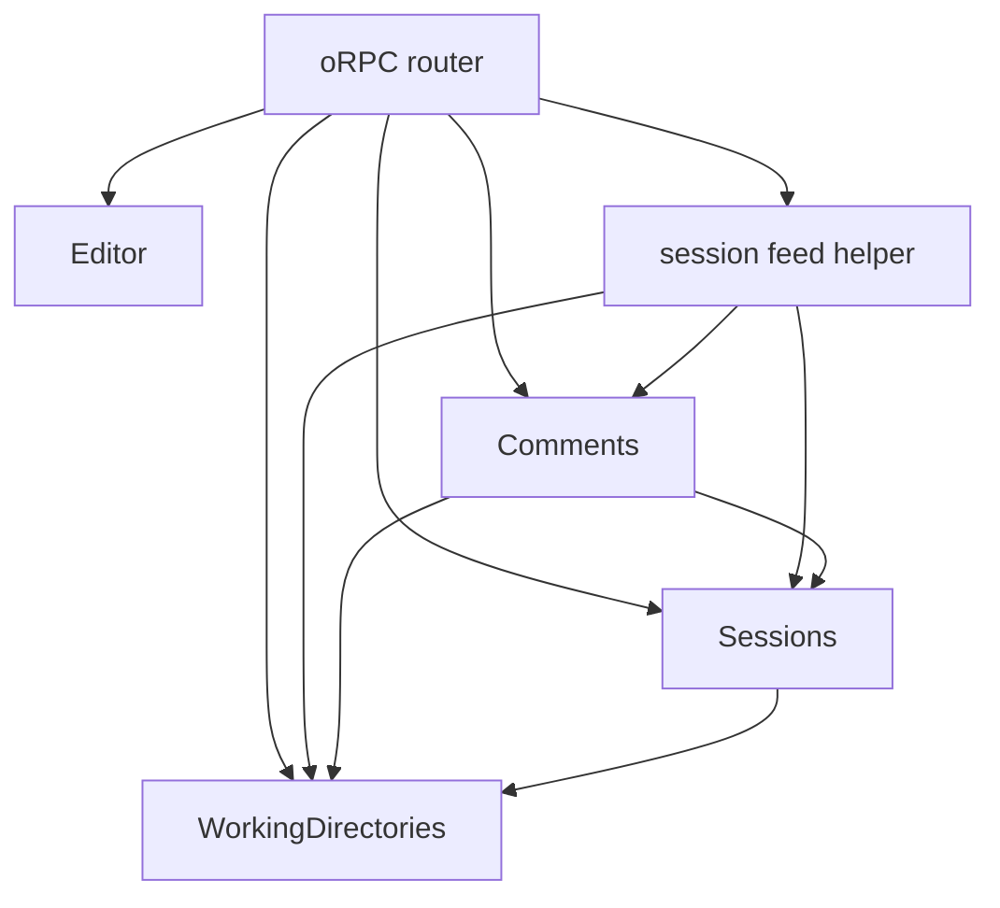
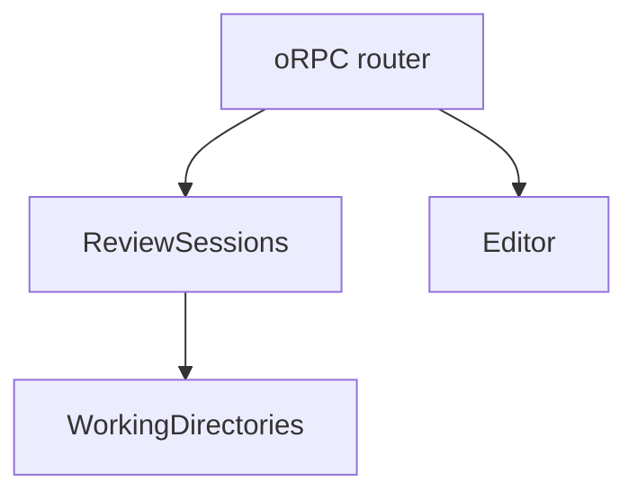
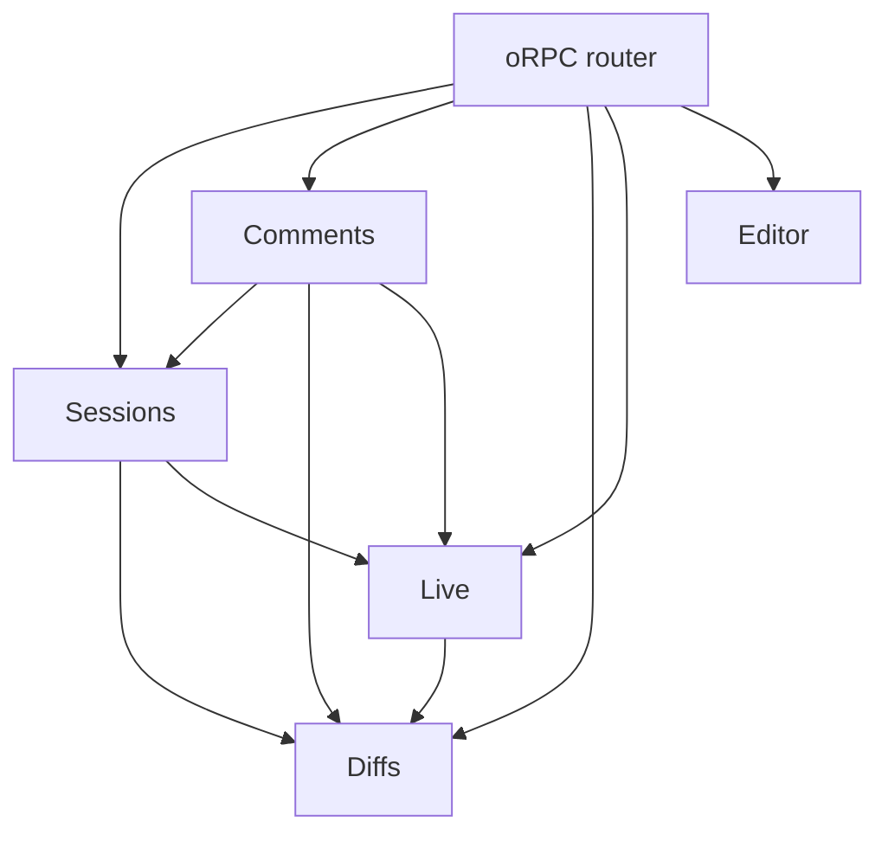

# 0007: How could the review server be split into a few deep modules, one per functional area?

- Date: 2026-10-16

## Question

The [review server](../glossary.md#review-server) is about to be built on the
scaffold in [`packages/server/src/`](../../packages/server/src/). Before any of
its behavior is written, Dan wants to critique how it's grouped into modules,
and later hand each module's internals to an agent session as a brief.

The grouping asked for is a few **deep modules**, each owning one functional
area of the product, such as comments and re-anchoring, rather than a technical
layer such as storage or HTTP. A deep module has a small, simple interface that
hides a lot of behavior (John Ousterhout, _A Philosophy of Software Design_,
chapter 4). This research asks:

- What the review server has to protect and react to: its invariants, and the
  events that pass between functional areas.
- Where that behavior sits today, in the prototype and in the scaffold.
- How the behavior could be grouped into 3 to 5 modules, with concrete
  TypeScript interfaces that can be argued with, and how deep each module is.
- How each grouping handles the steps of the product's workflow, and what it
  costs.

It doesn't recommend a grouping, design oRPC routes, choose libraries beyond
[0021](../decisions/0021-orpc-and-valibot-build-the-api.md),
[0022](../decisions/0022-node-sqlite-plain-sql-and-dbmate.md),
[0025](../decisions/0025-contract-first-orpc-over-rpc.md), and
[0026](../decisions/0026-workspaces-typescript-7-and-test-stack.md), or answer
the "Registration" and "Reporting turns" open questions in the
[README](../../README.md#open-questions). It says where turn snapshots and the
agent tree would sit in each option without designing commands for them.

## Findings

### How depth is judged in this doc

Ousterhout's terms, used in their standard sense throughout:

- **Module.** Any unit with an interface and an implementation: here, a
  TypeScript module that exports one factory and one interface. A module's
  **interface** is everything a caller must know to use it: its signatures,
  types, errors, and the rules in its doc comments, such as "call this inside a
  transaction". Its **implementation** is everything else (chapter 4).
- **Deep module.** One whose interface is much simpler than the behavior it
  provides. The cost of a module is its interface, and the benefit is its
  functionality, so depth is the ratio of the two. The Unix file I/O calls, five
  functions hiding file systems, caching, and devices, are the book's example of
  a deep interface (chapter 4).
- **Shallow module.** One whose interface is nearly as complicated as its
  implementation, so it saves its callers little (chapter 4).
- **Information hiding** and **information leakage.** A deep module hides design
  decisions, such as a data format or an algorithm, so they can change without
  its callers changing. Leakage is the same decision showing up in several
  modules, so changing it means changing all of them (chapter 5).
- **Temporal decomposition.** Splitting code by the order things happen, such as
  "read, then change, then write", rather than by the knowledge each step needs.
  It usually causes leakage, because the steps share knowledge (chapter 5).
- **Pass-through method.** A method that does little except call another
  module's method with a similar signature. It adds interface without adding
  behavior, and signals that responsibilities between the two modules are
  muddled (chapter 7).
- **Conjoined methods.** Two methods that can't be understood or used without
  each other, such as a "prepare" that must be followed by a "commit" (the
  red-flag summary at the end of the book).
- **Defining errors out of existence.** Giving an operation semantics where a
  case that would be an error simply isn't, such as deleting a file that's
  already gone. It removes errors from the interface (chapter 10).

Secondary summaries of the book were used to check the chapter contents:
[Dan Lebrero's notes](https://danlebrero.com/2021/02/24/philosophy-of-software-design-summary/)
and
[Programmer Raja's notes](https://programmerraja.is-a.dev/notes/2024/A-Philosophy-of-Software-Design-Book-Notes).
The book itself wasn't available to quote. See [Gaps](#gaps).

Each module below is judged on:

1. **Interface size:** how many public functions and named types (including
   named errors and event types) a caller has to know.
2. **Hidden behavior:** a list of what it does that no caller has to know.
3. **Red flags:** pass-through methods, information leakage to or from another
   module, conjoined methods, temporal decomposition, and errors that could be
   defined out of existence.
4. **Split in two:** what the module would look like as two, and whether the two
   would be shallower.

Types shared by every option (IDs, file lists, comments) aren't counted against
any one module, because they're the API's data and every option returns the same
data. Only the types a module adds are counted.

### Invariants the review server protects

Each invariant comes from a decision or a section of the README. "Who owns it"
is answered per option, in [Options](#options).

| #   | Invariant                                                                                                                                                                           | Source                                                                                                                                                   |
| --- | ----------------------------------------------------------------------------------------------------------------------------------------------------------------------------------- | -------------------------------------------------------------------------------------------------------------------------------------------------------- |
| I1  | A review session covers at least one working directory when it starts.                                                                                                              | [0018](../decisions/0018-agents-list-open-comments.md#review-session-commands) (`session new` needs one)                                                 |
| I2  | A working directory can be in several review sessions.                                                                                                                              | [0018](../decisions/0018-agents-list-open-comments.md#explicit-ids), [0013](../decisions/0013-working-directories.md)                                    |
| I3  | An archived review session is read-only: comments can't be added or change status, and working directories can't be added.                                                          | [0018](../decisions/0018-agents-list-open-comments.md#archiving-and-deleting), [README step 9](../../README.md#typical-workflow)                         |
| I4  | Archiving is one-way.                                                                                                                                                               | [0018](../decisions/0018-agents-list-open-comments.md#archiving-and-deleting)                                                                            |
| I5  | Archiving stops watching a working directory for that review session. A working directory also in an active review session stays watched.                                           | [0018](../decisions/0018-agents-list-open-comments.md#archiving-and-deleting)                                                                            |
| I6  | An archived review session can still be queried, and its comments keep their statuses, including open.                                                                              | [0018](../decisions/0018-agents-list-open-comments.md#archiving-and-deleting)                                                                            |
| I7  | Deleting a review session removes it and its data permanently, and an active one can be deleted.                                                                                    | [0018](../decisions/0018-agents-list-open-comments.md#archiving-and-deleting)                                                                            |
| I8  | A comment is available to agents as soon as it's saved. There are no drafts.                                                                                                        | [0018](../decisions/0018-agents-list-open-comments.md#comments), [README step 6](../../README.md#typical-workflow)                                       |
| I9  | Every comment starts open. An agent marks it addressed, the reviewer resolves an addressed comment, and the reviewer can reopen a comment, which sets it back to open.              | [0018](../decisions/0018-agents-list-open-comments.md#comment-statuses), [glossary](../glossary.md#comment-status)                                       |
| I10 | A comment's status and its anchor state are independent.                                                                                                                            | [0018](../decisions/0018-agents-list-open-comments.md#comment-statuses), [glossary](../glossary.md#anchor-state)                                         |
| I11 | Comment IDs are unique across review sessions.                                                                                                                                      | [0018](../decisions/0018-agents-list-open-comments.md#agents)                                                                                            |
| I12 | An overall comment belongs to the review session and isn't attached to code. A line comment has an anchor and an anchor state.                                                      | [0018](../decisions/0018-agents-list-open-comments.md#comments), [glossary](../glossary.md#comment)                                                      |
| I13 | An anchor never changes. Re-anchoring changes only where a comment is shown.                                                                                                        | [0008](../decisions/0008-comment-reanchoring.md#anchors), [glossary](../glossary.md#anchor)                                                              |
| I14 | Each file version is stored once and shared by every comment written on it.                                                                                                         | [0008](../decisions/0008-comment-reanchoring.md#anchors), [glossary](../glossary.md#file-version)                                                        |
| I15 | Re-anchoring compares the original file version with the current one, never a chain of versions.                                                                                    | [0008](../decisions/0008-comment-reanchoring.md#anchors)                                                                                                 |
| I16 | Anchors refer to a file version, not a diff mode. Each diff mode works out where a comment falls.                                                                                   | [0008](../decisions/0008-comment-reanchoring.md#anchors)                                                                                                 |
| I17 | When in doubt, a comment is outdated rather than placed on code that might not match.                                                                                               | [0008](../decisions/0008-comment-reanchoring.md#layers)                                                                                                  |
| I18 | Renamed files are followed with git's rename detection. Code moved to another file isn't followed. Comments on deleted lines anchor to the base version.                            | [0008](../decisions/0008-comment-reanchoring.md#other-cases)                                                                                             |
| I19 | `comment list` returns open comments, overall comments first, then line comments grouped by working directory and file, each with its working directory's path and a relative path. | [0018](../decisions/0018-agents-list-open-comments.md#agents)                                                                                            |
| I20 | `comment list --working-directory <dir>` returns that working directory's line comments and every overall comment.                                                                  | [0018](../decisions/0018-agents-list-open-comments.md#agents)                                                                                            |
| I21 | Nothing works out a review session or working directory from the directory the CLI runs in. Commands name them.                                                                     | [0018](../decisions/0018-agents-list-open-comments.md#explicit-ids)                                                                                      |
| I22 | The diff and the file view include only files under the working directory, even when git runs against the whole repo.                                                               | [0013](../decisions/0013-working-directories.md#solution)                                                                                                |
| I23 | In a git working directory, the branch is whatever `HEAD` points to.                                                                                                                | [0013](../decisions/0013-working-directories.md#solution)                                                                                                |
| I24 | A working directory that doesn't use git has no diff modes and no git statuses, and the file view lists all its files.                                                              | [0013](../decisions/0013-working-directories.md#solution), [README](../../README.md#file-view)                                                           |
| I25 | By default the file view lists files changed in the selected diff mode. "Show all files" adds unchanged files, and changed files keep their status.                                 | [0002](../decisions/0002-show-unchanged-files.md), [README](../../README.md#file-view)                                                                   |
| I26 | Each file in the file view shows its git status for the mode, its comment count, and lines added and removed. Files are grouped by working directory.                               | [README](../../README.md#file-view)                                                                                                                      |
| I27 | The diff updates live for changes by any actor, from watching the working tree, the index, and `HEAD` and refs, not from agent reports.                                             | [0007](../decisions/0007-live-reload-from-file-watching.md#solution), [README step 8](../../README.md#typical-workflow)                                  |
| I28 | Code stays in git. Diffs are computed from the working directories, not copied into the database.                                                                                   | [0006](../decisions/0006-sqlite-review-state.md#solution)                                                                                                |
| I29 | The review server never contacts agents. Agents pull.                                                                                                                               | [0010](../decisions/0010-user-prompts-agent-to-fetch-review.md#solution), [0018](../decisions/0018-agents-list-open-comments.md#agents)                  |
| I30 | "Open branch" never switches the branch of an existing checkout. It creates a worktree, or asks first.                                                                              | [0003](../decisions/0003-open-in-ide.md#solution), [README](../../README.md#open-in-an-ide)                                                              |
| I31 | The agent tree is reported by agents and harnesses, never inferred from git.                                                                                                        | [0004](../decisions/0004-agent-tree-is-an-input.md#solution), [glossary](../glossary.md#agent-tree)                                                      |
| I32 | The review server is the only process that opens its user's database, and migrations run before it serves requests.                                                                 | [0023](../decisions/0023-one-review-server-for-every-review-session.md#solution), [0022](../decisions/0022-node-sqlite-plain-sql-and-dbmate.md#solution) |
| I33 | A transaction never `await`s between `begin` and `commit`.                                                                                                                          | [0022](../decisions/0022-node-sqlite-plain-sql-and-dbmate.md#solution)                                                                                   |
| I34 | Every API call carries the user's token, and the server listens only on localhost.                                                                                                  | [0001](../decisions/0001-local-web-app.md#tradeoffs), [0024](../decisions/0024-config-file-holds-port-and-token.md#solution)                             |

Some invariants belong to the CLI rather than the review server, and shape no
module: no command but `server start` starts the review server
([0019](../decisions/0019-cli-does-not-start-the-server.md)), and
`session delete` asks for confirmation or `--yes`
([0018](../decisions/0018-agents-list-open-comments.md#archiving-and-deleting)).
I34 belongs to the router's middleware and `server.ts`, not to a module.

Two properties the prototype keeps aren't stated by any decision, so they're
listed here as behavior to hide rather than as invariants:

- Building the trees that diff modes compare never touches the index,
  `git status`, the stash, reflogs, or the user's refs
  ([`prototype/README.md`](../../prototype/README.md#4-turn-snapshots),
  [`workspace.ts:1-10`](../../prototype/src/server/workspace.ts)). The README
  only says a turn snapshot is "a hidden ref or stash-like commit"
  ([Diff modes](../../README.md#diff-modes)).
- A git command the review server runs ignores `GIT_DIR` and similar variables
  inherited from a parent git process
  ([`git.ts:31-48`](../../prototype/src/server/git.ts)).

None of the invariants contradict each other. 0018 says the reviewer resolves
"an addressed comment", so the sketches below reject resolving an open comment,
which 0018 lists as a follow-up ("More statuses and messages"). 0018 doesn't say
which statuses a comment can be reopened from, so the sketches allow addressed
and resolved.

### Events between functional areas

These are the things that happen in one functional area that another has to
react to. The options differ in whether each crosses a module boundary.

| Event                                                          | Raised by                                                | Who reacts, and how                                                                                                                                                                                | Source                                                                                                                                                      |
| -------------------------------------------------------------- | -------------------------------------------------------- | -------------------------------------------------------------------------------------------------------------------------------------------------------------------------------------------------- | ----------------------------------------------------------------------------------------------------------------------------------------------------------- |
| E1. The review server starts                                   | `server.ts`                                              | Watching resumes for every working directory an active review session covers.                                                                                                                      | [I27](#invariants-the-review-server-protects); prototype [`service.ts:89-103`](../../prototype/src/server/service.ts)                                       |
| E2. A review session starts, or working directories are added  | `session new`, `session add`                             | The working directories are resolved and watched. A pushed update tells open review UIs.                                                                                                           | [0018](../decisions/0018-agents-list-open-comments.md#review-session-commands), [0007](../decisions/0007-live-reload-from-file-watching.md)                 |
| E3. A comment is saved                                         | The reviewer, in the review UI                           | Its file version is stored if new. The file view's comment count changes. A pushed update tells other review UIs. Agents see it on their next `comment list`.                                      | [I8](#invariants-the-review-server-protects), [I14](#invariants-the-review-server-protects)                                                                 |
| E4. A comment's status changes                                 | `comment addressed`, or the reviewer                     | A pushed update tells the review UI. `comment list` stops or starts returning it.                                                                                                                  | [0018](../decisions/0018-agents-list-open-comments.md#comment-statuses)                                                                                     |
| E5. A file changes in a working directory                      | Any actor, seen by the file watcher                      | Cached diffs and file lists for that working directory are dropped. Every active review session covering it gets a pushed update. Anchor states are worked out again, eagerly or on the next read. | [0007](../decisions/0007-live-reload-from-file-watching.md), [0008](../decisions/0008-comment-reanchoring.md) ("When re-anchoring runs")                    |
| E6. The index, `HEAD`, or refs change, such as a branch switch | Any actor, seen by the file watcher                      | As E5, for every file, since every diff mode's sides may have moved.                                                                                                                               | [0007](../decisions/0007-live-reload-from-file-watching.md#solution), [0013](../decisions/0013-working-directories.md#tradeoffs)                            |
| E7. A review session is archived                               | `session archive`                                        | Writes to it stop. Its working directories stop being watched for it. A pushed update tells open review UIs, and their stream can end.                                                             | [I3](#invariants-the-review-server-protects), [I5](#invariants-the-review-server-protects)                                                                  |
| E8. A review session is deleted                                | `session delete`                                         | Its comments go, and file versions no other comment refers to may go. Watching stops for it. A pushed update tells open review UIs.                                                                | [I7](#invariants-the-review-server-protects), [0018](../decisions/0018-agents-list-open-comments.md#follow-up-design-choices) ("Cleaning up file versions") |
| E9. A turn boundary is reported                                | An agent or harness, if "Reporting turns" adds a command | A turn snapshot is recorded for the working directory. The "Last turn" diff mode compares with it.                                                                                                 | [README](../../README.md#open-questions) ("Reporting turns"), [0007](../decisions/0007-live-reload-from-file-watching.md#solution)                          |
| E10. An agent registers                                        | An agent or harness, if "Registration" is kept           | The agent tree gains a node, linked to working directories. The review UI can filter by agent.                                                                                                     | [README](../../README.md#open-questions) ("Registration"), [0004](../decisions/0004-agent-tree-is-an-input.md)                                              |

E3, E5, E7, and E8 each touch more than one functional area at once. For
example, deleting a review session (E8) touches review sessions, comments, file
versions, and watching, and a file changing on disk (E5) touches watching,
diffs, the file view, and anchor states.

### Where today's code sits

#### The prototype's server

The prototype predates [0013](../decisions/0013-working-directories.md) and
[0018](../decisions/0018-agents-list-open-comments.md), so it says "workspace"
for a working directory and has drafts, reviews, notifications, and turn
reporting. Its functional areas, in glossary terms:

| File                                                      | Lines | Functional areas                                                                                                                                                                                                                                                      | Where it mixes areas                                                                                                                                                                                                                                                                                                                                                |
| --------------------------------------------------------- | ----- | --------------------------------------------------------------------------------------------------------------------------------------------------------------------------------------------------------------------------------------------------------------------- | ------------------------------------------------------------------------------------------------------------------------------------------------------------------------------------------------------------------------------------------------------------------------------------------------------------------------------------------------------------------- |
| [`db.ts`](../../prototype/src/server/db.ts)               | 156   | Storage for every area                                                                                                                                                                                                                                                | One schema string (lines 5-106) holds working directories, review sessions, agents, file versions, reviews, comments, notifications, fetches, and turn snapshots, created with `create table if not exists` rather than migrations.                                                                                                                                 |
| [`git.ts`](../../prototype/src/server/git.ts)             | 235   | Running git: a clean environment (31-48), one-shot commands (51-92), and a long-running `git cat-file --batch-command` reader (106-216)                                                                                                                               | None. It's a technical helper with no product knowledge.                                                                                                                                                                                                                                                                                                            |
| [`workspace.ts`](../../prototype/src/server/workspace.ts) | 527   | Diffs and diff modes (`sides`, 263-306), the file view's files and statuses (`changedFiles`, 308-386), file contents (`readFile`, `readBlob`, 401-437), caching (58-69, 118-133, 471-483), default base ref (147-169), and turn snapshots (`createSnapshot`, 440-464) | Turn snapshots sit with diffs. Whether results can be cached is a public field, `cacheable` (58-62), that the watcher sets, and `invalidate` (118-121) is public for the watcher to call. Only git working directories are handled: `resolveWorkspaceRoot` throws for anything else (45-49).                                                                        |
| [`watcher.ts`](../../prototype/src/server/watcher.ts)     | 169   | Watching: recursive `fs.watch` (54-68), classifying git paths (84-101), debouncing with a maximum wait (103-111), and dropping ignored paths with `git check-ignore` (156-163)                                                                                        | It reaches into `GitWorkspace`: it sets `cacheable` (42, 48) and calls `invalidate` (137) before it reports a change. It knows git's directory layout (84-101), which is diff knowledge.                                                                                                                                                                            |
| [`service.ts`](../../prototype/src/server/service.ts)     | 1,237 | Everything: working directories and watching (111-184), review sessions (186-307), diffs (309-410), comments and re-anchoring (412-633), reviews and notifications (635-819), agents and turns (821-1100), turn snapshots (1102-1159), and settings (1161-1169)       | `files` (331-368) counts comments with SQL inside the diff path. `file` (370-410) re-anchors comments inside a diff response. `createComment` (522-600) reads a blob through git to store a file version. `addWorkspace` (209-232) starts watching and records a turn snapshot. `turn` (884-939) mixes registration, busy state, turn snapshots, and notifications. |
| [`http.ts`](../../prototype/src/server/http.ts)           | 253   | The API: routing (78-106), the `Host` and write-header checks (57-64), pushed updates over SSE (44-47, 66-76), and a metrics log (227-233)                                                                                                                            | Most routes pass straight through to one `ReviewService` method (108-234). Pushed updates go to every client, with no filtering by review session (44-47).                                                                                                                                                                                                          |
| [`notify.ts`](../../prototype/src/server/notify.ts)       | 103   | Delivering notifications to agents                                                                                                                                                                                                                                    | None, but the area no longer exists: [0010](../decisions/0010-user-prompts-agent-to-fetch-review.md) and [0018](../decisions/0018-agents-list-open-comments.md) removed it (I29).                                                                                                                                                                                   |
| [`main.ts`](../../prototype/src/server/main.ts)           | 137   | Startup: wiring the database, service, and API (42-48), resuming watches (74), serving the review UI through Vite (99-137), and shutdown (88-97)                                                                                                                      | None.                                                                                                                                                                                                                                                                                                                                                               |

Re-anchoring itself is outside `src/server/`, in
[`prototype/src/shared/reanchor.ts`](../../prototype/src/shared/reanchor.ts)
(343 lines): one `reanchor` function (line 73) and its options (14-44), with no
I/O. It's already a small interface hiding a lot, and every option below keeps
it as a pure helper inside whichever module re-anchors.

`ReviewService` is the opposite of a deep module: its public interface is about
35 methods, about one per HTTP route, so
[`http.ts`](../../prototype/src/server/http.ts) is mostly pass-through methods
over it. The depth it does have comes from `GitWorkspace` and `reanchor`, which
it calls.

#### The scaffold on `main`

| File                                                 | Lines | What it does                                                                                                                         | Functional area                                                     |
| ---------------------------------------------------- | ----- | ------------------------------------------------------------------------------------------------------------------------------------ | ------------------------------------------------------------------- |
| [`server.ts`](../../packages/server/src/server.ts)   | 120   | Creates the state directory, migrates, opens the `Store`, serves the API under `/api` and the review UI, and picks the port (73-120) | None: startup and serving                                           |
| [`router.ts`](../../packages/server/src/router.ts)   | 19    | Implements the contract with `implement(contract)` (6-17)                                                                            | None: the API adapter                                               |
| [`store.ts`](../../packages/server/src/store.ts)     | 25    | A `Store` class over `DatabaseSync`, with the placeholder `addGreeting` (5-25)                                                       | None yet. It's 0022's "store module"                                |
| [`migrate.ts`](../../packages/server/src/migrate.ts) | 40    | Runs `dbmate up` (15-40)                                                                                                             | None: migrations                                                    |
| [`state.ts`](../../packages/server/src/state.ts)     | 29    | Creates the state directory and writes the config file (9-29)                                                                        | None: [0024](../decisions/0024-config-file-holds-port-and-token.md) |
| [`static.ts`](../../packages/server/src/static.ts)   | 78    | Serves the built review UI (37-78)                                                                                                   | None: serving                                                       |

No functional area is implemented yet. `createRouter(store)` takes the `Store`
directly (`router.ts:6`), so today the router would call SQL methods itself.
Each option below replaces that parameter with the option's modules.

### Behavior a module would hide

These are measured or verified in the prototype, and each is something callers
of a well-chosen module would never have to know:

- **Spawning git costs about 60 ms per command** on the prototype's machine, and
  one file took about 850 ms of git time without caching. The prototype caches
  anything keyed by an object hash forever, caches results that depend on the
  current state until the watcher reports a change, and reads objects through
  one long-running `git cat-file --batch-command`. Switching files then took 1
  to 10 ms, and a refresh after an edit about 300 ms
  ([`prototype/README.md`](../../prototype/README.md#findings-so-far)).
- **The watcher debounces** (150 ms, flushing at least every 1,000 ms), drops
  git internals except the index, `HEAD`, and refs, and drops ignored paths.
  Events arrived 240 to 290 ms after the last write, and 200 files written at
  once arrived as one event (same source,
  [live reload](../../prototype/README.md#3-live-reload)).
- **Diff modes compare trees.** The working tree and the index are written as
  trees through private index files that keep the real index's timestamps, so
  unchanged files aren't rehashed and same-second edits aren't missed
  ([`workspace.ts:240-261`](../../prototype/src/server/workspace.ts),
  [`workspace.ts:509-518`](../../prototype/src/server/workspace.ts)).
- **Turn snapshots** are commits of the working-tree tree under
  `refs/agent-diff/`, which git doesn't write reflogs for
  ([`prototype/README.md`](../../prototype/README.md#4-turn-snapshots)).
- **"All changes" and "Committed" compare against the merge base** of the base
  ref and `HEAD`, like a pull request
  ([`workspace.ts:171-197`](../../prototype/src/server/workspace.ts)).
- **Untracked files** are told apart from added ones by checking the index's
  paths ([`workspace.ts:360-377`](../../prototype/src/server/workspace.ts)).
- **Large and binary files** are detected and not sent: over 2 MB, or a NUL byte
  in the first 8,000 bytes
  ([`workspace.ts:32`](../../prototype/src/server/workspace.ts),
  [`workspace.ts:414-437`](../../prototype/src/server/workspace.ts)).
- **Re-anchoring** has six tuned options, such as a minimum similarity of 0.9
  and an ambiguity margin, and kept 86% of comments current, 1% moved, and 13%
  outdated on 20 commits of a real repo
  ([`reanchor.ts:14-44`](../../prototype/src/shared/reanchor.ts),
  [`prototype/README.md`](../../prototype/README.md#findings-so-far)).
- **A comment on a renamed file** is placed by looking up the rename in the
  diff's file list
  ([`service.ts:478-503`](../../prototype/src/server/service.ts)).

### Constraints every option has to meet

- **The router and server stay thin.** In every option, a router handler either
  calls one module function, or looks up one value (such as a working
  directory's base ref) and passes it to one module function. Anything more
  belongs in a module. `server.ts` builds the modules in dependency order, runs
  the startup step that resumes watching, and closes them on shutdown. The token
  and `Host` checks stay as oRPC middleware (I34).
- **Transactions are synchronous.** `node:sqlite` is synchronous and a
  transaction must not `await` (I33). So a module that needs data from git and
  the database reads git first, then writes in one synchronous transaction, and
  checks its preconditions, such as "the review session is active", again inside
  that transaction. Because every module shares one connection, any module's
  synchronous code inside a transaction sees the same state.
- **No module reads another's tables.** Where an action spans modules, as in E3,
  E7, and E8, the options use one of three mechanisms, named in each option: one
  module owns both sides, a **synchronous hook** that one module registers with
  another and that runs inside the other's transaction, or a foreign key with
  `ON DELETE CASCADE` declared by the module that owns the referring table.
- **Dependencies can be replaced in tests.** Every factory takes its
  dependencies as arguments: the database (an in-memory `DatabaseSync` in
  tests), git, the file system, timers, the clock, an ID source, and other
  modules' interfaces. All of them are interfaces in the
  [shared types](#shared-types), so `node --test` can pass fakes
  ([0026](../decisions/0026-workspaces-typescript-7-and-test-stack.md)).
- **0022's store module.** 0022 says queries are "plain SQL in a store module".
  Each option says whether its SQL stays in one store module or is split between
  modules, and what that means for 0022.

### How the sketches were checked

Every TypeScript block below was extracted from this file and type-checked with
the repo's TypeScript (`tsc` 7.0.2) using
`tsc --strict --noEmit --target es2022 --lib es2022,dom`, in a scratch directory
outside the repo. The `dom` library supplies `AbortSignal`. Each block is
preceded by an HTML comment naming the options it belongs to, such as
`<!-- sketch: a b -->`. The blocks are scripts rather than modules, so the
shared types are visible to every option without imports. Each option was
checked on its own: the shared types plus that option's blocks. A call to a
function an interface doesn't have was added once to confirm `tsc` rejects it.

The walk-throughs were also written as TypeScript, one function per step,
calling only the interfaces in each option, and type-checked the same way. They
aren't in this doc, because they repeat the prose walk-throughs. Both checks
were run on 2026-10-16. Results are in [Gaps](#gaps) and the pull request.

## Options

Three decompositions follow. They differ in where three boundaries fall:

| Boundary                       | Option A                                            | Option B                                            | Option C                            |
| ------------------------------ | --------------------------------------------------- | --------------------------------------------------- | ----------------------------------- |
| Review sessions and comments   | Two modules                                         | One module                                          | Two modules                         |
| File watching                  | Hidden in the module that reads working directories | Hidden in the module that reads working directories | Its own module, with pushed updates |
| Re-anchoring and file versions | With comments                                       | With comments                                       | With diffs                          |
| Modules                        | 4                                                   | 3                                                   | 5                                   |

Opening the code in an IDE is the same `Editor` module in every option, since
nothing else in the review server needs it. It's specified once, under
[Option A](#editor), and reused by B and C.

None of the counts include the oRPC router, `server.ts`, `migrate.ts`,
`state.ts`, `static.ts`, the pure re-anchoring function, or the small helpers
named in each option.

### Shared types

The API's data, the same in every option, and the dependencies every module can
be given as test doubles. Errors are named classes with a `code`, which the
router maps to oRPC errors
([0021](../decisions/0021-orpc-and-valibot-build-the-api.md)). They're declared
here because every option throws the same errors, from different modules.

<!-- sketch: a b c -->

```ts
type Brand<T, B extends string> = T & { readonly __brand: B };

/** A review session's ID. Its format is open (0018, "ID format"). */
type SessionId = Brand<string, 'SessionId'>;
/** A comment's ID, unique across review sessions (0018). */
type CommentId = Brand<string, 'CommentId'>;
/**
 * A working directory's ID, the same in every review session that covers it.
 * How it's derived, and what happens when the directory moves, is open (0013,
 * "Identity").
 */
type WorkingDirectoryId = Brand<string, 'WorkingDirectoryId'>;
/** A hash of a file version's contents (0008). Whether it's git's blob hash is open. */
type FileVersionHash = Brand<string, 'FileVersionHash'>;
type TurnSnapshotId = Brand<string, 'TurnSnapshotId'>;
type AbsolutePath = string;
/** A path relative to a working directory, with `/` separators. */
type RelativePath = string;

type DiffMode =
  'all-changes' | 'committed' | 'staged' | 'unstaged' | 'last-turn';
type FileStatus =
  | 'added'
  | 'modified'
  | 'deleted'
  | 'renamed'
  | 'copied'
  | 'untracked'
  | 'type-changed'
  | 'conflicted';
type Side = 'old' | 'new';
/** 1-based and inclusive. */
interface LineRange {
  readonly start: number;
  readonly end: number;
}
type AnchorState = 'current' | 'moved' | 'outdated';
type CommentStatus = 'open' | 'addressed' | 'resolved';

/** The diff mode the reviewer picked. Ignored without git. */
interface ModeChoice {
  readonly mode: DiffMode;
  /** For "Last turn": the turn snapshot to compare with. The latest when absent. */
  readonly turnSnapshot?: TurnSnapshotId;
}
/** Everything needed to work out a diff mode's two sides. */
interface DiffSpec extends ModeChoice {
  /** The base ref, for "All changes" and "Committed". Null without git. */
  readonly baseRef: string | null;
}

interface WorkingDirectoryInfo {
  readonly id: WorkingDirectoryId;
  readonly path: AbsolutePath;
  /** False for a directory that doesn't use git, which has no diff modes (0013). */
  readonly usesGit: boolean;
  /** The branch `HEAD` points to (0013). Null when detached, or without git. */
  readonly branch: string | null;
  /** False when the directory has been removed since it was added. */
  readonly exists: boolean;
}

/** A working directory as one review session covers it. */
interface Membership {
  readonly sessionId: SessionId;
  readonly workingDirectory: WorkingDirectoryId;
  readonly path: AbsolutePath;
  readonly usesGit: boolean;
  /** Null without git. Whether this belongs to the membership is open (0013, "Base ref"). */
  readonly baseRef: string | null;
}

interface Session {
  readonly id: SessionId;
  readonly createdAt: Date;
  /** Null while the review session is active. */
  readonly archivedAt: Date | null;
  readonly workingDirectories: readonly (WorkingDirectoryInfo & {
    readonly baseRef: string | null;
  })[];
}

/** One file in the file view. */
interface FileEntry {
  readonly path: RelativePath;
  /** The old path of a renamed or copied file. */
  readonly oldPath: RelativePath | null;
  /** Null for an unchanged file, and for every file without git. */
  readonly status: FileStatus | null;
  /** Null for binary and unchanged files, and without git. */
  readonly added: number | null;
  readonly removed: number | null;
  readonly binary: boolean;
}

interface FileList {
  readonly workingDirectory: WorkingDirectoryId;
  /** Null without git. */
  readonly mode: DiffMode | null;
  /** Changed files, then unchanged ones when asked for, each sorted by path. */
  readonly files: readonly FileEntry[];
}

/** One side of a file. */
interface FileContents {
  /** Null when the file doesn't exist on this side. */
  readonly version: FileVersionHash | null;
  /** Null for binary and too-large files. */
  readonly text: string | null;
  readonly binary: boolean;
  readonly tooLarge: boolean;
}

interface FileDiff {
  readonly path: RelativePath;
  readonly oldPath: RelativePath | null;
  /** Null for an unchanged file, and without git. */
  readonly status: FileStatus | null;
  /** Null without git, where there's only the current file. */
  readonly old: FileContents | null;
  readonly new: FileContents;
}

interface TurnSnapshot {
  readonly id: TurnSnapshotId;
  readonly workingDirectory: WorkingDirectoryId;
  readonly recordedAt: Date;
}

/** Something changed in a watched working directory. */
interface WorkingDirectoryChanged {
  readonly workingDirectory: WorkingDirectoryId;
  /**
   * The changed files, or 'all' when the index, `HEAD`, or refs changed, so
   * every diff mode's sides may have moved.
   */
  readonly paths: readonly RelativePath[] | 'all';
}

/** What a line comment was written on. Never changes (0008). */
interface Anchor {
  readonly workingDirectory: WorkingDirectoryId;
  readonly path: RelativePath;
  /** Without git there's no diff side, which 0013 leaves open. The sketch uses 'new'. */
  readonly side: Side;
  readonly lines: LineRange;
  readonly fileVersion: FileVersionHash;
}

interface Comment {
  readonly id: CommentId;
  readonly sessionId: SessionId;
  readonly body: string;
  readonly status: CommentStatus;
  readonly createdAt: Date;
  /** Null for an overall comment. */
  readonly anchor: Anchor | null;
}

/** Where a line comment is shown in one diff mode (0008). */
interface Placement {
  readonly state: AnchorState;
  /** Where it sits now, after following a rename. Null when outdated. */
  readonly path: RelativePath | null;
  readonly lines: LineRange | null;
  /** For an outdated comment, the code that replaced its lines, if any. */
  readonly replacement: LineRange | null;
  /** The lines it was written on, from its file version. */
  readonly originalCode: readonly string[];
}

interface PlacedComment extends Comment {
  /** Null for an overall comment. */
  readonly placement: Placement | null;
}

/** What `comment list` returns (0018). */
interface OpenComments {
  readonly overall: readonly Comment[];
  /** In the order the working directories were added, files sorted by path. */
  readonly workingDirectories: readonly {
    readonly path: AbsolutePath;
    readonly files: readonly {
      readonly path: RelativePath;
      readonly comments: readonly PlacedComment[];
    }[];
  }[];
}

interface NewLineComment {
  readonly sessionId: SessionId;
  readonly workingDirectory: WorkingDirectoryId;
  readonly path: RelativePath;
  readonly side: Side;
  readonly lines: LineRange;
  /** The version the review UI showed, from `FileContents.version`. */
  readonly fileVersion: FileVersionHash;
  readonly body: string;
}

interface NewOverallComment {
  readonly sessionId: SessionId;
  readonly body: string;
}

type CommentCounts = Readonly<Record<CommentStatus, number>>;

/** What's pushed to a review UI watching one review session. */
type SessionUpdate =
  | {
      readonly type: 'working-directories-added';
      readonly workingDirectories: readonly WorkingDirectoryId[];
    }
  | { readonly type: 'files-changed'; readonly change: WorkingDirectoryChanged }
  | { readonly type: 'comment-saved'; readonly comment: Comment }
  | { readonly type: 'comment-status-changed'; readonly comment: Comment }
  | { readonly type: 'archived' }
  | { readonly type: 'deleted' };

interface EditorChoice {
  readonly id: string;
  readonly label: string;
  readonly isDefault: boolean;
}

type Unsubscribe = () => void;

// Dependencies, each replaceable with a test double.

/** The part of node:sqlite's DatabaseSync the modules use (0022). */
interface SqlDatabase {
  exec(sql: string): void;
  prepare(sql: string): SqlStatement;
}
type SqlValue = null | number | bigint | string | Uint8Array;
interface SqlStatement {
  run(...params: SqlValue[]): { changes: number | bigint };
  get(...params: SqlValue[]): Record<string, SqlValue> | undefined;
  all(...params: SqlValue[]): Record<string, SqlValue>[];
}
/**
 * Runs `fn` in one transaction on the shared connection. `fn` is synchronous,
 * so nothing can await before the commit (0022). A call inside another joins
 * the outer transaction, and a throw rolls the whole thing back.
 */
type Transact = <T>(fn: () => T) => T;

interface Clock {
  now(): Date;
}
interface IdSource {
  sessionId(): SessionId;
  commentId(): CommentId;
}
interface GitRunner {
  /** Runs git with a clean environment. Rejects when the exit code isn't in `okCodes` ([0] by default). */
  run(
    cwd: AbsolutePath,
    args: readonly string[],
    options?: {
      readonly input?: string;
      readonly env?: Readonly<Record<string, string>>;
      readonly okCodes?: readonly number[];
    },
  ): Promise<{ code: number; stdout: Uint8Array; stderr: string }>;
  /** A long-running object reader: `git cat-file --batch-command` in production. */
  objectReader(cwd: AbsolutePath): GitObjectReader;
}
interface GitObjectReader {
  info(
    name: string,
  ): Promise<{ oid: string; type: string; size: number } | null>;
  contents(name: string): Promise<Uint8Array | null>;
  close(): void;
}
interface FileSystem {
  realpath(path: AbsolutePath): Promise<AbsolutePath>;
  stat(
    path: AbsolutePath,
  ): Promise<{ kind: 'file' | 'directory' | 'other'; size: number } | null>;
  readFile(path: AbsolutePath): Promise<Uint8Array>;
  readDir(
    path: AbsolutePath,
  ): Promise<readonly { name: string; kind: 'file' | 'directory' | 'other' }[]>;
  /** Calls `onEvent` with the changed path, or null when the platform doesn't say. */
  watch(
    path: AbsolutePath,
    options: { readonly recursive: boolean },
    onEvent: (path: AbsolutePath | null) => void,
  ): { close(): void };
}
interface Timers {
  setTimeout(fn: () => void, ms: number): { cancel(): void };
}
interface ProcessLauncher {
  /** Starts a detached process, and resolves once it has started. */
  launch(
    command: string,
    args: readonly string[],
    cwd: AbsolutePath,
  ): Promise<void>;
  /** Opens a URL, such as `vscode://file/...`, with the system's handler. */
  openUrl(url: string): Promise<void>;
}
interface EditorSettings {
  readonly editors: readonly {
    readonly id: string;
    readonly label: string;
    /** How to open a file at a line, such as ['code', '-g', '{file}:{line}']. */
    readonly openFile: readonly string[];
    readonly openDirectory: readonly string[];
  }[];
  readonly defaultEditor: string;
}

// Errors.

declare abstract class ModuleError extends Error {
  abstract readonly code: string;
}
declare class SessionNotFound extends ModuleError {
  readonly code: 'SESSION_NOT_FOUND';
  readonly sessionId: SessionId;
}
declare class SessionArchived extends ModuleError {
  readonly code: 'SESSION_ARCHIVED';
  readonly sessionId: SessionId;
}
declare class NoWorkingDirectories extends ModuleError {
  readonly code: 'NO_WORKING_DIRECTORIES';
}
/** The path doesn't exist, or isn't a directory. */
declare class WorkingDirectoryNotFound extends ModuleError {
  readonly code: 'WORKING_DIRECTORY_NOT_FOUND';
  readonly path: AbsolutePath;
}
declare class WorkingDirectoryNotInSession extends ModuleError {
  readonly code: 'WORKING_DIRECTORY_NOT_IN_SESSION';
  readonly sessionId: SessionId;
  readonly workingDirectory: WorkingDirectoryId | AbsolutePath;
}
/** The ID wasn't returned by `open` since the review server started. */
declare class UnknownWorkingDirectory extends ModuleError {
  readonly code: 'UNKNOWN_WORKING_DIRECTORY';
  readonly workingDirectory: WorkingDirectoryId;
}
declare class BaseRefNotFound extends ModuleError {
  readonly code: 'BASE_REF_NOT_FOUND';
  readonly ref: string;
}
declare class NoTurnSnapshot extends ModuleError {
  readonly code: 'NO_TURN_SNAPSHOT';
  readonly workingDirectory: WorkingDirectoryId;
}
/** The index can't be read as a tree, for example during a merge conflict. */
declare class IndexUnreadable extends ModuleError {
  readonly code: 'INDEX_UNREADABLE';
  readonly reason: string;
}
declare class FileNotFound extends ModuleError {
  readonly code: 'FILE_NOT_FOUND';
  readonly path: RelativePath;
}
/** No text with this hash can be read from the working directory. */
declare class FileVersionNotFound extends ModuleError {
  readonly code: 'FILE_VERSION_NOT_FOUND';
  readonly fileVersion: FileVersionHash;
}
declare class LinesOutsideFile extends ModuleError {
  readonly code: 'LINES_OUTSIDE_FILE';
  readonly lines: LineRange;
  readonly lineCount: number;
}
declare class EmptyBody extends ModuleError {
  readonly code: 'EMPTY_BODY';
}
declare class CommentNotFound extends ModuleError {
  readonly code: 'COMMENT_NOT_FOUND';
  readonly commentId: CommentId;
}
declare class StatusChangeNotAllowed extends ModuleError {
  readonly code: 'STATUS_CHANGE_NOT_ALLOWED';
  readonly commentId: CommentId;
  readonly from: CommentStatus;
  readonly to: CommentStatus;
}
declare class NotAGitWorkingDirectory extends ModuleError {
  readonly code: 'NOT_A_GIT_WORKING_DIRECTORY';
  readonly path: AbsolutePath;
}
declare class DetachedHead extends ModuleError {
  readonly code: 'DETACHED_HEAD';
  readonly path: AbsolutePath;
}
/** The branch isn't checked out in any worktree, and creating one wasn't confirmed. */
declare class WorktreeNeeded extends ModuleError {
  readonly code: 'WORKTREE_NEEDED';
  readonly branch: string;
  readonly suggestedPath: AbsolutePath;
}
declare class PathOutsideWorkingDirectory extends ModuleError {
  readonly code: 'PATH_OUTSIDE_WORKING_DIRECTORY';
  readonly path: string;
}
declare class UnknownEditor extends ModuleError {
  readonly code: 'UNKNOWN_EDITOR';
  readonly editor: string;
}
declare class EditorFailedToLaunch extends ModuleError {
  readonly code: 'EDITOR_FAILED_TO_LAUNCH';
  readonly editor: string;
  readonly reason: string;
}
```

### Option A: Sessions, comments, working directories, and the editor

Four modules, one per product area that has its own data or its own outside
world: `Sessions` (review sessions, in the database), `Comments` (comments and
file versions, in the database), `WorkingDirectories` (code on disk, through git
and the file system), and `Editor` (launching editors). File watching and turn
snapshots are hidden in `WorkingDirectories`, and re-anchoring in `Comments`.

#### Dependencies



There are no cycles. `Sessions` needs `Comments` once, to delete a review
session's comments, and that goes the other way through a synchronous hook that
`Comments` registers with `Sessions.onDeleting`, so neither imports the other in
both directions.

#### Sessions

**Purpose:** keeps review sessions and the working directories each one covers,
keeps those working directories watched while an active review session covers
them, and is the one place that says whether a review session can change.

<!-- sketch: a -->

```ts
type SessionEvent =
  | { readonly type: 'created'; readonly sessionId: SessionId }
  | {
      readonly type: 'working-directories-added';
      readonly sessionId: SessionId;
      readonly workingDirectories: readonly WorkingDirectoryId[];
    }
  | { readonly type: 'archived'; readonly sessionId: SessionId }
  | { readonly type: 'deleted'; readonly sessionId: SessionId };

interface Sessions {
  /**
   * Starts a review session over `paths`, resolving each to a working
   * directory and watching it. Paths that resolve to the same directory count
   * once. `baseRef` applies to every git working directory. Without it, each
   * gets its default base ref.
   * @throws NoWorkingDirectories when `paths` is empty.
   * @throws WorkingDirectoryNotFound, BaseRefNotFound
   */
  create(input: {
    readonly paths: readonly AbsolutePath[];
    readonly baseRef?: string;
  }): Promise<Session>;
  /**
   * Adds working directories. One the review session already covers is left
   * as it was.
   * @throws SessionNotFound, SessionArchived, NoWorkingDirectories,
   *   WorkingDirectoryNotFound, BaseRefNotFound
   */
  add(
    sessionId: SessionId,
    input: {
      readonly paths: readonly AbsolutePath[];
      readonly baseRef?: string;
    },
  ): Promise<Session>;
  /** @throws SessionNotFound */
  get(sessionId: SessionId): Promise<Session>;
  /** Every review session, active and archived, newest first. */
  list(): Promise<readonly Session[]>;
  /**
   * A working directory in a review session, by ID or by path. Synchronous, and
   * reads only the database.
   * @throws SessionNotFound, WorkingDirectoryNotInSession
   */
  membership(
    sessionId: SessionId,
    workingDirectory: WorkingDirectoryId | AbsolutePath,
  ): Membership;
  /** The active review sessions that cover a working directory. */
  activeSessionsCovering(
    workingDirectory: WorkingDirectoryId,
  ): readonly SessionId[];
  /**
   * Throws unless the review session exists and is active. Synchronous, so
   * another module can check inside its own transaction.
   * @throws SessionNotFound, SessionArchived
   */
  assertActive(sessionId: SessionId): void;
  /**
   * Archives a review session. It becomes read-only, and stops holding its
   * working directories' watches. Archiving an archived one does nothing.
   * There's no way back (0018).
   * @throws SessionNotFound
   */
  archive(sessionId: SessionId): Promise<Session>;
  /**
   * Deletes a review session and, through `onDeleting` hooks, everything that
   * belongs to it, in one transaction. An active one can be deleted.
   * @throws SessionNotFound
   */
  delete(sessionId: SessionId): void;
  /**
   * Registers a hook that runs inside `delete`'s transaction, before the review
   * session's own rows go. A hook that throws rolls the delete back.
   */
  onDeleting(hook: (sessionId: SessionId) => void): Unsubscribe;
  /** Calls `listener` after each change commits. */
  subscribe(listener: (event: SessionEvent) => void): Unsubscribe;
  /**
   * Reopens and watches every working directory that an active review session
   * covers. `server.ts` calls it once at startup. A directory that no longer
   * exists is skipped and shown with `exists: false`.
   */
  resume(): Promise<void>;
}

declare function createSessions(deps: {
  readonly db: SqlDatabase;
  readonly transact: Transact;
  readonly clock: Clock;
  readonly ids: IdSource;
  readonly workingDirectories: WorkingDirectories;
}): Sessions;
```

- **Invariants it owns:** I1, I2, I3 and I4 for review sessions and their
  working directories, I5, I6 for review sessions, and I7's "an active one can
  be deleted". It enforces I3 for comments through `assertActive`, which
  `Comments` calls.
- **Hides:** its tables (review sessions and memberships), ID generation, path
  resolution through `WorkingDirectories.open`, the default base ref, which
  owner key it holds watches under, reopening working directories at startup,
  running hooks inside the delete transaction, and when events fire (after the
  commit, never inside it).
- **Depends on:** `SqlDatabase`, `Transact`, `Clock`, `IdSource`, and
  `WorkingDirectories` (`open`, `info`, `defaultBaseRef`, `checkBaseRef`,
  `hold`, `release`).
- **Emits:** `created`, `working-directories-added`, `archived`, `deleted`, and
  the `onDeleting` hook inside the delete transaction. **Consumes:** nothing.
- **Depth:** 12 functions and 1 type of its own (`SessionEvent`). It hides the
  list above, but most of its functions are small. `membership`,
  `activeSessionsCovering`, and `assertActive` exist only so that other modules
  and the router can ask about review sessions without reading its tables.
  They're not pass-through methods, but they are interface added because
  comments live elsewhere. `get` and `list` need `WorkingDirectories.info` for
  each working directory's branch, which is the closest it comes to passing a
  call through.
- **Red flags:** `onDeleting` is a hook that only `Comments` uses, so it's
  interface that exists because of a split. Deleting could instead use a foreign
  key with `ON DELETE CASCADE` on the comments table, which removes the hook but
  leaves cleaning up file versions to a trigger or a later sweep.
- **Split in two:** "review session records" and "watch holds". The second would
  only turn memberships into `WorkingDirectories.hold` and `release` calls, so
  it would be a pass-through module, shallower than the whole.

#### Comments

**Purpose:** keeps comments, their anchors and statuses, and the file versions
they were written on, and works out where each line comment sits in the current
code.

<!-- sketch: a -->

```ts
type CommentEvent =
  | { readonly type: 'saved'; readonly comment: Comment }
  | {
      readonly type: 'status-changed';
      readonly comment: Comment;
      readonly from: CommentStatus;
    };

interface Comments {
  /**
   * Saves a line comment on the given file version, storing the version once
   * however many comments share it. It starts open, and agents see it as soon
   * as this resolves (0018).
   * @throws SessionNotFound, SessionArchived, WorkingDirectoryNotInSession
   * @throws FileVersionNotFound when the working directory has no text with that hash.
   * @throws LinesOutsideFile, EmptyBody
   */
  addLineComment(input: NewLineComment): Promise<Comment>;
  /** @throws SessionNotFound, SessionArchived, EmptyBody */
  addOverallComment(input: NewOverallComment): Comment;
  /** @throws CommentNotFound */
  get(commentId: CommentId): Comment;
  /**
   * The review session's comments, with this working directory's line
   * comments placed in the code that the diff mode compares (0008), and every
   * overall comment. Works on archived review sessions.
   * @throws SessionNotFound, WorkingDirectoryNotInSession, BaseRefNotFound,
   *   NoTurnSnapshot, IndexUnreadable
   */
  placed(
    sessionId: SessionId,
    workingDirectory: WorkingDirectoryId,
    mode: ModeChoice,
  ): Promise<readonly PlacedComment[]>;
  /**
   * The open comments for an agent, in 0018's order. With `workingDirectory`,
   * only that one's line comments, plus every overall comment. Line comments
   * are placed in "All changes", or in the files as they are without git.
   * @throws SessionNotFound, WorkingDirectoryNotInSession
   */
  listOpen(
    sessionId: SessionId,
    options?: { readonly workingDirectory?: AbsolutePath },
  ): Promise<OpenComments>;
  /** @throws SessionNotFound */
  counts(sessionId: SessionId): CommentCounts;
  /**
   * Comments of every status per file, for the file view. A renamed file's
   * count includes comments under its old path.
   * @throws SessionNotFound, WorkingDirectoryNotInSession
   */
  countsByFile(
    sessionId: SessionId,
    workingDirectory: WorkingDirectoryId,
  ): ReadonlyMap<RelativePath, number>;
  /**
   * Marks a comment addressed. Marking an addressed one again does nothing.
   * @throws CommentNotFound, SessionArchived
   * @throws StatusChangeNotAllowed for a resolved comment.
   */
  markAddressed(commentId: CommentId): Comment;
  /**
   * Resolves an addressed comment. Resolving a resolved one does nothing.
   * @throws CommentNotFound, SessionArchived
   * @throws StatusChangeNotAllowed for an open comment.
   */
  resolve(commentId: CommentId): Comment;
  /**
   * Sets an addressed or resolved comment back to open. Reopening an open one
   * does nothing.
   * @throws CommentNotFound, SessionArchived
   */
  reopen(commentId: CommentId): Comment;
  /** Calls `listener` after each change commits. */
  subscribe(listener: (event: CommentEvent) => void): Unsubscribe;
}

declare function createComments(deps: {
  readonly db: SqlDatabase;
  readonly transact: Transact;
  readonly clock: Clock;
  readonly ids: IdSource;
  readonly sessions: Sessions;
  readonly workingDirectories: WorkingDirectories;
}): Comments;
```

- **Invariants it owns:** I8 to I19 and I20: comment kinds, statuses and their
  transitions, unique IDs, anchors that never change, file versions stored once,
  re-anchoring against the original version, outdated rather than guessed,
  renames followed, and the order `comment list` returns.
- **Hides:** its tables (comments and file versions), the status rules, how a
  file version is hashed and stored (and, later, compressed), reading the
  version's text before the transaction and checking the review session again
  inside it, the re-anchoring algorithm and its tuned thresholds, looking up
  renames in the file list, caching placements by file version and current
  contents, ordering and grouping for agents, and deleting its rows and unused
  file versions in the `Sessions.onDeleting` hook.
- **Depends on:** `SqlDatabase`, `Transact`, `Clock`, `IdSource`, `Sessions`
  (`assertActive`, `membership`, `onDeleting`, `get`), and `WorkingDirectories`
  (`readVersion`, `readDiff`, `listFiles`).
- **Emits:** `saved`, `status-changed`. **Consumes:** `Sessions.onDeleting`.
  With eager re-anchoring, it would also consume `WorkingDirectories.subscribe`
  and emit a placement change.
- **Depth:** 11 functions and 1 type of its own (`CommentEvent`). It's the
  deepest module in the option after `WorkingDirectories`: `placed` and
  `listOpen` are one call each, behind which sit file versions, rename lookup,
  and the whole of re-anchoring. `counts` and `countsByFile` are thin queries.
- **Red flags:** `placed` takes a working directory and a mode that it turns
  into a `DiffSpec` by asking `Sessions` for the base ref, so the base ref is
  known by `Sessions`, `Comments`, and the router (for the file view), which is
  mild leakage. If the base ref belonged to the working directory instead (0013,
  "Base ref"), that would go away.
- **Split in two:** "comment records" (bodies, statuses, ordering) and
  "anchoring" (file versions and re-anchoring). Anchoring would be a deep
  module, but comment records would be shallow: a status machine over a table.
  Each line comment would need both, and saving one would need a write in each
  inside one transaction. Option C takes a similar split, with anchoring in the
  diff module.

#### WorkingDirectories

**Purpose:** reads working directories, with or without git: the file view for
each diff mode, both sides of a file, and file versions by hash. It caches what
it reads until the directory changes, watches the directories it's asked to,
reports changes, and records turn snapshots.

<!-- sketch: a b -->

```ts
interface WorkingDirectories {
  /**
   * Resolves a path to a working directory, following symlinks, so the same
   * directory always gets the same ID. A directory inside a git repo is a git
   * working directory rooted at that path, not at the repo's top (0013). Must
   * be called for each directory after the review server starts, before its ID
   * is used.
   * @throws WorkingDirectoryNotFound
   */
  open(path: AbsolutePath): Promise<WorkingDirectoryInfo>;
  /** @throws UnknownWorkingDirectory */
  info(id: WorkingDirectoryId): Promise<WorkingDirectoryInfo>;
  /**
   * The base ref to compare with when none is given. Null without git. Which
   * ref that is, is open (0018, "Base ref").
   * @throws UnknownWorkingDirectory
   */
  defaultBaseRef(id: WorkingDirectoryId): Promise<string | null>;
  /** @throws UnknownWorkingDirectory, BaseRefNotFound */
  checkBaseRef(id: WorkingDirectoryId, ref: string): Promise<void>;
  /**
   * The file view: files that differ in `spec`, then unchanged files with
   * `allFiles`. Without git, every file, and `spec` is ignored. Only files
   * under the working directory, and never ignored files (0013).
   * @throws UnknownWorkingDirectory, BaseRefNotFound, NoTurnSnapshot, IndexUnreadable
   */
  listFiles(
    id: WorkingDirectoryId,
    spec: DiffSpec,
    options?: { readonly allFiles?: boolean },
  ): Promise<FileList>;
  /**
   * Both sides of one file in `spec`, following a rename to its old path. Both
   * sides are the same for an unchanged file. Without git, `old` is null.
   * @throws UnknownWorkingDirectory, BaseRefNotFound, NoTurnSnapshot,
   *   IndexUnreadable, FileNotFound
   */
  readDiff(
    id: WorkingDirectoryId,
    spec: DiffSpec,
    path: RelativePath,
  ): Promise<FileDiff>;
  /**
   * A file version's text by hash, from anything this working directory has
   * shown: git's objects, or, without git, contents it read recently. Null
   * when it isn't found or isn't text.
   * @throws UnknownWorkingDirectory
   */
  readVersion(
    id: WorkingDirectoryId,
    version: FileVersionHash,
  ): Promise<string | null>;
  /**
   * Keeps the directory watched while any owner holds it. Holding again with
   * the same owner counts once.
   * @throws UnknownWorkingDirectory
   */
  hold(id: WorkingDirectoryId, owner: string): Promise<void>;
  /**
   * Releases a hold. The last release stops watching. Releasing what isn't held
   * does nothing.
   */
  release(id: WorkingDirectoryId, owner: string): void;
  /** Calls `listener` once a burst of changes in a held directory settles. */
  subscribe(listener: (change: WorkingDirectoryChanged) => void): Unsubscribe;
  /**
   * Records the current state as a turn snapshot, without changing the index,
   * the working tree, or any ref but its own. Nothing calls it until
   * "Reporting turns" is answered.
   * @throws UnknownWorkingDirectory, NotAGitWorkingDirectory
   */
  recordTurnSnapshot(id: WorkingDirectoryId): Promise<TurnSnapshot>;
  /** Newest first. Empty without git. @throws UnknownWorkingDirectory */
  listTurnSnapshots(id: WorkingDirectoryId): Promise<readonly TurnSnapshot[]>;
  /** Stops every watcher and git process. */
  close(): Promise<void>;
}

declare function createWorkingDirectories(deps: {
  readonly git: GitRunner;
  readonly fs: FileSystem;
  readonly timers: Timers;
  readonly clock: Clock;
  /** Where private index files go, under the state directory. */
  readonly scratchDir: AbsolutePath;
  readonly debounceMs?: number;
  readonly maxWaitMs?: number;
}): WorkingDirectories;
```

- **Invariants it owns:** I22 to I25, I27, I28, and the two prototype
  properties: never disturbing the repo and ignoring inherited git variables.
- **Hides:** everything in
  [Behavior a module would hide](#behavior-a-module-would-hide) except
  re-anchoring: telling git and non-git directories apart, filtering git's
  output to the working directory, writing trees through private indexes, merge
  bases, rename detection, untracked files, binary and large files, the
  long-running `cat-file` reader and its caches, which results can be cached and
  for how long, watching with `fs.watch`, classifying git paths, debouncing,
  `git check-ignore`, reference counting holds, how turn snapshots are stored
  (hidden refs, or rows, which 0006 leaves open), and, for directories without
  git, listing files, hashing contents the way git would, and keeping recently
  shown contents so `readVersion` can find them.
- **Depends on:** `GitRunner`, `FileSystem`, `Timers`, `Clock`. No database,
  unless turn snapshots are stored as rows.
- **Emits:** `WorkingDirectoryChanged`. **Consumes:** file system events.
- **Depth:** 13 functions and no types of its own. This is the deepest module in
  every option: the prototype's version of this behavior is about 930 lines
  across `workspace.ts`, `watcher.ts`, and `git.ts`, behind what would be these
  13 functions. Making `spec` ignored without git, and `release` safe to repeat,
  define two errors out of existence.
- **Red flags:** `open` must be called after every restart before an ID is used,
  which is a temporal rule callers have to know. A table mapping IDs to paths
  inside the module would remove it, at the cost of the module owning database
  rows. `recordTurnSnapshot` and `listTurnSnapshots` sit here only because
  snapshots are git trees, and they'd move if "Reporting turns" puts them in the
  database.
- **Split in two:** "diffs" and "watching", which is Option C's `Diffs` and
  `Live`. Watching would need to know git's directory layout and ignore rules,
  and diffs would need to be told when caches go stale. Each half's interface
  grows (see
  [Option C](#option-c-watching-and-pushed-updates-as-their-own-module-and-anchoring-with-the-diffs)),
  so both would be shallower.

#### Editor

**Purpose:** opens a working directory, its branch, or a file at a line in the
reviewer's editor.

<!-- sketch: a b c -->

```ts
interface Editor {
  /** The editors offered, default first. Where they're configured is open (0024, "Other settings"). */
  editors(): readonly EditorChoice[];
  /** Opens the directory as a project. @throws UnknownEditor, EditorFailedToLaunch */
  openWorkingDirectory(
    directory: AbsolutePath,
    options?: { readonly editor?: string },
  ): Promise<void>;
  /**
   * Opens the branch `HEAD` points to in `directory`, in a worktree where it's
   * checked out. Never switches an existing checkout's branch. Creates a
   * worktree only with `createWorktree` (0003).
   * @throws NotAGitWorkingDirectory, DetachedHead, WorktreeNeeded,
   *   UnknownEditor, EditorFailedToLaunch
   */
  openBranch(
    directory: AbsolutePath,
    options?: { readonly editor?: string; readonly createWorktree?: boolean },
  ): Promise<{ readonly worktree: AbsolutePath; readonly created: boolean }>;
  /**
   * Opens a file under `directory`, at `line` when given.
   * @throws PathOutsideWorkingDirectory, UnknownEditor, EditorFailedToLaunch
   */
  openFile(
    directory: AbsolutePath,
    path: RelativePath,
    options?: { readonly line?: number; readonly editor?: string },
  ): Promise<void>;
}

declare function createEditor(deps: {
  readonly launcher: ProcessLauncher;
  readonly git: GitRunner;
  readonly fs: FileSystem;
  readonly settings: () => EditorSettings;
}): Editor;
```

- **Invariants it owns:** I30, and that it only opens paths under the directory
  it's given.
- **Hides:** each editor's command line or URL scheme and how it takes a line,
  finding the worktree a branch is checked out in (`git worktree list`),
  creating one, resolving symlinks so `../` can't escape the directory, and
  launching detached processes.
- **Depends on:** `ProcessLauncher`, `GitRunner`, `FileSystem`, settings.
  **Emits and consumes:** nothing.
- **Depth:** 4 functions and no types of its own. It's small, but each function
  hides per-editor differences, and nothing else in the review server knows
  editors exist.
- **Red flags:** none found. Since the branch is whatever `HEAD` points to
  (0013), it's always checked out in the working directory's own worktree, so
  `WorktreeNeeded` may never happen. See [Gaps](#gaps).
- **Split in two:** "launching" and "worktrees for branches" would each be one
  or two functions with little behind them, so both would be shallower.

#### Where technical concerns go in Option A

- **SQL and migrations.** Two sub-options, which affect 0022 differently:
  - _Each module owns its tables._ `Sessions` and `Comments` each have their own
    `store.ts` inside the module, with their statements. The migrations stay in
    `packages/server/db/migrations`, as dbmate needs one sequence, and each file
    creates or changes one module's tables. The comments table can reference the
    review sessions table with a foreign key, which is the one place one
    module's schema names another's. This changes 0022's "a store module" to one
    store per module.
  - _One store module._ A single `store.ts`, as 0022 says, with a section of
    statements per module that only that module calls. It keeps 0022 as written,
    but every change to `Sessions` or `Comments` also changes the store, and the
    store's interface is as wide as both modules' queries put together, which is
    a shallow module.
- **Running git:** a `GitRunner` helper (the prototype's `git.ts`), used by
  `WorkingDirectories` and `Editor`.
- **Watching the file system:** inside `WorkingDirectories`.
- **Caching:** inside `WorkingDirectories` (git results) and `Comments`
  (placements). Nothing else caches.
- **Pushed updates.** A small session feed helper in the server, about 40 lines,
  not a module: it subscribes to `Sessions`, `Comments`, and
  `WorkingDirectories`, uses `Sessions.activeSessionsCovering` to find which
  review sessions a change belongs to, and publishes `SessionUpdate`s through
  oRPC's `EventPublisher`, keyed by review session. The router's update
  procedure returns `publisher.subscribe(sessionId, { signal })` as an event
  iterator over SSE (0021).

<!-- sketch: a -->

```ts
/** A server helper, not a module: turns module events into each review session's pushed updates. */
declare function createSessionFeed(deps: {
  readonly sessions: Sessions;
  readonly comments: Comments;
  readonly workingDirectories: WorkingDirectories;
}): {
  /** Ends after `archived` or `deleted`, or when `signal` aborts. */
  updates(
    sessionId: SessionId,
    signal: AbortSignal,
  ): AsyncIterable<SessionUpdate>;
  close(): void;
};
```

#### Commands mapped onto Option A

| Command or review UI action    | Router calls                                                                                             |
| ------------------------------ | -------------------------------------------------------------------------------------------------------- |
| `server start`                 | No procedure: `server.ts` builds the modules and calls `Sessions.resume`. Already running: `health`      |
| `server stop`                  | A stop procedure, or a signal, makes `server.ts` close the feed and `WorkingDirectories`                 |
| `server status`                | `health`                                                                                                 |
| `session new`                  | `Sessions.create`                                                                                        |
| `session add`                  | `Sessions.add`                                                                                           |
| `session show`                 | `Sessions.get` and `Comments.counts`                                                                     |
| `session list`                 | `Sessions.list`                                                                                          |
| `session archive`              | `Sessions.archive`                                                                                       |
| `session delete`               | `Sessions.delete` (the CLI asks for confirmation first)                                                  |
| `comment list`                 | `Comments.listOpen`                                                                                      |
| `comment addressed`            | `Comments.markAddressed`                                                                                 |
| File view                      | `Sessions.membership`, then `WorkingDirectories.listFiles`. Counts: `Comments.countsByFile`              |
| One file's diff                | `Sessions.membership`, then `WorkingDirectories.readDiff`                                                |
| Comments in the diff           | `Comments.placed`                                                                                        |
| Save a line or overall comment | `Comments.addLineComment`, `Comments.addOverallComment`                                                  |
| Resolve, reopen                | `Comments.resolve`, `Comments.reopen`                                                                    |
| Pushed updates                 | `Sessions.get` to check it exists, then the feed's `updates`                                             |
| Editors, open in an IDE        | `Editor.editors`; `Sessions.membership`, then `Editor.openWorkingDirectory`, `openBranch`, or `openFile` |

`session show` and the file view each need two modules, so in this option the
review UI asks for the file view and the comment counts separately, and the
router returns `Sessions.get` and `Comments.counts` side by side for
`session show`.

#### Walk-through of Option A

1. **`server start` on an existing database.** `server.ts` creates the state
   directory, runs `dbmate up` (nothing to apply), opens the database, and
   builds `WorkingDirectories`, `Sessions`, `Comments` (which registers its
   `onDeleting` hook), `Editor`, and the feed. It calls `Sessions.resume`, which
   reads the active memberships, calls `WorkingDirectories.open` on each path
   and `hold(id, sessionId)`. Then it listens.
2. **`session new` with a git working directory.** `Sessions.create` calls
   `WorkingDirectories.open` (git found, `usesGit: true`), then `defaultBaseRef`
   or `checkBaseRef`. In one transaction it inserts the review session and the
   membership with the base ref. After the commit it calls `hold` and emits
   `created`.
3. **`session new` with a non-git working directory.** The same, except `open`
   returns `usesGit: false` and the base ref is null. `hold` watches the
   directory without git paths.
4. **`session add`.** `Sessions.add` checks the review session is active, opens
   and checks each path as above, and inserts the new memberships in one
   transaction, checking it's still active inside it. After the commit it holds
   each one and emits `working-directories-added`, which the feed pushes.
5. **File view for a diff mode.** The router calls `Sessions.membership` for the
   base ref, then `WorkingDirectories.listFiles(id, { mode, baseRef })`, which
   uses its cached trees or builds them. The review UI asks
   `Comments.countsByFile` separately.
6. **File view with "show all files".** The same, with `allFiles: true`. Without
   git, every file was already listed and the flag changes nothing.
7. **One file's diff.** `Sessions.membership`, then
   `WorkingDirectories.readDiff(id, spec, path)`. The review UI then asks
   `Comments.placed` for that working directory and mode, which calls `readDiff`
   for each commented file, served from cache, and re-anchors.
8. **The reviewer saves a line comment.** `Comments.addLineComment` calls
   `Sessions.membership`, then `WorkingDirectories.readVersion` for the hash the
   review UI showed, and checks the lines. In one transaction it calls
   `Sessions.assertActive` again, inserts the file version if it's new, and
   inserts the comment. After the commit it emits `saved`, which the feed
   pushes.
9. **The reviewer saves an overall comment.** `Comments.addOverallComment`: one
   transaction with `assertActive` and the insert, then `saved`.
10. **`comment list <session-id>`.** `Comments.listOpen(sessionId)` reads the
    open comments, places each line comment in "All changes" through
    `WorkingDirectories.readDiff`, and groups them, overall comments first.
11. **`comment list <session-id> --working-directory <dir>`.** The same, with
    `workingDirectory`. `Comments` calls `Sessions.membership(sessionId, dir)`
    to find the working directory, or throws `WorkingDirectoryNotInSession`.
12. **`comment addressed`.** `Comments.markAddressed`: one transaction that
    reads the comment, calls `assertActive` on its review session, and sets the
    status. It emits `status-changed`, which the feed pushes.
13. **The reviewer resolves, then reopens.** `Comments.resolve`, then
    `Comments.reopen`, each like step 12.
14. **A file changes on disk.** `WorkingDirectories` gets the file system
    events, waits for the burst to settle, drops ignored paths, drops its own
    cached state for that working directory, and emits
    `WorkingDirectoryChanged`. The feed asks `Sessions.activeSessionsCovering`
    and publishes `files-changed` to each review session. The router's event
    iterator sends it over SSE. The review UI asks again for the file view, the
    diff, and `Comments.placed`, which re-anchors against the new contents and
    returns new anchor states. (With eager re-anchoring, `Comments` would
    subscribe to the change and push the new placements itself.)
15. **Opening a file at a line in an IDE.** `Sessions.membership` for the
    directory's path, then `Editor.openFile(path, file, { line })`.
16. **`session archive`.** `Sessions.archive`: one transaction that sets
    `archivedAt`, then `release(id, sessionId)` for each working directory,
    which stops watching any that no other active review session holds, and
    `archived`, which the feed pushes before ending that review session's
    streams. Later writes through `Comments` fail with `SessionArchived`.
17. **`session delete`.** `Sessions.delete`: one transaction that runs the
    `onDeleting` hooks, so `Comments` deletes the review session's comments and
    any file versions no other comment uses, then deletes the memberships and
    the review session. After the commit it releases the holds and emits
    `deleted`.

#### Benefits and costs of Option A

Benefits:

- Each module matches a part of the product that a brief can describe in product
  terms: review sessions, comments, the code on disk, and editors.
- `WorkingDirectories` holds everything that's slow, platform-specific, or
  depends on git, behind 13 functions, so the riskiest code can be delegated and
  tested on its own against real temporary repos, with fake timers for
  debouncing.
- `Sessions` and `Comments` need no git, so both can be tested with an in-memory
  database and a fake `WorkingDirectories`.
- Cleaning up file versions, re-anchoring, and status rules are each inside
  `Comments`.

Costs:

- Four places know about review sessions: `Sessions`, `Comments` through
  `assertActive` and `membership`, the feed, and the router's lookups. The
  `onDeleting` hook and the feed exist because review sessions and comments are
  split.
- The router composes two modules for `session show`, the file view, and opening
  a file, which is close to the limit of a thin router.
- Briefs for `Sessions` and `Comments` depend on each other's interfaces, so
  `Sessions` has to be delivered first.
- Hardest to change later: `WorkingDirectories`' change events and cache rules,
  because `Comments` and the feed depend on when they fire, and the comments and
  file versions tables, because they hold the reviewer's data.

### Option B: One module for review sessions and their comments

Three modules: `ReviewSessions` (review sessions, their working directories,
comments, statuses, file versions, re-anchoring, and pushed updates),
`WorkingDirectories` (as in Option A), and `Editor` (as in Option A). Everything
the reviewer and agents do to review state goes through one module, and
everything about code on disk through another.

#### Dependencies



There are no cycles, and the router never calls `WorkingDirectories` directly.

#### ReviewSessions

**Purpose:** keeps review sessions with the working directories they cover and
the comments left in them, decides what each one shows (file view, diffs, and
where comments sit), and pushes its updates.

<!-- sketch: b -->

```ts
interface SessionDetails extends Session {
  readonly counts: CommentCounts;
}

interface FileViewEntry extends FileEntry {
  readonly commentCount: number;
}

interface ReviewSessions {
  /**
   * Starts a review session over `paths`, resolving and watching each one.
   * @throws NoWorkingDirectories, WorkingDirectoryNotFound, BaseRefNotFound
   */
  create(input: {
    readonly paths: readonly AbsolutePath[];
    readonly baseRef?: string;
  }): Promise<SessionDetails>;
  /**
   * Adds working directories. One already covered is left as it was.
   * @throws SessionNotFound, SessionArchived, NoWorkingDirectories,
   *   WorkingDirectoryNotFound, BaseRefNotFound
   */
  add(
    sessionId: SessionId,
    input: {
      readonly paths: readonly AbsolutePath[];
      readonly baseRef?: string;
    },
  ): Promise<SessionDetails>;
  /** A review session with its comment counts. @throws SessionNotFound */
  get(sessionId: SessionId): Promise<SessionDetails>;
  /** Newest first, active and archived. */
  list(): Promise<readonly SessionDetails[]>;
  /**
   * Makes a review session read-only and stops watching its working directories
   * for it. Archiving an archived one does nothing.
   * @throws SessionNotFound
   */
  archive(sessionId: SessionId): Promise<SessionDetails>;
  /**
   * Removes a review session, its comments, and file versions no other comment
   * uses, in one transaction. Active ones can be deleted.
   * @throws SessionNotFound
   */
  delete(sessionId: SessionId): void;
  /**
   * The file view for one working directory, with comment counts.
   * @throws SessionNotFound, WorkingDirectoryNotInSession, BaseRefNotFound,
   *   NoTurnSnapshot, IndexUnreadable
   */
  files(
    sessionId: SessionId,
    workingDirectory: WorkingDirectoryId,
    mode: ModeChoice,
    options?: { readonly allFiles?: boolean },
  ): Promise<readonly FileViewEntry[]>;
  /**
   * One file's diff, with the comments on it placed for the mode.
   * @throws as `files`, and FileNotFound
   */
  file(
    sessionId: SessionId,
    workingDirectory: WorkingDirectoryId,
    mode: ModeChoice,
    path: RelativePath,
  ): Promise<{
    readonly diff: FileDiff;
    readonly comments: readonly PlacedComment[];
  }>;
  /** Every comment, placed for the mode. @throws as `files` */
  comments(
    sessionId: SessionId,
    workingDirectory: WorkingDirectoryId,
    mode: ModeChoice,
  ): Promise<readonly PlacedComment[]>;
  /**
   * @throws SessionNotFound, SessionArchived, WorkingDirectoryNotInSession,
   *   FileVersionNotFound, LinesOutsideFile, EmptyBody
   */
  addLineComment(input: NewLineComment): Promise<Comment>;
  /** @throws SessionNotFound, SessionArchived, EmptyBody */
  addOverallComment(input: NewOverallComment): Comment;
  /** As Option A's `Comments.listOpen`. @throws SessionNotFound, WorkingDirectoryNotInSession */
  listOpen(
    sessionId: SessionId,
    options?: { readonly workingDirectory?: AbsolutePath },
  ): Promise<OpenComments>;
  /** As Option A. @throws CommentNotFound, SessionArchived, StatusChangeNotAllowed */
  markAddressed(commentId: CommentId): Comment;
  /** As Option A. @throws CommentNotFound, SessionArchived, StatusChangeNotAllowed */
  resolve(commentId: CommentId): Comment;
  /** As Option A. @throws CommentNotFound, SessionArchived */
  reopen(commentId: CommentId): Comment;
  /**
   * A working directory's path, for opening it in an IDE.
   * @throws SessionNotFound, WorkingDirectoryNotInSession
   */
  directory(
    sessionId: SessionId,
    workingDirectory: WorkingDirectoryId,
  ): AbsolutePath;
  /**
   * The review session's pushed updates. Ends after `archived` or `deleted`,
   * or when `signal` aborts. The router returns it as an oRPC event iterator.
   * @throws SessionNotFound
   */
  updates(
    sessionId: SessionId,
    signal: AbortSignal,
  ): AsyncIterable<SessionUpdate>;
  /** Watches every working directory an active review session covers. Called once at startup. */
  resume(): Promise<void>;
}

declare function createReviewSessions(deps: {
  readonly db: SqlDatabase;
  readonly transact: Transact;
  readonly clock: Clock;
  readonly ids: IdSource;
  readonly workingDirectories: WorkingDirectories;
}): ReviewSessions;
```

- **Invariants it owns:** I1 to I21 and I26: everything about review sessions
  and comments, plus the file view's comment counts. Read-only after archiving
  is checked inside the same transaction as every write, by the module that does
  the write.
- **Hides:** everything Option A's `Sessions`, `Comments`, and session feed
  hide, plus applying the base ref, joining comment counts to the file view, and
  fanning out changes to the review sessions that cover a working directory.
  Deleting is one transaction over its own tables, with no hooks.
- **Depends on:** `SqlDatabase`, `Transact`, `Clock`, `IdSource`, and
  `WorkingDirectories`.
- **Emits:** `SessionUpdate`s, through `updates`. **Consumes:**
  `WorkingDirectories.subscribe`.
- **Depth:** 18 functions and 2 types of its own (`SessionDetails`,
  `FileViewEntry`). It has the widest interface of any module here, close to one
  function per API procedure, but each function hides the whole of a product
  action. Option A's `membership`, `activeSessionsCovering`, `assertActive`,
  `onDeleting`, `subscribe`, `counts`, and `countsByFile` disappear, because
  nothing outside needs them.
- **Red flags:** `file` and `files` mostly call `WorkingDirectories.readDiff`
  and `listFiles` with the base ref filled in, then add comments or counts. They
  add behavior, so they aren't pure pass-through methods, but the diff half of
  each is. `directory` exists only for the router to pass a path to `Editor`.
  The module's interface mirrors the API contract closely, so it's at risk of
  becoming the prototype's `ReviewService` again if every new procedure adds a
  method here.
- **Split in two:** Option A's `Sessions` and `Comments`, which needs
  `onDeleting`, `assertActive`, `membership`, and the feed helper to hold it
  together. The two would together have more interface (23 functions and 2 event
  types) than this one module (18 functions), so each would be shallower.

#### Where technical concerns go in Option B

- **SQL and migrations.** All review state is in one module, so its `store.ts`
  is 0022's single store module, used by one module only. 0022 needs no change.
  If turn snapshots or the agent tree need rows, they're either added to this
  store, or `WorkingDirectories` gets its own tables and 0022 changes as in
  Option A.
- **Running git, watching, caching git results:** inside `WorkingDirectories`,
  as in Option A. Placements are cached inside `ReviewSessions`.
- **Pushed updates:** inside `ReviewSessions.updates`, which uses oRPC's
  `EventPublisher` internally. The router's procedure is
  `async function* ({ input, signal }) { yield* reviewSessions.updates(input.sessionId, signal) }`.

#### Commands mapped onto Option B

| Command or review UI action                               | Router calls                                                                 |
| --------------------------------------------------------- | ---------------------------------------------------------------------------- |
| `server start`, `stop`, `status`                          | As Option A, with `ReviewSessions.resume`                                    |
| `session new`, `add`, `show`, `list`, `archive`, `delete` | `ReviewSessions.create`, `add`, `get`, `list`, `archive`, `delete`           |
| `comment list`, `comment addressed`                       | `ReviewSessions.listOpen`, `markAddressed`                                   |
| File view, one file's diff, comments                      | `ReviewSessions.files`, `file`, `comments`                                   |
| Save comments, resolve, reopen                            | `ReviewSessions.addLineComment`, `addOverallComment`, `resolve`, `reopen`    |
| Pushed updates                                            | `ReviewSessions.updates`                                                     |
| Editors, open in an IDE                                   | `Editor.editors`; `ReviewSessions.directory`, then an `Editor` open function |

Every procedure but opening in an IDE is one call.

#### Walk-through of Option B

1. **`server start` on an existing database.** As Option A, building
   `WorkingDirectories`, `ReviewSessions`, and `Editor`, and calling
   `ReviewSessions.resume`, which opens and holds each active membership's
   working directory and subscribes to its changes.
2. **`session new`, git.** `ReviewSessions.create`: `WorkingDirectories.open`,
   `defaultBaseRef` or `checkBaseRef`, one transaction inserting the review
   session and memberships, then `hold`.
3. **`session new`, non-git.** The same, with `usesGit: false` and no base ref.
4. **`session add`.** `ReviewSessions.add`, as step 2 for the new paths, with
   the active check inside the transaction. It pushes
   `working-directories-added`.
5. **File view.** `ReviewSessions.files(sessionId, id, { mode })` reads the base
   ref from its own table, calls `WorkingDirectories.listFiles`, and adds
   comment counts from its own table, following renames.
6. **"Show all files".** The same with `allFiles: true`.
7. **One file's diff.** `ReviewSessions.file` calls
   `WorkingDirectories.readDiff` and places the comments on that file, in one
   response.
8. **Line comment.** `ReviewSessions.addLineComment`:
   `WorkingDirectories.readVersion`, then one transaction that checks the review
   session is active, inserts the file version if new, and inserts the comment.
   It pushes `comment-saved`.
9. **Overall comment.** `ReviewSessions.addOverallComment`, one transaction.
10. **`comment list <session-id>`.** `ReviewSessions.listOpen`, placing line
    comments through `WorkingDirectories.readDiff`.
11. **With `--working-directory`.** The same, finding the working directory by
    path in its own table.
12. **`comment addressed`.** `ReviewSessions.markAddressed`, one transaction. It
    pushes `comment-status-changed`.
13. **Resolve, reopen.** `ReviewSessions.resolve`, then `reopen`.
14. **A file changes.** `WorkingDirectories` debounces, filters, drops caches,
    and emits `WorkingDirectoryChanged`. `ReviewSessions` looks up the active
    review sessions covering it in its own table and pushes `files-changed` to
    each. The review UI asks for `files`, `file`, or `comments` again, which
    re-anchor against the new contents.
15. **Open a file at a line.** `ReviewSessions.directory`, then
    `Editor.openFile`.
16. **`session archive`.** `ReviewSessions.archive`: one transaction, then
    `release` for each working directory, then `archived`, which ends the review
    session's update streams.
17. **`session delete`.** `ReviewSessions.delete`: one transaction deleting
    comments, file versions no other comment uses, memberships, and the review
    session. Then `release` and `deleted`.

#### Benefits and costs of Option B

Benefits:

- The fewest modules and the thinnest router: almost every procedure is one
  call, and the router never sees a base ref.
- Every action that spans review sessions and comments, such as deleting or
  archiving, is inside one module and one transaction, with no hooks.
- 0022's single store module stays as written.
- Only two interfaces between modules: `ReviewSessions` to `WorkingDirectories`,
  and the router to both.

Costs:

- `ReviewSessions` is large: in the prototype, the equivalent parts of
  `service.ts` are about 700 lines. As one brief, it would be the biggest piece
  of work, and hard to split between agent sessions without splitting the
  module. It could be delegated as two briefs against one interface, review
  sessions first and comments second, but they'd change the same files.
- Its interface grows with every new procedure, which is how the prototype's
  `ReviewService` ended up with about 35 methods.
- Testing needs a fake `WorkingDirectories` for almost every test, since most
  functions read code.
- Hardest to change later: `ReviewSessions`' tables, which hold all review
  state, and the `WorkingDirectories` interface, which is the only thing between
  review state and the code.

### Option C: Watching and pushed updates as their own module, and anchoring with the diffs

Five modules: `Sessions`, `Comments`, `Diffs` (the code on disk, file versions,
and re-anchoring), `Live` (file watching and pushed updates), and `Editor` (as
in Option A). The boundaries move in two places compared with Option A: watching
leaves the module that reads code, and file versions and re-anchoring leave
comments, so that everything that compares file contents is in one module.

#### Dependencies



There are no cycles. `Live` doesn't depend on `Sessions` or `Comments`: they
publish to it.

#### Sessions (Option C)

**Purpose:** as in Option A, but it publishes its updates to `Live` and holds
watches through `Live`. If "Registration" is kept, it would also hold the agent
tree (see
[turn snapshots and the agent tree](#where-turn-snapshots-and-the-agent-tree-sit)).

<!-- sketch: c -->

```ts
interface Sessions {
  /** As Option A. Holds each working directory through `Live.hold`. */
  create(input: {
    readonly paths: readonly AbsolutePath[];
    readonly baseRef?: string;
  }): Promise<Session>;
  /** As Option A. Publishes `working-directories-added` to `Live`. */
  add(
    sessionId: SessionId,
    input: {
      readonly paths: readonly AbsolutePath[];
      readonly baseRef?: string;
    },
  ): Promise<Session>;
  /** @throws SessionNotFound */
  get(sessionId: SessionId): Promise<Session>;
  list(): Promise<readonly Session[]>;
  /** As Option A. @throws SessionNotFound, WorkingDirectoryNotInSession */
  membership(
    sessionId: SessionId,
    workingDirectory: WorkingDirectoryId | AbsolutePath,
  ): Membership;
  /** As Option A. @throws SessionNotFound, SessionArchived */
  assertActive(sessionId: SessionId): void;
  /** As Option A. Releases holds through `Live` and publishes `archived`. @throws SessionNotFound */
  archive(sessionId: SessionId): Promise<Session>;
  /** As Option A. Publishes `deleted`. @throws SessionNotFound */
  delete(sessionId: SessionId): void;
  /** As Option A. */
  onDeleting(hook: (sessionId: SessionId) => void): Unsubscribe;
  /** As Option A, holding through `Live`. */
  resume(): Promise<void>;
}

declare function createSessions(deps: {
  readonly db: SqlDatabase;
  readonly transact: Transact;
  readonly clock: Clock;
  readonly ids: IdSource;
  readonly diffs: Diffs;
  readonly live: Live;
}): Sessions;
```

- **Invariants, hides, depends on:** as Option A's `Sessions`, except it depends
  on `Diffs` for `open`, `info`, `defaultBaseRef`, and `checkBaseRef`, and on
  `Live` for `hold`, `release`, and `publish`.
- **Emits:** `SessionUpdate`s through `Live.publish`, and the `onDeleting` hook.
  **Consumes:** nothing.
- **Depth:** 10 functions and no types of its own. It loses `subscribe` and
  `activeSessionsCovering`, because `Live` learns which review sessions cover a
  working directory from the holds.
- **Red flags and split:** as Option A's `Sessions`.

#### Comments (Option C)

**Purpose:** keeps comments and their statuses, and the order agents read them
in. Where a line comment sits, and the file versions behind it, belong to
`Diffs`.

<!-- sketch: c -->

```ts
interface Comments {
  /**
   * Asks `Diffs` to prepare the file version, then saves the version and the
   * comment in one transaction.
   * @throws SessionNotFound, SessionArchived, WorkingDirectoryNotInSession,
   *   FileVersionNotFound, LinesOutsideFile, EmptyBody
   */
  addLineComment(input: NewLineComment): Promise<Comment>;
  /** @throws SessionNotFound, SessionArchived, EmptyBody */
  addOverallComment(input: NewOverallComment): Comment;
  /** @throws CommentNotFound */
  get(commentId: CommentId): Comment;
  /**
   * The review session's comments, with this working directory's line
   * comments placed by `Diffs.place`.
   * @throws SessionNotFound, WorkingDirectoryNotInSession, BaseRefNotFound,
   *   NoTurnSnapshot, IndexUnreadable
   */
  placed(
    sessionId: SessionId,
    workingDirectory: WorkingDirectoryId,
    mode: ModeChoice,
  ): Promise<readonly PlacedComment[]>;
  /** As Option A. @throws SessionNotFound, WorkingDirectoryNotInSession */
  listOpen(
    sessionId: SessionId,
    options?: { readonly workingDirectory?: AbsolutePath },
  ): Promise<OpenComments>;
  /** @throws SessionNotFound */
  counts(sessionId: SessionId): CommentCounts;
  /** As Option A. @throws SessionNotFound, WorkingDirectoryNotInSession */
  countsByFile(
    sessionId: SessionId,
    workingDirectory: WorkingDirectoryId,
  ): ReadonlyMap<RelativePath, number>;
  /** As Option A. @throws CommentNotFound, SessionArchived, StatusChangeNotAllowed */
  markAddressed(commentId: CommentId): Comment;
  /** As Option A. @throws CommentNotFound, SessionArchived, StatusChangeNotAllowed */
  resolve(commentId: CommentId): Comment;
  /** As Option A. @throws CommentNotFound, SessionArchived */
  reopen(commentId: CommentId): Comment;
}

declare function createComments(deps: {
  readonly db: SqlDatabase;
  readonly transact: Transact;
  readonly clock: Clock;
  readonly ids: IdSource;
  readonly sessions: Sessions;
  readonly diffs: Diffs;
  readonly live: Live;
}): Comments;
```

- **Invariants it owns:** I8 to I12, I19, I20: kinds, statuses, unique IDs, and
  the order for agents. I13 is shared: `Comments` stores the anchor and never
  changes it, while `Diffs` stores the file version it points to.
- **Hides:** its table, the status rules, ordering and grouping for agents, the
  read-then-transaction pattern for saving, and deleting its rows in the
  `onDeleting` hook, including telling `Diffs` which file versions are no longer
  used.
- **Depends on:** `SqlDatabase`, `Transact`, `Clock`, `IdSource`, `Sessions`,
  `Diffs` (`prepareFileVersion`, `saveFileVersion`, `deleteFileVersions`,
  `place`, `listFiles`), and `Live` (`publish`).
- **Emits:** `comment-saved` and `comment-status-changed`, through
  `Live.publish`. **Consumes:** `Sessions.onDeleting`.
- **Depth:** 10 functions and no types of its own, hiding the least of any
  module in these options. `placed` builds anchors from rows and passes them to
  `Diffs.place`, so it's close to a pass-through.
- **Red flags:** `placed` is nearly a pass-through. Saving a line comment needs
  `Diffs.prepareFileVersion` and `Diffs.saveFileVersion`, which are conjoined
  methods. Cleaning up file versions needs `Comments` to know which hashes its
  rows still use and `Diffs` to delete the rest, so the "Cleaning up file
  versions" rule is split between two modules.
- **Split in two:** there's little left to split. Merging it with `Sessions`
  gives a module like Option B's, minus the diff parts.

#### Diffs

**Purpose:** reads working directories like Option A's `WorkingDirectories`,
stores file versions, and places anchors in the current code, so everything that
compares file contents is in one module. It doesn't watch, but it's told when
its caches go stale.

<!-- sketch: c -->

```ts
/** A file version read from disk, ready to be saved inside a transaction. */
interface PreparedFileVersion {
  readonly fileVersion: FileVersionHash;
  readonly lineCount: number;
}

/** What `Live` watches for one working directory, and how to read its events. */
interface WatchPlan {
  readonly roots: readonly {
    readonly path: AbsolutePath;
    readonly recursive: boolean;
  }[];
  classify(
    path: AbsolutePath,
  ):
    | { readonly kind: 'file'; readonly path: RelativePath }
    | { readonly kind: 'git-state' }
    | { readonly kind: 'ignore' };
}

interface Diffs {
  /** As Option A's `WorkingDirectories.open`. @throws WorkingDirectoryNotFound */
  open(path: AbsolutePath): Promise<WorkingDirectoryInfo>;
  /** @throws UnknownWorkingDirectory */
  info(id: WorkingDirectoryId): Promise<WorkingDirectoryInfo>;
  /** @throws UnknownWorkingDirectory */
  defaultBaseRef(id: WorkingDirectoryId): Promise<string | null>;
  /** @throws UnknownWorkingDirectory, BaseRefNotFound */
  checkBaseRef(id: WorkingDirectoryId, ref: string): Promise<void>;
  /** As Option A. @throws UnknownWorkingDirectory, BaseRefNotFound, NoTurnSnapshot, IndexUnreadable */
  listFiles(
    id: WorkingDirectoryId,
    spec: DiffSpec,
    options?: { readonly allFiles?: boolean },
  ): Promise<FileList>;
  /** As Option A. @throws as `listFiles`, and FileNotFound */
  readDiff(
    id: WorkingDirectoryId,
    spec: DiffSpec,
    path: RelativePath,
  ): Promise<FileDiff>;
  /**
   * Reads a file version's text, so `saveFileVersion` can store it inside the
   * caller's transaction. The two can't be one call, because reading is async.
   * @throws UnknownWorkingDirectory, FileVersionNotFound
   */
  prepareFileVersion(
    id: WorkingDirectoryId,
    fileVersion: FileVersionHash,
  ): Promise<PreparedFileVersion>;
  /** Stores a prepared version once. Synchronous, for the caller's transaction. */
  saveFileVersion(prepared: PreparedFileVersion): void;
  /** Deletes stored versions. Synchronous. Unknown ones are skipped. */
  deleteFileVersions(fileVersions: readonly FileVersionHash[]): void;
  /**
   * Places anchors in the code `spec` compares, in the same order (0008).
   * An anchor whose file version isn't stored is outdated.
   * @throws UnknownWorkingDirectory, BaseRefNotFound, NoTurnSnapshot, IndexUnreadable
   */
  place(
    id: WorkingDirectoryId,
    spec: DiffSpec,
    anchors: readonly Anchor[],
  ): Promise<readonly Placement[]>;
  /** What to watch for this working directory. @throws UnknownWorkingDirectory */
  watchPlan(id: WorkingDirectoryId): Promise<WatchPlan>;
  /** The given paths that git ignores. Empty without git. */
  ignored(
    id: WorkingDirectoryId,
    paths: readonly RelativePath[],
  ): Promise<ReadonlySet<RelativePath>>;
  /**
   * Caches results that depend on the current state only while `on`. `Live`
   * turns it on while it watches, since only `Live` knows when they go stale.
   */
  setCaching(id: WorkingDirectoryId, on: boolean): void;
  /** Drops cached results the change makes stale. `Live` calls it before publishing. */
  invalidate(change: WorkingDirectoryChanged): void;
  /** As Option A. @throws UnknownWorkingDirectory, NotAGitWorkingDirectory */
  recordTurnSnapshot(id: WorkingDirectoryId): Promise<TurnSnapshot>;
  /** @throws UnknownWorkingDirectory */
  listTurnSnapshots(id: WorkingDirectoryId): Promise<readonly TurnSnapshot[]>;
  close(): Promise<void>;
}

declare function createDiffs(deps: {
  readonly db: SqlDatabase;
  readonly git: GitRunner;
  readonly fs: FileSystem;
  readonly clock: Clock;
  readonly scratchDir: AbsolutePath;
}): Diffs;
```

- **Invariants it owns:** I13 to I18 for file versions and placement, I22 to
  I25, I28, and the two prototype properties.
- **Hides:** what Option A's `WorkingDirectories` hides apart from watching,
  plus what Option A's `Comments` hides about file versions and re-anchoring.
- **Depends on:** `SqlDatabase` (for file versions), `GitRunner`, `FileSystem`,
  `Clock`.
- **Emits:** nothing. **Consumes:** `invalidate` and `setCaching` calls from
  `Live`.
- **Depth:** 17 functions and 2 types of its own (`PreparedFileVersion`,
  `WatchPlan`). It hides the most of any module in these options, but 6 of its
  functions (`watchPlan`, `ignored`, `setCaching`, `invalidate`,
  `prepareFileVersion` with `saveFileVersion`) exist only because watching and
  comments are outside it.
- **Red flags:** information leakage with `Live`: when caches are valid is
  decided here but known only to `Live`, which is the prototype's `cacheable`
  field and public `invalidate`
  ([`watcher.ts:42`](../../prototype/src/server/watcher.ts),
  [`watcher.ts:137`](../../prototype/src/server/watcher.ts)). If `Live` forgets
  to call `invalidate`, diffs go stale without an error. Conjoined
  `prepareFileVersion` and `saveFileVersion`.
- **Split in two:** "reading code" and "anchoring", which is Option A's
  arrangement. Anchoring would need to read both sides through reading code's
  interface, which is what Option A's `Comments` does, so the split itself is
  workable, and each half would be shallower than this module.

#### Live

**Purpose:** watches working directories that review sessions hold, turns bursts
of file system events into changes, and pushes every review session's updates to
the review UIs watching it.

<!-- sketch: c -->

```ts
interface Live {
  /**
   * Watches a working directory while any review session holds it, and turns
   * on caching in `Diffs`. Holding again does nothing.
   * @throws UnknownWorkingDirectory
   */
  hold(id: WorkingDirectoryId, sessionId: SessionId): Promise<void>;
  /** The last release stops watching and turns caching off. Releasing what isn't held does nothing. */
  release(id: WorkingDirectoryId, sessionId: SessionId): void;
  /** Pushes an update to the review session's subscribers. `archived` and `deleted` end their streams. */
  publish(sessionId: SessionId, update: SessionUpdate): void;
  /**
   * The review session's pushed updates, including `files-changed` for every
   * working directory it holds. Ends after `archived` or `deleted`, or when
   * `signal` aborts. The router returns it as an oRPC event iterator.
   */
  updates(
    sessionId: SessionId,
    signal: AbortSignal,
  ): AsyncIterable<SessionUpdate>;
  /** Every change, after `Diffs` has dropped stale results. For eager re-anchoring. */
  subscribe(listener: (change: WorkingDirectoryChanged) => void): Unsubscribe;
  close(): Promise<void>;
}

declare function createLive(deps: {
  readonly diffs: Diffs;
  readonly fs: FileSystem;
  readonly timers: Timers;
  readonly clock: Clock;
  readonly debounceMs?: number;
  readonly maxWaitMs?: number;
}): Live;
```

- **Invariants it owns:** I27, and I5's "a working directory also in an active
  review session stays watched", through reference counting holds.
- **Hides:** `fs.watch` and its platform differences, editors' rename-saves and
  git's lock files, debouncing with a maximum wait, dropping ignored paths
  through `Diffs.ignored`, reference counting, fanning out to review sessions,
  oRPC's `EventPublisher`, and, later, coalescing updates for slow subscribers.
- **Depends on:** `Diffs` (`watchPlan`, `ignored`, `setCaching`, `invalidate`),
  `FileSystem`, `Timers`, `Clock`.
- **Emits:** `SessionUpdate`s and `WorkingDirectoryChanged`. **Consumes:** file
  system events, and `publish` calls from `Sessions` and `Comments`.
- **Depth:** 6 functions and no types of its own, hiding the watcher (about 170
  lines in the prototype) and the push channel.
- **Red flags:** information leakage with `Diffs`, as above. `Live` knows which
  review sessions hold a working directory, which `Sessions` also knows, so the
  two must agree, including after a restart, when `Sessions.resume` holds them
  again.
- **Split in two:** "watcher" and "push channel". The push channel alone would
  be a thin wrapper over `EventPublisher`, so it would be a shallow module.

#### Where technical concerns go in Option C

- **SQL and migrations.** Three modules own tables: `Sessions`, `Comments`, and
  `Diffs` (file versions, and turn snapshots if they need rows). Either each has
  its own store, which changes 0022's "a store module" as in Option A, or one
  store module serves all three, which keeps 0022 as written but makes the store
  the shallow layer described under Option A.
- **Running git and caching git results:** inside `Diffs`. **Placements:**
  cached inside `Diffs`.
- **Watching the file system:** inside `Live`, using `Diffs.watchPlan` for what
  to watch.
- **Pushed updates:** inside `Live`. The router returns `Live.updates` as an
  event iterator, after `Sessions.get` checks the review session exists.

#### Commands mapped onto Option C

| Command or review UI action                       | Router calls                                                                                 |
| ------------------------------------------------- | -------------------------------------------------------------------------------------------- |
| `server start`, `stop`, `status`                  | As Option A, with `Sessions.resume`, and closing `Live` and `Diffs` on stop                  |
| `session new`, `add`, `list`, `archive`, `delete` | `Sessions.create`, `add`, `list`, `archive`, `delete`                                        |
| `session show`                                    | `Sessions.get` and `Comments.counts`                                                         |
| `comment list`, `comment addressed`               | `Comments.listOpen`, `markAddressed`                                                         |
| File view, one file's diff                        | `Sessions.membership`, then `Diffs.listFiles` or `readDiff`. Counts: `Comments.countsByFile` |
| Comments in the diff                              | `Comments.placed`                                                                            |
| Save comments, resolve, reopen                    | `Comments.addLineComment`, `addOverallComment`, `resolve`, `reopen`                          |
| Pushed updates                                    | `Sessions.get`, then `Live.updates`                                                          |
| Editors, open in an IDE                           | `Editor.editors`; `Sessions.membership`, then an `Editor` open function                      |

#### Walk-through of Option C

1. **`server start` on an existing database.** `server.ts` migrates, opens the
   database, and builds `Diffs`, `Live`, `Sessions`, `Comments`, and `Editor`.
   `Sessions.resume` calls `Diffs.open` on each active membership's path and
   `Live.hold`, which asks `Diffs.watchPlan`, starts watching, and calls
   `Diffs.setCaching(id, true)`.
2. **`session new`, git.** `Sessions.create`: `Diffs.open`, `defaultBaseRef` or
   `checkBaseRef`, one transaction, then `Live.hold` for each.
3. **`session new`, non-git.** The same. `Diffs.watchPlan` returns the directory
   alone, and `classify` never returns `git-state`.
4. **`session add`.** `Sessions.add`, then `Live.hold` and
   `Live.publish(working-directories-added)`.
5. **File view.** `Sessions.membership`, then `Diffs.listFiles`. Counts from
   `Comments.countsByFile`.
6. **"Show all files".** The same with `allFiles: true`.
7. **One file's diff.** `Sessions.membership`, then `Diffs.readDiff`. The review
   UI asks `Comments.placed`, which reads anchors from its table and calls
   `Diffs.place`.
8. **Line comment.** `Comments.addLineComment`: `Sessions.membership`,
   `Diffs.prepareFileVersion`, then one transaction with
   `Sessions.assertActive`, `Diffs.saveFileVersion`, and the insert. Then
   `Live.publish(comment-saved)`.
9. **Overall comment.** `Comments.addOverallComment`, one transaction, then
   `Live.publish`.
10. **`comment list <session-id>`.** `Comments.listOpen`, which calls
    `Diffs.place` for each working directory with open line comments.
11. **With `--working-directory`.** The same, after `Sessions.membership` finds
    the working directory by path.
12. **`comment addressed`.** `Comments.markAddressed`, one transaction, then
    `Live.publish(comment-status-changed)`.
13. **Resolve, reopen.** `Comments.resolve`, then `reopen`, each the same.
14. **A file changes.** `Live` gets the events, classifies them with the watch
    plan, waits for the burst to settle, asks `Diffs.ignored`, calls
    `Diffs.invalidate`, and publishes `files-changed` to every review session
    holding the working directory. The review UI asks `Diffs` and
    `Comments.placed` again, which calls `Diffs.place` and returns new anchor
    states. (Eager re-anchoring would have `Comments` subscribe through
    `Live.subscribe`.)
15. **Open a file at a line.** `Sessions.membership`, then `Editor.openFile`.
16. **`session archive`.** `Sessions.archive`: one transaction, then
    `Live.release` for each working directory, which turns `Diffs`' caching off
    when the last hold goes, and `Live.publish(archived)`, which ends the review
    session's streams.
17. **`session delete`.** `Sessions.delete`: one transaction in which the
    `onDeleting` hook has `Comments` delete its rows and call
    `Diffs.deleteFileVersions` for versions no remaining comment uses. Then
    `Live.release` and `Live.publish(deleted)`.

#### Benefits and costs of Option C

Benefits:

- Everything that compares file contents, diffs and re-anchoring alike, is in
  one module, which can share caches between them, such as the current contents
  of a file read for both the diff and the anchors.
- Watching, with its platform-specific behavior, can be built, tested, and tuned
  (debounce timing, what to watch, polling fallbacks) without touching git code,
  with fake file system events and timers.
- Pushed updates have one owner. Every module that changes something publishes
  to `Live`, and nothing needs a feed helper.
- Five smaller briefs, each of which a single agent session could finish.

Costs:

- `Diffs` and `Live` leak into each other: caching only works if `Live` calls
  `setCaching` and `invalidate` at the right times, which is the coupling the
  prototype has between `watcher.ts` and `workspace.ts`.
- `Comments` is shallow, and saving a comment needs conjoined methods in
  `Diffs`.
- Cleaning up file versions is split between `Comments` and `Diffs`.
- The most interfaces to keep in step: six arrows between modules, against three
  in Option A and one in Option B.
- Hardest to change later: the `Diffs`-`Live` contract, because a mistake shows
  up as stale diffs rather than an error, and `Diffs.place`, because both
  comments and the review UI depend on what it returns.

### Where turn snapshots and the agent tree sit

Neither "Reporting turns" nor "Registration" is answered here. Each option has a
place for what they'd add:

| Concern                                 | Option A                                                                                                                          | Option B                                                                | Option C                                                                                           |
| --------------------------------------- | --------------------------------------------------------------------------------------------------------------------------------- | ----------------------------------------------------------------------- | -------------------------------------------------------------------------------------------------- |
| Recording and listing turn snapshots    | `WorkingDirectories.recordTurnSnapshot` and `listTurnSnapshots`                                                                   | The same, in `WorkingDirectories`                                       | `Diffs.recordTurnSnapshot` and `listTurnSnapshots`                                                 |
| The "Last turn" diff mode               | `WorkingDirectories`, given a `turnSnapshot` in the `DiffSpec`                                                                    | The same, through `ReviewSessions`                                      | `Diffs`                                                                                            |
| Reporting a turn boundary               | A router procedure calling `recordTurnSnapshot` after `Sessions.membership`, or a fifth module if turns need more than a snapshot | A router procedure calling `ReviewSessions`, which would add a function | A router procedure calling `Diffs` after `Sessions.membership`                                     |
| The agent tree, if registration is kept | A fifth module, `Agents`, owning the tree and linking agents to working directories through `WorkingDirectories.open`             | A fourth module, `Agents`, or more of `ReviewSessions`                  | Inside `Sessions`, which already maps working directories to review sessions, keeping five modules |
| Filtering the review UI by agent        | `Agents` joined with turn snapshots, which show who changed which lines                                                           | The same                                                                | `Sessions` and `Diffs`                                                                             |

Turn snapshots show who changed which lines only if they record which agent
ended each turn, which ties them to registration
([README](../../README.md#open-questions)). In Options A and B, that would mean
`recordTurnSnapshot` taking an agent ID it doesn't otherwise need. In Option C,
`Sessions` would pass it to `Diffs`.

### Follow-up design choices each option affects

None of these are answered here. The table says which module the answer would
change in each option, and where the answer would cross a module boundary.

| Follow-up                                                                                                                                                                                          | Option A                                                                                                                                             | Option B                                             | Option C                                                      |
| -------------------------------------------------------------------------------------------------------------------------------------------------------------------------------------------------- | ---------------------------------------------------------------------------------------------------------------------------------------------------- | ---------------------------------------------------- | ------------------------------------------------------------- |
| Store layout and "a store module" ([0022](../decisions/0022-node-sqlite-plain-sql-and-dbmate.md))                                                                                                  | One store per module changes 0022's wording. One shared store keeps it.                                                                              | Keeps 0022 as written.                               | As Option A, with three table owners.                         |
| "Typing rows" and "Long jobs" (0022)                                                                                                                                                               | Per module                                                                                                                                           | In `ReviewSessions`                                  | Per module                                                    |
| "Connection settings" (0022), such as `foreign_keys`                                                                                                                                               | Needed if deletes cascade between modules' tables                                                                                                    | Internal                                             | As Option A                                                   |
| "Cleaning up file versions" ([0018](../decisions/0018-agents-list-open-comments.md))                                                                                                               | `Comments`, in the `onDeleting` hook                                                                                                                 | `ReviewSessions.delete`                              | Split: `Comments` finds unused versions, `Diffs` deletes them |
| "What an archived review session shows" (0018)                                                                                                                                                     | `Comments.placed` and the router's file view calls, which would skip `WorkingDirectories` for an archived review session                             | `ReviewSessions.files`, `file`, `comments`           | `Comments.placed` and the router, as Option A                 |
| "Base ref" (0018, [0013](../decisions/0013-working-directories.md))                                                                                                                                | Membership: `Sessions`, read by `Comments` and the router. On the working directory: moves into `WorkingDirectories` and removes the router's lookup | `ReviewSessions`, either way                         | As Option A, with `Diffs`                                     |
| "Editing and deleting comments", "More statuses and messages", "Listing other statuses", "Who addressed a comment" (0018)                                                                          | `Comments`                                                                                                                                           | `ReviewSessions`                                     | `Comments`                                                    |
| "Overall comment scope" (0018)                                                                                                                                                                     | `Comments`                                                                                                                                           | `ReviewSessions`                                     | `Comments`                                                    |
| "Removing working directories" (0018)                                                                                                                                                              | `Sessions`, and what `Comments` does with that working directory's comments: another hook                                                            | `ReviewSessions`                                     | `Sessions` and `Comments`, as Option A, plus `Live.release`   |
| "ID format" (0018)                                                                                                                                                                                 | `IdSource`, shared                                                                                                                                   | The same                                             | The same                                                      |
| "When re-anchoring runs" ([0008](../decisions/0008-comment-reanchoring.md))                                                                                                                        | `Comments`. Eager means subscribing to `WorkingDirectories` and emitting placements                                                                  | `ReviewSessions`, internal                           | `Diffs` caches, and `Comments` subscribing to `Live` if eager |
| "Storing file contents", "Diff algorithm", "Matching threshold", "Manual re-anchoring", "Later layers" (0008)                                                                                      | `Comments`, except the diff algorithm for diffs is `WorkingDirectories`'                                                                             | `ReviewSessions`, and `WorkingDirectories` for diffs | `Diffs`, all of it                                            |
| "Debounce timing", "What to watch" ([0007](../decisions/0007-live-reload-from-file-watching.md))                                                                                                   | `WorkingDirectories`                                                                                                                                 | `WorkingDirectories`                                 | `Live`, with `Diffs.watchPlan`                                |
| "Changes under the reviewer", "Showing activity" (0007)                                                                                                                                            | The feed helper and the review UI                                                                                                                    | `ReviewSessions.updates`                             | `Live`                                                        |
| "Diffs without git", "Comments without diffs", "Nested working directories", "Identity" (0013)                                                                                                     | `WorkingDirectories`, and `Comments` for comments without diffs                                                                                      | `WorkingDirectories` and `ReviewSessions`            | `Diffs`                                                       |
| "Turn snapshots" location ([0006](../decisions/0006-sqlite-review-state.md)), and retention                                                                                                        | `WorkingDirectories`, which would gain tables if snapshots are rows                                                                                  | The same, or rows in `ReviewSessions`' store         | `Diffs`, which already has tables                             |
| Worktree clean-up, warning on busy working directories, which editors ([0003](../decisions/0003-open-in-ide.md)); "Other settings" ([0024](../decisions/0024-config-file-holds-port-and-token.md)) | `Editor`                                                                                                                                             | `Editor`                                             | `Editor`                                                      |
| "Racing starts" ([0023](../decisions/0023-one-review-server-for-every-review-session.md)), "Stopping with active review sessions" ([0019](../decisions/0019-cli-does-not-start-the-server.md))     | `server.ts`, and `Sessions.list`                                                                                                                     | `server.ts`, and `ReviewSessions.list`               | `server.ts`, and `Sessions.list`                              |

### How the options compare

| Measure                           | Option A                                                                           | Option B                                                            | Option C                                                                       |
| --------------------------------- | ---------------------------------------------------------------------------------- | ------------------------------------------------------------------- | ------------------------------------------------------------------------------ |
| Modules                           | 4                                                                                  | 3                                                                   | 5                                                                              |
| Public functions, all modules     | 40 (12, 11, 13, 4)                                                                 | 35 (18, 13, 4)                                                      | 47 (10, 10, 17, 6, 4)                                                          |
| Types modules add                 | 2                                                                                  | 2                                                                   | 2                                                                              |
| Dependency arrows between modules | 3                                                                                  | 1                                                                   | 6                                                                              |
| Router calls per procedure        | 1 or 2                                                                             | 1, or 2 to open in an IDE                                           | 1 or 2                                                                         |
| Helpers beyond startup            | Session feed                                                                       | None                                                                | None                                                                           |
| Cross-module consistency          | `onDeleting` hook, or a cascading foreign key                                      | Inside one module                                                   | `onDeleting` hook, and conjoined file version calls                            |
| Red flags found                   | `onDeleting` used by one caller, base ref known in three places, `open` before use | `file` and `files` half pass-through, interface tracks the contract | `Diffs`-`Live` leakage, `Comments.placed` near pass-through, conjoined methods |
| 0022's store module               | Changed or kept, by sub-option                                                     | Kept                                                                | Changed or kept, by sub-option                                                 |
| Briefs                            | 4, `Sessions` before `Comments`                                                    | 3, one large                                                        | 5, `Diffs` before `Live` and `Comments`                                        |

Every option tests the module that touches git and the file system
(`WorkingDirectories` or `Diffs` and `Live`) against real temporary git repos
and directories, run hermetically, with fake timers for debouncing, and tests
the others with an in-memory `DatabaseSync` and fakes of the modules they depend
on, under `node --test`
([0026](../decisions/0026-workspaces-typescript-7-and-test-stack.md)).

## Gaps

- **The book wasn't available.** Chapter numbers and red-flag names come from
  memory of the second edition of _A Philosophy of Software Design_ (2021),
  checked against the two summaries linked in
  [How depth is judged](#how-depth-is-judged-in-this-doc). "Conjoined methods"
  appears in the book's red-flag summary, which neither summary quotes.
- **Line counts and depth.** Function counts are of the sketches, and "hidden
  behavior" is judged against the prototype, which predates 0013 and 0018 and
  has no non-git working directories, opening in an IDE, or file view of
  unchanged files. Those parts of the hidden behavior are inferred from the
  decisions, not measured.
- **What the sketches don't prove.** `tsc --strict --noEmit` passed on the
  shared types plus each option's blocks, and on a TypeScript walk-through of
  every step against each option's interfaces, on 2026-10-16 with TypeScript
  7.0.2. That shows the steps use only the listed functions with matching types.
  It doesn't show that the interfaces can be implemented as documented, for
  example that `WorkingDirectories.readVersion` can find a non-git file version
  reliably, or that a transaction-joining `Transact` works with dbmate's schema.
- **"Open branch" after 0013.** Since the branch is whatever `HEAD` points to,
  it's always checked out in the working directory's own worktree, so it's
  unclear when `Editor.openBranch` would need a new worktree, as 0003 expects.
  The sketch keeps `WorktreeNeeded` for that case.
- **dbmate and module-owned migrations.** Whether dbmate can read migrations
  from several directories, which would let each module keep its own, wasn't
  checked. The options assume one directory.
- **Event timing.** Whether modules should emit events synchronously after a
  commit, as the sketches say, or queue them, wasn't measured. With a slow
  listener, a synchronous emit delays the request that caused it.
